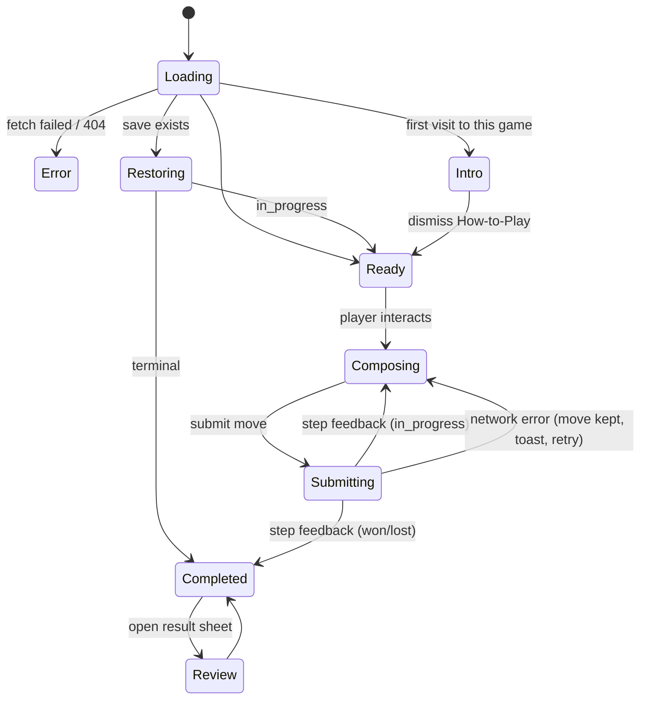
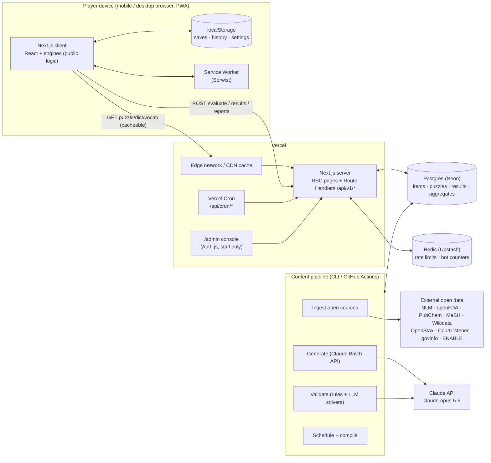
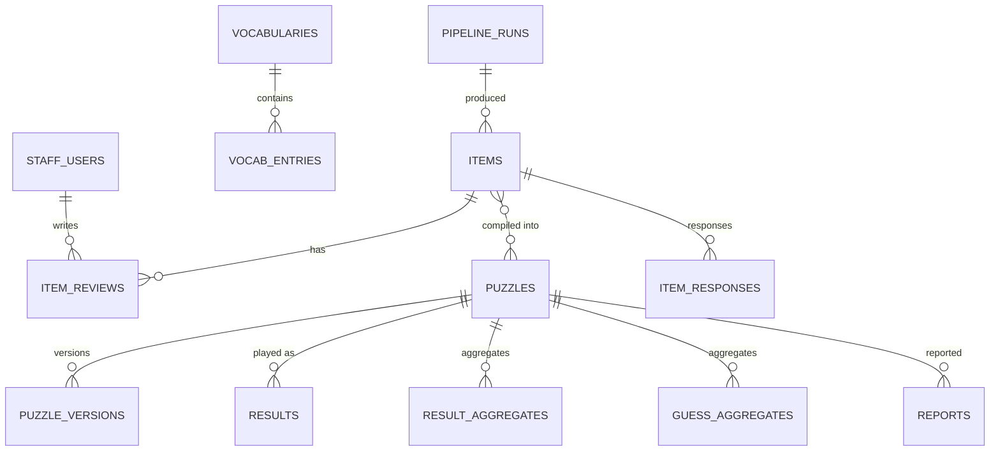
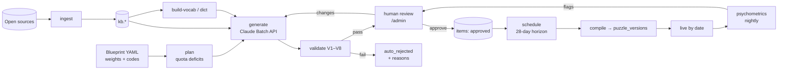

# Prepdle: Low-Level Design (LLD)

> **Daily, shareable, Wordle-style games for standardized-exam prep: MCAT · LSAT · Medical Boards · Bar**

| | |
|---|---|
| **Document** | End-to-end Low-Level Design |
| **Status** | Draft v1.0, ready for implementation review |
| **Date** | 2026-11-18 |
| **Repo** | `GameifyExams` |
| **Working product name** | **Prepdle** (placeholder; run trademark and domain checks before launch. `prepdle.app` is used as a placeholder domain throughout.) |
| **Audience** | Engineers implementing the system, content leads, reviewers |

---

## Table of Contents

1. [Overview, Goals, Non-Goals, Assumptions](#1-overview-goals-non-goals-assumptions)
2. [Glossary](#2-glossary)
3. [Exam Landscape & Content Standards](#3-exam-landscape--content-standards)
4. [Product Specification](#4-product-specification)
5. [Game Engine Designs](#5-game-engine-designs)
6. [UI / UX System](#6-ui--ux-system)
7. [System Architecture](#7-system-architecture)
8. [Client Architecture](#8-client-architecture)
9. [API Specification](#9-api-specification)
10. [Data Model](#10-data-model)
11. [Content Strategy & External Data Sources](#11-content-strategy--external-data-sources)
12. [Content Pipeline](#12-content-pipeline)
13. [Admin & Review Console](#13-admin--review-console)
14. [Security, Privacy, Legal](#14-security-privacy-legal)
15. [Observability & Operations](#15-observability--operations)
16. [Performance Budgets](#16-performance-budgets)
17. [Testing Strategy](#17-testing-strategy)
18. [Environments, CI/CD, Configuration](#18-environments-cicd-configuration)
19. [Implementation Plan](#19-implementation-plan)
20. [Risks & Mitigations](#20-risks--mitigations)
21. [Open Questions](#21-open-questions)
22. [Appendices](#22-appendices)

---

## 1. Overview, Goals, Non-Goals, Assumptions

### 1.1 Problem

Standardized-exam prep is long, solitary and hard to keep up every day. Daily puzzle games (Wordle, grouping games, daily-diagnosis games) build streaks and social sharing, but they are trivia-grade. Prepdle combines the two. A few minutes of daily play, built to the standard of the real exams, with streaks and spoiler-free sharing.

### 1.2 Goals

| # | Goal | Measurable target |
|---|---|---|
| G1 | Daily cadence: one puzzle per game per day, the same for everyone | 100% of (track, game, date) slots filled, with a buffer of ≥ 21 days |
| G2 | No login required | 0 required accounts. Identity is an anonymous device cookie. |
| G3 | Streaks that survive normal use | Streak computed locally and restorable from the server via the device cookie |
| G4 | Spoiler-free share text | Native share sheet on mobile, clipboard fallback on desktop |
| G5 | Exam-grade challenge | Content aligned to each exam's official outline. Every item is validated automatically and approved by a human. |
| G6 | Works well on mobile and desktop browsers | LCP < 2.0 s on mid-tier mobile. Core interactions need no scrolling on 360×640. |
| G7 | Simple to run | One web app plus one Postgres plus one Redis. No third-party API calls at runtime. |

### 1.3 Non-Goals (v1)

- No user accounts, social graph, friends list or leaderboards with names. Comparing happens through shared text.
- No full-length practice tests, adaptive question banks or spaced-repetition decks.
- No native iOS or Android apps. A PWA covers install-to-home-screen.
- No archive or "play past days". This follows the "one a day" requirement. A feature flag allows it later (§4.7).
- No real-time multiplayer.
- No monetization design.

### 1.4 Key Assumptions (decisions made so we can proceed; see §21)

| ID | Assumption | Rationale / how to change |
|---|---|---|
| A1 | **"Only 1 a day" means each game in each track can be played once per day.** A player can do all of today's games, each one time. | Matches Wordle and NYT Games. If the intent is one game per day in total, set `DAILY_LIMIT_MODE=per_day` (§4.4). |
| A2 | **"Board exams" means USMLE Step 1 and Step 2 CK**, the largest audience. COMLEX, NCLEX and specialty boards can be added later as sub-tracks. | The track model supports sub-tracks (`boards.usmle`, `boards.nclex`, …). |
| A3 | **The Bar track targets the MBE subjects plus NextGen Foundational Concepts.** The NextGen bar exam started in July 2026 in some jurisdictions. The legacy UBE (with the MBE) continues elsewhere through about February 2028. | The blueprint covers both (§3.4). |
| A4 | **The LSAT track has no Logic Games.** LSAC removed Analytical Reasoning starting with the August 2024 test, so LSAT games train Logical Reasoning and Reading Comprehension skills. | §3.2 |
| A5 | The puzzle "day" is the **player's local calendar date**, as in Wordle. | §4.3 |
| A6 | Content is **original**: LLM-drafted from open sources, validated by machine and reviewed by humans. Official exam questions (AAMC, LSAC, NBME, NCBE) are copyrighted and are not used. | §11 |
| A7 | English only, US-centric (US law, US units with SI where relevant). | |

### 1.5 Solution Summary

- **4 tracks** (MCAT, LSAT, Boards, Bar), each with **4 daily games**. The games come from **5 reusable engines**:
  - **Quartet**: sort 16 tiles into 4 hidden groups, with up to 4 mistakes allowed.
  - **Jargon**: guess a domain term in 6 tries, with per-letter feedback.
  - **Workup**: identify a diagnosis, molecule or doctrine from clues that unlock one at a time, with feedback on how close each guess was.
  - **Gauntlet**: 5 exam-style multiple-choice questions that get harder, each with a confidence wager.
  - **Classify**: label parts of an argument (LSAT *Anatomy*) or classify inferences as Must, Could or Cannot be true (LSAT *Verdict*).
- **The server checks every move** (`/evaluate`), so answers never reach the browser before the game ends. Puzzles are generated in advance and served from CDN cache.
- **Anonymous identity** uses a server-set HttpOnly device cookie. Streaks are kept locally and can be restored from the server.
- **The content pipeline** works offline: open data sources feed Claude-drafted items (Batch API, structured output), followed by automated validation, then human review, a scheduler and the published puzzles.

---

## 2. Glossary

| Term | Definition |
|---|---|
| **Track** | An exam category: `mcat`, `lsat`, `boards`, `bar`. |
| **Engine** | A reusable game mechanic: `quartet`, `jargon`, `workup`, `gauntlet`, `classify`. |
| **Game** | A track-specific configuration of an engine, with its own display name, e.g. `boards/workup` ("Workup") or `bar/workup` ("Doctrine"). |
| **Item** | An atomic unit of content in the bank: one MCQ, one Quartet board, one Jargon word, one Workup case, one Classify set. |
| **Puzzle** | A scheduled, compiled instance of a game for one date. It references one item (or 5 items for Gauntlet). Its ID has the form `boards-workup-20261118`. |
| **Public payload** | The parts of a puzzle the player is allowed to see before playing. |
| **Secret payload** | Answers, later clues, explanations. Only the server reads it. |
| **Move** | One player action, such as a guess, a skip, an answer or a check. |
| **Transcript** | The ordered list of moves for one play of one puzzle. |
| **Step feedback** | The server's verdict on one move. |
| **Outcome** | The final result of a play: score, pass/fail, distribution bucket. |
| **Pass** | The per-engine success threshold, used for win streaks (§4.5). |
| **Blueprint** | The hierarchical taxonomy of what an exam tests, with target weights. |
| **Blueprint code** | A leaf in the blueprint, e.g. `MCAT.BB.1A`, `BAR.EVID.HEARSAY`. |
| **Vocabulary (vocab)** | The closed answer list for Workup, with synonyms and attributes. |
| **Dictionary** | The list of valid guesses for Jargon. |
| **Device** | An anonymous browser identity (`pd_did` cookie). |
| **Buffer** | The number of future days fully scheduled for a (track, game). |
| **Void** | Withdrawing a published puzzle version because of a content error. Streaks are protected. |

---

## 3. Exam Landscape & Content Standards

> Every item is tagged to a blueprint code. The scheduler balances coverage across a rolling 28-day window to match the weights below. Weights are **editorial targets** that approximate the published outlines. They are not official numbers. Task `C-1` (§19) reconciles each blueprint YAML against the official outline PDF before content production.

### 3.1 MCAT (AAMC)

**Exam facts:** four sections. Chem/Phys, Bio/Biochem and Psych/Soc each have 59 questions (44 passage-based, 15 discrete) in 95 minutes. CARS has 53 passage-based questions in 90 minutes. Sections are scored 118–132 and the total is 472–528.

**Blueprint (top levels):**

```
MCAT
├─ CP  Chemical & Physical Foundations of Biological Systems
│   disciplines (approx.): Gen Chem 30% · Physics 25% · Biochem 25% · Orgo 15% · Intro Bio 5%
│   FC4: 4A motion/forces/energy · 4B fluids · 4C electrochem & circuits · 4D light & sound · 4E atoms & nuclear
│   FC5: 5A water & solutions · 5B molecular structure · 5C separation/purification · 5D biomolecule reactivity · 5E thermo & kinetics
├─ BB  Biological & Biochemical Foundations of Living Systems
│   disciplines (approx.): Intro Bio ~65% · Biochem ~25% · Gen Chem ~5% · Orgo ~5%   (verify vs AAMC)
│   FC1: 1A proteins/amino acids · 1B genetic information · 1C heritable info · 1D bioenergetics/metabolism
│   FC2: 2A cells · 2B prokaryotes/viruses · 2C cell division/differentiation
│   FC3: 3A nervous & endocrine · 3B other organ systems
├─ PS  Psychological, Social & Biological Foundations of Behavior
│   disciplines (approx.): Psych 65% · Soc 30% · Bio 5%
│   FC6: 6A sensing · 6B making sense · 6C responding     FC7: 7A individual · 7B social processes · 7C attitude/behavior change
│   FC8: 8A self-identity · 8B social thinking · 8C social interactions   FC9: 9A social structure · 9B demographics   FC10: 10A inequality
└─ CARS  Critical Analysis & Reasoning Skills
    Foundations of Comprehension · Reasoning Within the Text · Reasoning Beyond the Text
    passages: humanities ~50% · social sciences ~50%
Skills overlay (science sections): SIRS-1 knowledge · SIRS-2 reasoning · SIRS-3 research design · SIRS-4 data/statistics
```

**Track-level weights for Gauntlet item selection:** CP 27%, BB 27%, PS 26%, CARS 20%. CARS appears as a ~200–300-word "mini passage" with one question, on Tue/Thu/Sat (§5.4.2).

**Item style rules (MCAT):**
- 4 options (A–D), one best answer.
- Science items should require *reasoning* (SIRS-2/3/4) at least 50% of the time, not pure recall.
- Data items use JSON-defined tables or charts (§5.4.4). Structures are drawn from SMILES strings (no copyrighted images).
- SI units, with conventional units in parentheses where AAMC customarily uses them.

### 3.2 LSAT (LSAC)

**Exam facts:** since August 2024 the test has two scored Logical Reasoning (LR) sections, one scored Reading Comprehension (RC) section and one unscored variable section, each 35 minutes, scored 120–180. **Analytical Reasoning (Logic Games) was removed.** LR is about 2/3 of the scored test.

**Blueprint:**

```
LSAT
├─ LR  Logical Reasoning (≈ 67%)
│   Structure:   LR.MAIN main point · LR.ROLE role of a claim · LR.METHOD method of reasoning
│   Assumption:  LR.NA necessary assumption · LR.SA sufficient assumption
│   Strength:    LR.STR strengthen · LR.WKN weaken · LR.EVAL evaluate
│   Flaw:        LR.FLAW flaw · LR.PFLAW parallel flaw
│   Inference:   LR.MBT must be true · LR.MSS most strongly supported · LR.CANNOT cannot be true
│   Principle:   LR.PRIN-ID identify principle · LR.PRIN-APP apply principle
│   Other:       LR.PAR parallel reasoning · LR.PARADOX resolve/explain · LR.POINT point at issue / agreement
└─ RC  Reading Comprehension (≈ 33%)
    RC.MAIN · RC.DETAIL · RC.INFER · RC.ATTITUDE · RC.FUNCTION · RC.ANALOGY · RC.COMPARATIVE (paired passages)
```

**Editorial weights for LR question types** (seed values based on public analyses of recent PrepTests; adjust with observed data):
Flaw 13%, MSS/MBT 12%, NA 9%, Strengthen 8%, Weaken 8%, Principle 8%, Main/Role/Method 10%, SA 5%, Paradox 6%, Point 5%, Parallel + Parallel Flaw 8%, Evaluate 2%, Cannot 2%, other 4%.

**Item style rules (LSAT):**
- LR stimulus of 50–130 words on a general-interest topic. No outside knowledge is required.
- Standard stems, for example "Which one of the following, if true, most seriously weakens the argument?"
- 5 options (A–E) with a single credited response.
- Topics must age well: no current events, no real living persons.
- RC mini-passages of 200–300 words with 1 question.

### 3.3 Medical Boards: USMLE Step 1 / Step 2 CK

**Exam facts:** Step 1 has been reported pass/fail since January 26, 2022. Step 2 CK has a 3-digit score. Items are clinical vignettes with single-best-answer options. Step 1 blocks are 60 minutes with up to about 40 items (about 90 s per item).

**Blueprint (two axes, as in the official outline):**

```
BOARDS
├─ System axis (editorial targets)
│   GEN general principles (biochem, genetics, immunology, micro, path, pharm) .... 12%
│   HEME blood & lymphoreticular / IMMUNE ............................................ 9%
│   NEURO nervous system & special senses / PSYCH behavioral health ................. 12%
│   MSK musculoskeletal, skin & subcutaneous ........................................ 8%
│   CV cardiovascular ................................................................ 9%
│   RESP respiratory ................................................................. 7%
│   RENAL renal/urinary .............................................................. 6%
│   GI gastrointestinal .............................................................. 8%
│   REPRO reproductive & breast / ENDO endocrine ..................................... 12%
│   MULTI multisystem processes ...................................................... 7%
│   BIOSTAT biostatistics, epidemiology, population health ........................... 5%
│   ETHICS social sciences: communication, ethics, patient safety .................... 5%
└─ Discipline axis: Pathology · Physiology · Pharmacology · Biochem/Nutrition · Microbiology
                    · Immunology · Anatomy/Histology/Embryology · Behavioral science · Genetics
Exam-level tag: STEP1 | STEP2CK  (default mix: 60% Step 1 / 40% Step 2 CK)
```

**Item style rules (Boards).** These follow widely published NBME item-writing principles:
- The vignette gives age and sex, setting, chief complaint, HPI, relevant history, vitals, exam, then labs and imaging.
- The lead-in is a closed, answerable question ("Which of the following is the most likely diagnosis?").
- 5 options by default (the schema allows 4–8). Options are homogeneous (all diagnoses, or all drugs).
- Single best answer. No "all/none of the above", no negatively phrased stems, no grammatical cues.
- Generic drug names. Lab values give units, and a reference-range drawer is always available (§5.4.5).
- Race and ethnicity appear only when clinically relevant, following current guidance against race-based diagnostic shortcuts. Use person-first language.

### 3.4 Bar Exam: MBE / UBE + NextGen

**Exam facts:** the MBE has 200 multiple-choice questions (175 scored and 25 unscored pretest). The 175 scored questions split evenly, 25 each, across Civil Procedure, Constitutional Law, Contracts, Criminal Law & Procedure, Evidence, Real Property and Torts. The **NextGen** bar exam began in July 2026 in its first jurisdictions. It tests Foundational Concepts & Principles (civil procedure, contract law, evidence, torts, business associations, constitutional law, criminal law, real property; family law is added from July 2028) together with Foundational Skills (research, writing, issue spotting and analysis, investigation, client counseling, negotiation). Legacy UBE materials remain available through the February 2028 exam.

**Blueprint:**

```
BAR
├─ CIVPRO  (12%)  jurisdiction (SMJ/PJ/venue) · Erie · pleadings · joinder · discovery · motions · trial · preclusion · appeals
├─ CONLAW  (12%)  justiciability · federalism/commerce · separation of powers · state action · due process · equal protection · speech · religion · takings
├─ CONTR   (12%)  formation · consideration/promissory estoppel · defenses · SoF · parol evidence · conditions · breach · remedies · third parties · UCC Art. 2
├─ CRIM    (12%)  homicide · other crimes · inchoate · accomplice · defenses · 4th/5th/6th Amendment procedure
├─ EVID    (12%)  relevance · character · impeachment · hearsay & exceptions · confrontation · privileges · expert · authentication · best evidence
├─ PROP    (12%)  estates & future interests · concurrent ownership · landlord-tenant · conveyancing/recording · mortgages · easements/covenants · adverse possession · zoning
├─ TORTS   (12%)  intentional torts · negligence · strict liability · products · nuisance · defamation · privacy · defenses · damages
├─ BA      (9%)   agency · partnerships · LLCs · corporations (NextGen)
└─ SKILLS  (7%)   NextGen-style skills items: issue spotting, next-best-step, research choice, client counseling
```

**Item style rules (Bar):**
- MBE style: a fact pattern of 80–200 words, a call of the question and 4 options (A–D).
- Apply generally accepted rules, meaning majority common law, the FRCP, the FRE, UCC Article 2 and the Restatement (Second) of Contracts, unless the item states otherwise ("In a jurisdiction that has adopted…").
- `SKILLS` items use NextGen-style framing ("What should the attorney do next?").

### 3.5 Difficulty Model (all engines)

| Level | Meaning (MCQ) | Observed p-value band* |
|---|---|---|
| D1 | Single-step recall of a high-yield fact | p ≥ 0.85 |
| D2 | Recall plus straightforward application | 0.70–0.85 |
| D3 | Two-step reasoning (e.g. identify the diagnosis, then the mechanism) | 0.55–0.70 |
| D4 | Multi-step reasoning with close distractors that need fine discrimination | 0.40–0.55 |
| D5 | Integrates two disciplines or data, or a rare-but-tested distinction | < 0.40 |

\*p-value = proportion of players answering correctly (§12.9). Authored difficulty is a prior. After n ≥ 50 responses, `difficulty_observed` replaces it in scheduling.

Engine-specific difficulty levers are defined in §5. Examples: Quartet red-herring count, Jargon word length and frequency, Workup first-clue specificity, Classify item count and number of distinct labels.

**Weekday ramp** (as in a newspaper crossword):

| Day | Mon | Tue | Wed | Thu | Fri | Sat | Sun |
|---|---|---|---|---|---|---|---|
| Target puzzle difficulty | 2 | 2 | 3 | 3 | 4 | 4–5 | 3 (mixed review) |
| Gauntlet Q1→Q5 | 1,2,2,3,3 | 1,2,3,3,3 | 2,2,3,3,4 | 2,3,3,4,4 | 2,3,4,4,5 | 3,3,4,5,5 | 2,3,3,4,4 |

---

## 4. Product Specification

### 4.1 Track × Game Matrix

| Engine ↓ / Track → | **MCAT** | **LSAT** | **Boards** | **Bar** |
|---|---|---|---|---|
| **Quartet** (grouping) | ✅ "Quartet" | ✅ "Quartet" | ✅ "Quartet" | ✅ "Quartet" |
| **Jargon** (word) | ✅ "Jargon" | — | ✅ "Jargon" | ✅ "Jargon" |
| **Workup** (progressive reveal) | ✅ "Specimen": molecule / structure / process / concept | — | ✅ "Workup": diagnosis | ✅ "Doctrine": rule / crime / tort / doctrine |
| **Gauntlet** (5 MCQs) | ✅ | ✅ | ✅ | ✅ |
| **Classify** | — | ✅ "Anatomy": roles in an argument<br>✅ "Verdict": Must / Could / Cannot | — | — |

Each track has exactly **4 daily games**, ordered on the track hub as:
- **MCAT:** Quartet, Jargon, Specimen, Gauntlet
- **LSAT:** Quartet, Anatomy, Verdict, Gauntlet
- **Boards:** Quartet, Jargon, Workup, Gauntlet
- **Bar:** Quartet, Jargon, Doctrine, Gauntlet

Why LSAT has no Jargon: a vocabulary word game does not train any tested LSAT skill. Anatomy (argument structure: Main Point, Role and Method questions) and Verdict (conditional and formal logic: Must Be True and Cannot Be True questions) train the most-tested LR skills.

**Game IDs** (stable and used in URLs): `quartet`, `jargon`, `workup`, `gauntlet`, `anatomy`, `verdict`. The display name comes from the track config, e.g. `bar/workup` is shown as "Doctrine" at `/bar/doctrine`. The URL slug is the display slug, and the router maps slug to game ID.

### 4.2 Core Loop

```
Open app ─► pick track (remembered) ─► track hub shows today's 4 games + status
   └─► play a game (≈ 2–6 min) ─► result sheet: score · explanation/review · distribution · streak
        ├─► Share (native share sheet / clipboard)
        └─► Next game ─► … ─► "All done today" ─► share Daily Card ─► countdown to tomorrow
```

### 4.3 The Daily Cycle

- **Puzzle date** is the player's local calendar date (IANA zone from `Intl.DateTimeFormat().resolvedOptions().timeZone`), formatted `YYYY-MM-DD`.
- **Puzzle number** is `daysBetween(LAUNCH_DATE, date) + 1`, e.g. "Boards Workup #127". (Examples in this document assume a hypothetical `LAUNCH_DATE` of 2026-07-15, which makes 2026-11-18 puzzle #127. The real launch date is set by env, §18.2.)
- Everyone on the same local date gets the same puzzle, so friends in different time zones compare the same "#127".
- **Rollover:** the client recomputes the local date on load, on `visibilitychange` (return to the tab) and every 60 s while visible.
  - If a game is **in progress** when midnight passes, the player finishes that puzzle. It is recorded under its original date. After completion the hub shows "New puzzles are ready".
  - If no game is in progress, the hub refreshes to the new date.
- **Server playable window:** a date is playable only if `utcDate(now − 12h) ≤ date ≤ utcDate(now + 14h)`, which covers every real offset from UTC−12 to UTC+14. This stops players from peeking at future puzzles by changing the device clock (§9.4).
- Countdown "Next puzzles in hh:mm:ss" counts to local midnight.

### 4.4 Daily Play Limit

- **Mode `per_game` (default):** each `(track, game, date)` puzzle can be completed once per device.
- **Mode `per_day` (flag):** one completed game per device per day across all tracks. The hub locks other games after the first completion. This mode exists only in case assumption A1 is wrong.
- **Enforcement** has two layers. Neither is cryptographically strong without login, which is acceptable for an honor-system game with no prizes:
  1. Client: the save state marks the puzzle completed and the UI shows the result sheet instead of the board.
  2. Server: `results` has a unique key `(puzzle_id, device_hash)`. `GET /me/day/{date}` returns completed outcomes, so a device that lost localStorage but kept its cookie restores its completed state.

### 4.5 Pass Thresholds, Streaks and Stats

**Pass (per engine):**

| Engine | Pass condition |
|---|---|
| Quartet | All 4 groups found (≤ 3 mistakes) |
| Jargon | Solved within 6 guesses |
| Workup | Correct answer within 6 clues |
| Gauntlet | ≥ 3 of 5 correct |
| Classify | All items correct within 3 checks |

**Three kinds of streak:**

| Streak | Increments when | Shown where |
|---|---|---|
| **Daily streak** (global) 🔥 | ≥ 1 game completed (pass or fail) on consecutive dates | Home header, Daily Card share |
| **Track streak** | ≥ 1 game in that track completed on consecutive dates | Track hub, track Daily Card |
| **Game win streak** | That game *passed* on consecutive dates | Per-game stats modal |

Completion (not a pass) drives the headline streak. This rewards showing up, which is the behavior we want for prep, while win streaks reward performance. Exact algorithm: §8.6.

**Per-game stats:** Played, Pass %, Current win streak, Max win streak, score distribution (bucket bars with today's bucket highlighted).

**Prep insights** (from local history, no login):
- **Weak spots:** Gauntlet accuracy per blueprint area over the last 30/90 days, sorted ascending ("Evidence › Hearsay: 42% (n=12)").
- **Calibration:** accuracy at each confidence level ("Your 'Sure' answers are right 81% of the time").
- **Perfect days:** count of days with all 4 games in a track passed.

### 4.6 Sharing

- **Per-game share** after completion: emoji grid with no spoilers (§5.x.share), streak and link.
- **Daily Card share** from the track hub once ≥ 1 game is done: a summary of all 4 games.
- Mechanism: `navigator.share({ text })` when available (mobile), else `navigator.clipboard.writeText` with a "Copied!" toast, else a textarea modal for manual copy.
- Share text never includes answers, clue text, tile labels or question text.
- **Daily Card format:**

```
Prepdle Boards · Wed Nov 18 · #127
🧩 Quartet   ✅ 1 mistake
🔤 Jargon    4/6
🩺 Workup    3/6
⚡ Gauntlet  4/5 · 11 pts
🔥 12-day streak
prepdle.app/boards
```

- Phase 2: a generated share image (OG-style PNG via `next/og`) for Instagram and iMessage previews.

### 4.7 Feature Flags (config, not code)

| Flag | Default | Purpose |
|---|---|---|
| `DAILY_LIMIT_MODE` | `per_game` | §4.4 |
| `ARCHIVE_ENABLED` | `false` | Allow past puzzles as unranked practice (no streak/stats) |
| `GAMES_ENABLED` | all 16 | Kill switch per (track, game) |
| `TRACKS_ENABLED` | all 4 | Soft-launch tracks |
| `GAUNTLET_TIMED_MODE` | `optional` | `off` / `optional` / `forced` |
| `SHOW_GLOBAL_STATS` | `true` | Distribution and percentile in result sheet |
| `BONUS_QUESTIONS` | `true` | Optional bonus MCQ in Jargon/Anatomy |


---

## 5. Game Engine Designs

### 5.0 Common Engine Contract

All engines are **pure, deterministic TypeScript modules** in `packages/core/src/engines/<engine>/`. They are shared by:
- the **server**, which is authoritative: it evaluates transcripts against secrets;
- the **client**, which uses only the public schema, move validation, UI reducers and share formatting, and never sees secrets before the game ends;
- the **pipeline**, which uses the content invariant checks.

```ts
// packages/core/src/engines/types.ts
export type TrackId  = 'mcat' | 'lsat' | 'boards' | 'bar';
export type EngineId = 'quartet' | 'jargon' | 'workup' | 'gauntlet' | 'classify';
export type GameId   = 'quartet' | 'jargon' | 'workup' | 'gauntlet' | 'anatomy' | 'verdict';
export type ISODate  = string; // 'YYYY-MM-DD', validated by regex + calendar check

export type GameStatus = 'in_progress' | 'won' | 'lost';

export interface EvaluationResult<StepFb, Outcome, Reveal> {
  status: GameStatus;
  steps: StepFb[];          // one per move, same order as transcript
  outcome?: Outcome;        // present iff status !== 'in_progress'
  reveal?: Reveal;          // full solution + explanations; present iff terminal
}

export interface Engine<Pub, Sec, Move, StepFb, Outcome, Reveal> {
  id: EngineId;
  publicSchema: z.ZodType<Pub>;
  secretSchema: z.ZodType<Sec>;
  moveSchema: z.ZodType<Move>;

  /** Hard upper bound on transcript length (abuse guard). */
  maxMoves(pub: Pub): number;

  /** Client-side pre-validation (no secrets): e.g. word in dictionary, 4 tiles selected. */
  validateMove(pub: Pub, priorSteps: StepFb[], move: Move, ctx: ClientCtx): MoveValidation;

  /** Server-side authoritative evaluation. Pure and deterministic. Throws EvaluationError on illegal transcripts. */
  evaluate(pub: Pub, sec: Sec, transcript: Move[]): EvaluationResult<StepFb, Outcome, Reveal>;

  /** Distribution bucket for global stats, plus the comparator used for percentiles. */
  bucket(outcome: Outcome): string;              // e.g. '3' or 'X'
  bucketOrder: readonly string[];                // best → worst

  /** Spoiler-free emoji lines. */
  shareLines(pub: Pub, steps: StepFb[], outcome: Outcome, opts: ShareOpts): string[];

  /** Content QA (pipeline + CI). Returns [] when valid. */
  checkInvariants(pub: Pub, sec: Sec, ctx: InvariantCtx): Issue[];
}

export class EvaluationError extends Error {
  constructor(public code:
    | 'INVALID_MOVE' | 'MOVE_AFTER_TERMINAL' | 'TOO_MANY_MOVES'
    | 'DUPLICATE_GUESS' | 'UNKNOWN_ID' | 'BAD_SEQUENCE',
    public moveIndex: number, message: string) { super(message); }
}
```

**Engine-wide rules:**
1. `evaluate()` re-evaluates the **whole transcript** on every call. It is idempotent and stateless, and the cost is trivial (≤ 10 moves).
2. Moves after a terminal state are rejected (`MOVE_AFTER_TERMINAL`). The one exception is a single `bonus` move in engines that have bonus questions.
3. Any ID or label shown to the client must be **opaque**. It must not encode group, answer or tier (e.g. Quartet tile IDs are random base62, §5.1.3).
4. A **leak test** runs for every engine: serialize the public payload and the steps of a non-terminal evaluation, then assert that no secret-only string (answer, group labels, unrevealed clues, keys) appears in them (§17.1).
5. Every engine exposes a `reducer` for UI state (selection, pending request, animations). It lives in `packages/core/src/engines/<engine>/ui.ts` and is separate from `evaluate`.

**Generic play state machine** (all engines):



---

### 5.1 Quartet (Grouping), all tracks

#### 5.1.1 Rules
- 16 tiles in a 4×4 grid hide 4 groups of 4. Each group shares an exam-relevant property.
- Select exactly 4 tiles, then **Submit**.
  - **Correct:** the 4 tiles merge into a solved band at the top showing the group label, tier color and a one-line explanation.
  - **Incorrect:** −1 life (4 lives, shown as ● ● ● ●). If exactly 3 of the 4 belong to one group, show the toast **"One away…"**.
  - **Duplicate** (same set as a previous guess): toast "Already guessed". No life is lost and nothing is sent to the server.
- Controls: **Shuffle**, **Deselect all**, **Submit** (enabled only with 4 selected).
- **Auto-finish:** when 3 groups are solved, the remaining 4 tiles are submitted automatically as the final correct guess. It counts as a row in the share grid.
- **End:** win when all 4 groups are solved. Lose after 4 mistakes, and the unsolved groups are then revealed in tier order.

#### 5.1.2 Tiers
Each group has a tier from 1 (most direct) to 4 (subtlest). Tier is shown by color **and** shape, so it does not depend on color perception:

| Tier | Meaning | Color token | Share emoji | Shape glyph (a11y / high contrast) |
|---|---|---|---|---|
| 1 | Direct recall | `--tier-1` (green) | 🟢 | ● |
| 2 | Standard association | `--tier-2` (blue) | 🔵 | ◆ |
| 3 | Requires discrimination | `--tier-3` (orange) | 🟠 | ▲ |
| 4 | Subtle, multi-step or "trap" group | `--tier-4` (red) | 🔴 | ★ |

> Circles in the share grid and an original palette keep Prepdle visually distinct from existing grouping games.

#### 5.1.3 Payloads

```ts
// PUBLIC
interface QuartetPublic {
  tiles: { id: string; label: string }[];   // 16; id = random 6-char base62, assigned at compile time
  maxMistakes: 4;
  topicHint?: string;                       // optional subject banner, e.g. "Hematology & Pharm"
}
// SECRET
interface QuartetSecret {
  groups: {
    id: string;                 // random, opaque
    tier: 1 | 2 | 3 | 4;
    label: string;              // "Drug-induced lupus"
    tileIds: [string, string, string, string];
    explanation: string;        // ≤ 240 chars
    blueprintCodes: string[];
  }[];                          // exactly 4
  redHerrings: { tileId: string; alsoFits: string; note: string }[];   // ≥ 2; shown in review
}
type QuartetMove   = { type: 'guess'; tileIds: [string, string, string, string] };
type QuartetStepFb =
  | { result: 'correct'; groupId: string; tier: 1|2|3|4; label: string; tileIds: string[]; explanation: string }
  | { result: 'one_away' }
  | { result: 'incorrect' };
interface QuartetOutcome { solved: number; mistakes: number; passed: boolean; guessTiers: (1|2|3|4)[][] }
```

> `guessTiers` (the true tier of each selected tile in each guess) is computed **server-side** and returned only in the terminal response, so the share grid can be built without the client knowing groups mid-game.

#### 5.1.4 Evaluation Algorithm (server)

```ts
function evaluateQuartet(pub, sec, transcript): EvaluationResult {
  const tileToGroup = new Map(sec.groups.flatMap(g => g.tileIds.map(t => [t, g])));
  const solved = new Set<string>(); const seen = new Set<string>();
  let mistakes = 0; const steps = [];
  transcript.forEach((m, i) => {
    if (solved.size === 4 || mistakes === 4) throw new EvaluationError('MOVE_AFTER_TERMINAL', i, '');
    const ids = [...new Set(m.tileIds)];
    if (ids.length !== 4 || ids.some(id => !tileToGroup.has(id))) throw new EvaluationError('INVALID_MOVE', i, '');
    if (ids.some(id => solved.has(tileToGroup.get(id)!.id))) throw new EvaluationError('INVALID_MOVE', i, 'tile already solved');
    const key = [...ids].sort().join(',');
    if (seen.has(key)) throw new EvaluationError('DUPLICATE_GUESS', i, '');
    seen.add(key);
    const counts = countBy(ids, id => tileToGroup.get(id)!.id);
    const [gid, n] = maxEntry(counts);
    if (n === 4) { solved.add(gid); steps.push(correctFb(sec, gid)); }
    else { mistakes++; steps.push({ result: n === 3 ? 'one_away' : 'incorrect' }); }
  });
  const status = solved.size === 4 ? 'won' : mistakes === 4 ? 'lost' : 'in_progress';
  return status === 'in_progress' ? { status, steps } :
    { status, steps, outcome: buildOutcome(...), reveal: { groups: sec.groups, redHerrings: sec.redHerrings } };
}
```

- `maxMoves = 7` (at most 4 correct + 3 incorrect before a win, or 4 incorrect before a loss).
- Buckets: `'0' | '1' | '2' | '3'` (mistakes, when won), then `'X'`. Order: `['0','1','2','3','X']`.

#### 5.1.5 UI (mobile ≥ 360 px)

```
┌──────────────────────────────────────┐
│ ←  BOARDS · Quartet         ?  📊  ⚙ │  header 56px
├──────────────────────────────────────┤
│  Create four groups of four          │
│ ┌──────────────────────────────────┐ │
│ │ ● MICROCYTIC ANEMIAS             │ │ ← solved band (tier color + glyph)
│ │ Iron deficiency, β-thal, Lead, … │ │
│ └──────────────────────────────────┘ │
│ ┌──────┐┌──────┐┌──────┐┌──────┐     │
│ │Hydra-││Dap-  ││Pheny-││Fava  │     │ 4-col grid, gap 8px
│ │lazine││sone  ││toin  ││beans │     │ tile ≥ 72×64px
│ └──────┘└──────┘└──────┘└──────┘     │ selected = filled accent
│   … 2 more rows …                    │
│                                      │
│  Mistakes remaining:  ● ● ● ○        │
│ ┌────────┐ ┌────────────┐ ┌────────┐ │
│ │Shuffle │ │Deselect all│ │ Submit │ │ bottom action bar (thumb zone)
│ └────────┘ └────────────┘ └────────┘ │
└──────────────────────────────────────┘
```

- Tile label typography: 600 weight, uppercase off (medical and legal terms are case-sensitive, e.g. "β-thal", "pH"). Auto-fit uses steps of 15 → 13 → 11.5 px with up to 3 lines and hyphenation (`hyphens: auto` plus `&shy;` hints added at compile time).
- Desktop (≥ 768 px): the grid is capped at 560 px wide, tiles are 120×80, and the action bar sits under the grid.
- Animations:
  - selected tiles lift slightly (`translateY(-2px)`, 120 ms);
  - an incorrect guess shakes the selected tiles horizontally (300 ms, 4 oscillations);
  - a correct guess moves the 4 tiles into the band (FLIP, 400 ms), then the band expands to show the label;
  - all are disabled under `prefers-reduced-motion`.
- Keyboard: arrow keys move focus in the grid, Space/Enter toggles a tile, `Ctrl/⌘+Enter` submits, `S` shuffles, `Esc` deselects.
- Screen reader: each tile is `<button aria-pressed>`. The live region announces "Selected 3 of 4". On submit it announces "Correct: Drug-induced lupus, tier 4" or "Incorrect, one away. 2 mistakes remaining."

#### 5.1.6 Review Mode (after completion)
- Solved bands list all 4 groups with explanations.
- Tapping a tile shows its note, e.g. "Isoniazid also triggers hemolysis in G6PD deficiency, but Nitrofurantoin completes that group, so Isoniazid must be lupus."
- The `redHerrings` section is labeled "Traps in today's board".

#### 5.1.7 Share

```
Prepdle · Boards Quartet #127
🟢🟢🟢🟢
🔴🔵🔴🔴
🔵🔵🔵🔵
🟠🟠🟠🟠
🔴🔴🔴🔴
✅ 1 mistake · 🔥12
prepdle.app/boards
```
One row per guess, with each emoji showing the true tier of the selected tile. Rows are in guess order and tiles within a row in selection order. A loss shows `❌ 3/4 groups`.

#### 5.1.8 Content Invariants (pipeline + CI)
- Exactly 16 unique tiles (case- and diacritic-insensitive) and 4 groups × 4 tiles. Tiers {1, 2, 3, 4} are each used once.
- Tile label ≤ 22 chars, with each word ≤ 12 chars (otherwise needs `&shy;` hints). Group label ≤ 40 chars.
- **Unique partition:** the intended partition must be the *only* valid one. Checked by the adversarial validator (§12.6, V4) and confirmed by the human reviewer.
- ≥ 2 red-herring tiles (each plausibly fits 2 groups). Tier 4 must contain ≥ 1 red-herring target.
- No group is solvable by surface features alone (shared prefix or suffix) unless it is tier 1 and flagged `surfacePattern: true`. At most 1 per week.
- Every group has an explanation and blueprint code(s).

#### 5.1.9 Difficulty Levers
Number of red herrings (2 → 5), tier-4 subtlety, how obscure the tiles are, and whether a group needs a two-step inference (e.g. "drugs whose *toxicity* is treated with the same antidote").

#### 5.1.10 Illustrative Board (Boards; *illustrative, not reviewed*)

| Tier | Group | Tiles |
|---|---|---|
| 🟢 1 | Microcytic anemias | Iron deficiency · β-thalassemia · Lead poisoning · Sideroblastic anemia |
| 🔵 2 | Oxidant triggers of hemolysis in G6PD deficiency | Primaquine · Dapsone · Fava beans · Nitrofurantoin |
| 🟠 3 | Causes of megaloblastic anemia | Methotrexate · Pernicious anemia · Hydroxyurea · Phenytoin |
| 🔴 4 | Drug-induced lupus | Hydralazine · Procainamide · Isoniazid · Methyldopa |

The partition is unique: Phenytoin fits lupus *and* megaloblastic, but megaloblastic has only 4 candidates, so it takes Phenytoin. Isoniazid fits lupus *and* G6PD, but Nitrofurantoin completes G6PD, so Isoniazid goes to lupus.

Track flavor examples:
- **MCAT:** "Ketogenic-only amino acids", "Gs-coupled hormone receptors", "Piaget stages", "Units equivalent to a joule".
- **LSAT:** "Sufficient-condition indicators (if, all, every, whenever)", "Necessary-condition indicators (only if, requires, unless→)", "Conclusion indicators", "Premise indicators".
- **Bar:** "Hearsay exceptions requiring unavailability", "Elements of adverse possession", "Exceptions to the warrant requirement", "Future interests in a grantor".

---

### 5.2 Jargon (Domain Word Guess): MCAT, Boards, Bar

#### 5.2.1 Rules
- The answer is a single-word domain term of **5–8 letters**, A–Z only. The board shows L boxes per row and 6 rows.
- Each guess must be a valid word of length L (from the dictionary, §5.2.4). Invalid guesses shake the row and show "Not in word list". No guess is used.
- Per-letter feedback: **correct** (right spot), **present** (in the word, wrong spot), **absent**. Duplicate letters are handled with standard two-pass logic.
- **Hints** (optional, cost shown in share as 💡n):
  - Hint 1 unlocks after guess 2: **category**, e.g. "Pharmacology · Antibiotic".
  - Hint 2 unlocks after guess 4: **definition clue**, e.g. "Bacteriostatic; binds the 50S subunit…" with the answer masked.
- **Hard mode** (setting): revealed `correct` letters must stay in place and `present` letters must be reused.
- **Bonus** (after the game ends, optional): one MCQ connected to the word, e.g. "LACHES is an equitable defense. Which remedy can it bar?" It does not affect pass/fail and appears in the share line as `Bonus ✅/❌`.
- End: win when solved, lose after 6 wrong guesses (the answer is then revealed with its definition).

#### 5.2.2 Payloads

```ts
interface JargonPublic {
  length: 5 | 6 | 7 | 8;
  maxGuesses: 6;
  dictionaryRef: { track: TrackId; length: number; hash: string };   // static asset (§9.3.7)
  hints: { index: 0 | 1; unlockAfterGuesses: 2 | 4; kind: 'category' | 'definition' }[];
  hasBonus: boolean;
}
interface JargonSecret {
  answer: string;               // uppercase A–Z
  category: string;             // hint 1
  definitionClue: string;       // hint 2 (answer masked as "_____")
  definition: string;           // full definition for reveal
  whyItMatters: string;         // exam relevance, ≤ 280 chars
  bonus?: McqPublic & McqSecret;
  blueprintCodes: string[];
}
type JargonMove =
  | { type: 'guess'; word: string }
  | { type: 'hint'; index: 0 | 1 }
  | { type: 'bonus'; optionId: string };      // only after terminal
type JargonStepFb =
  | { kind: 'guess'; letters: ('correct' | 'present' | 'absent')[] }
  | { kind: 'hint'; index: 0 | 1; text: string }
  | { kind: 'bonus'; correct: boolean; correctOptionId: string; rationale: string };
interface JargonOutcome { solved: boolean; guesses: number; hintsUsed: number; hardMode: boolean; bonus?: boolean; passed: boolean }
```

#### 5.2.3 Evaluation

```ts
export function scoreGuess(answer: string, guess: string): LetterState[] {
  const res: LetterState[] = Array(guess.length).fill('absent');
  const remaining = new Map<string, number>();
  for (let i = 0; i < answer.length; i++) {
    if (guess[i] === answer[i]) res[i] = 'correct';
    else remaining.set(answer[i], (remaining.get(answer[i]) ?? 0) + 1);
  }
  for (let i = 0; i < guess.length; i++) {
    if (res[i] === 'correct') continue;
    const n = remaining.get(guess[i]) ?? 0;
    if (n > 0) { res[i] = 'present'; remaining.set(guess[i], n - 1); }
  }
  return res;
}
```

Server-side checks per move:
- `guess`: `/^[A-Z]+$/`, `length === L`, and membership in the **server copy** of the dictionary. The server must not trust client validation. The dictionary is loaded once per instance as a `Set` (a few MB for all lengths, which is acceptable in memory).
- `hint`: index `i` is allowed only if `guessCount ≥ unlockAfterGuesses[i]` and hint `i−1` has been used. Duplicate hint moves are rejected.
- `hardMode`: the client sends `flags.hardMode: true` in the evaluate request body (§9.3.4), and the server then validates hard-mode constraints so the `*` marker in the share cannot be faked.
- `bonus`: allowed once, only after terminal.

`maxMoves = 6 + 2 + 1`. Buckets: `'1'…'6','X'`.

#### 5.2.4 Dictionaries
- **Valid guesses** = ENABLE word list (public domain) filtered to length 5–8, **plus** the track's domain-term list. Some answers, such as drug names, are not ordinary English words, so the domain list is required.
- **Domain-term lists** (§11): medical terms (MeSH and RxNorm ingredient names, single-word entries), science terms (curated from OpenStax glossary headwords; the words themselves are facts), legal terms (US Courts glossary, public domain, plus a curated list).
- **Answer pool** (secret, server/pipeline only): a curated subset of domain terms. Each is tagged with a blueprint code, an exam-relevance score and a frequency rank. Answers must be "fair": a prep student should know the word.
- Static files are served from `/dict/{track}/{len}.{hash}.txt` (newline-separated, immutable cache). Approximate size per file: 20–90 KB gzipped. The client lazy-loads only the length it needs.
- Spelling normalization: answers and guesses are compared as uppercase ASCII. Greek letters and diacritics are never part of answers (no "β").

#### 5.2.5 UI

```
┌──────────────────────────────────────┐
│ ←  BAR · Jargon               ?  📊 ⚙│
├──────────────────────────────────────┤
│         ┌──┬──┬──┬──┬──┬──┐          │
│         │L │A │T │C │H │E │  ← row states: correct/present/absent
│         ├──┼──┼──┼──┼──┼──┤          │
│         │  │  │  │  │  │  │  ← current row
│         … 6 rows …                   │
│   [💡 Hint: category]  (locked until 2 guesses)
│ ┌──────────────────────────────────┐ │
│ │ Q W E R T Y U I O P              │ │ on-screen keyboard
│ │  A S D F G H J K L               │ │ key colors mirror best-known state
│ │ ENTER Z X C V B N M ⌫            │ │ keys ≥ 32×52 px on 360 px wide
│ └──────────────────────────────────┘ │
└──────────────────────────────────────┘
```

- Cell size: `min(56px, (viewportWidth − 32 − (L−1)·6) / L)`, so 8-letter words fit on a 360 px screen with 39 px cells.
- Reveal animation: tiles flip one after another (250 ms each, 120 ms stagger) **after** the server responds. While waiting, the row pulses gently. If the response takes over 2 s, a spinner appears in the row.
- A physical keyboard is supported on desktop. The native mobile keyboard is suppressed (no input element is focused).
- On a win, the tiles bounce one after another. The result sheet then shows the definition, why it matters and the bonus question.

#### 5.2.6 Share

```
Prepdle · Bar Jargon #127 · 4/6*
⚫🟡⚫⚫⚫🟢
🟢⚫🟡⚫⚫🟢
🟢🟢⚫🟢🟢🟢
🟢🟢🟢🟢🟢🟢
💡1 · Bonus ✅ · 🔥5
prepdle.app/bar
```
`*` means hard mode. Absent is shown as ⚫ when the sharer uses the dark theme and ⚪ in the light theme. In high-contrast mode, correct is 🟠 and present is 🔵.

#### 5.2.7 Invariants
- The answer is in the valid-guess dictionary and is 5–8 letters, A–Z.
- The answer has not been used for this track in the last 365 days.
- `definitionClue` does not contain the answer or a word sharing a ≥ 5-letter stem with it.
- The answer has no conflict with other puzzles on the same track and date (same concept ID).
- Length rotation: no length more than 2 days in a row. Weekday bias: Mon/Tue 5–6, Fri/Sat 7–8.

#### 5.2.8 Examples (*illustrative*)
- **Boards:** SEPSIS, ANEMIA, LITHIUM, HEPARIN, ASCITES, MYXEDEMA
- **MCAT:** LIPASE, CODON, ISOMER, OPERON, SYNAPSE, ENTROPY
- **Bar:** LACHES, ESTOPPEL, BAILEE, ESCHEAT, DICTA, LARCENY

---

### 5.3 Workup (Progressive-Reveal Identification): Boards "Workup", MCAT "Specimen", Bar "Doctrine"

#### 5.3.1 Rules
- The answer is one entity from a **closed vocabulary**:
  - Boards: ~1,500 diagnoses at USMLE granularity.
  - MCAT: ~800 entities (molecules, enzymes, hormones, organelles, brain regions, laws, techniques, theories).
  - Bar: ~600 doctrines, rules, crimes, torts and defenses.
- **Clue 1** is shown at the start. There are up to **6 clues**, ordered from least to most specific.
- The player either **guesses** (picks an entry from autocomplete; free text is not accepted) or **skips** to the next clue.
- Each wrong guess or skip reveals the next clue. A guess at clue *k* that is correct scores *k*.
- **Attribute feedback** on wrong guesses shows how close the guess was without revealing the answer:

| Track | Attribute 1 | Attribute 2 | Attribute 3 |
|---|---|---|---|
| Boards | Organ system (multi-valued) | Etiology class | Acuity (acute/chronic/either) |
| MCAT | Section (CP/BB/PS) | Discipline | Entity type (hormone, enzyme, theory…) |
| Bar | Subject | Area within subject | Type (crime/tort/defense/rule/doctrine/remedy) |

  Each attribute shows ✓ (exact match), ◐ (partial: the sets intersect for multi-valued attributes) or ✗.

- **Close** guesses: if the guess is a listed near-miss (a parent, child or curated sibling, e.g. "Lymphoma" for "Burkitt lymphoma", or "Larceny" for "Larceny by trick"), feedback is 🟡 "Close: be more specific / consider a related entity". It still counts as a wrong guess.
- End: win on an exact match (or an entry in `acceptIds`). Lose after the 6th clue is used without a correct guess.

#### 5.3.2 Clue Stages (Boards default; other tracks have analogous ladders)

| # | Stage | Content | Specificity |
|---|---|---|---|
| 1 | Presentation | Age/sex, setting, chief complaint, duration | Low |
| 2 | History | HPI details, associated symptoms | Low–Med |
| 3 | Background | PMH, meds, social and family history, exposures | Med |
| 4 | Exam | Vitals and focused physical findings | Med–High |
| 5 | Data | Labs and imaging (rendered as a table) | High |
| 6 | Clincher | Pathognomonic finding, histology or classic association | Very high |

- **MCAT Specimen ladder:** category → structure/property → mechanism/function → context/experiment → distinguishing data → defining fact.
- **Bar Doctrine ladder:** parties and setting → conduct → mental state or circumstances → legal context → distinguishing element → "clincher" fact that separates it from the nearest doctrine.

#### 5.3.3 Payloads

```ts
interface WorkupPublic {
  prompt: string;                 // "Name the diagnosis" | "Identify the specimen" | "Name the doctrine"
  totalClues: 6;
  firstClue: Clue;                // later clues are secret until revealed
  vocabRef: { id: string; hash: string };      // static asset (§9.3.7)
  attributes: { key: string; label: string }[];
}
interface Clue { stage: string; text: string; table?: { label: string; value: string; unit?: string; flag?: 'H'|'L' }[] }
interface WorkupSecret {
  answerId: string; acceptIds: string[]; closeIds: string[];
  clues: Clue[];                  // length 6; clues[0] === public.firstClue
  explanation: string;            // why this answer, ≤ 600 chars
  discriminators: { vsEntityId: string; point: string }[];   // "vs. TB: no caseation; vs. lymphoma: …"
  blueprintCodes: string[];
  sources: SourceRef[];
}
type WorkupMove   = { type: 'guess'; entityId: string } | { type: 'skip' };
type WorkupStepFb = {
  kind: 'guess' | 'skip';
  result?: 'correct' | 'close' | 'wrong';
  attributes?: { key: string; match: 'yes' | 'partial' | 'no'; guessValue: string }[];
  nextClue?: Clue;                // present when the move revealed a new clue
};
interface WorkupOutcome { solved: boolean; cluesUsed: number; closeCount: number; passed: boolean; path: ('W'|'C'|'S'|'R')[] }
```

#### 5.3.4 Evaluation

```ts
for (let i = 0; i < transcript.length; i++) {
  if (terminal) throw MOVE_AFTER_TERMINAL;
  const clueIndex = i;                       // clue (i+1) was visible when move i was made
  const m = transcript[i];
  if (m.type === 'skip') { if (i === 5) /* skipping the last clue = give up */ lose(); else reveal(i + 1); continue; }
  if (!vocab.has(m.entityId)) throw UNKNOWN_ID;
  if (guessedBefore(m.entityId)) throw DUPLICATE_GUESS;
  if (m.entityId === sec.answerId || sec.acceptIds.includes(m.entityId)) win(clueIndex + 1);
  else {
    const result = sec.closeIds.includes(m.entityId) ? 'close' : 'wrong';
    const attributes = compareAttributes(vocab.get(m.entityId), vocab.get(sec.answerId));
    if (i === 5) lose(); else reveal(i + 1);    // nextClue attached to this step
  }
}
```

- `compareAttributes`: single-valued gives `yes` if equal, else `no`. Multi-valued gives `yes` if the sets are equal, `partial` if they intersect, else `no`.
- `maxMoves = 6`. Buckets: `'1'…'6','X'`.
- **Aggregate side-effect** (server, on result submit): wrong guesses increment `guess_aggregates`. After the game, the review shows **"Most common wrong answers: Tuberculosis (31%), Lymphoma (18%)"**, a differential built from player data.

#### 5.3.5 Vocabulary & Autocomplete
- Vocab file entries look like `{ id, name, synonyms[], abbreviations[], attributes{}, parentId?, conceptIds[] }`. They are served as static, hashed, immutable JSON (Boards ~1,500 entries, about 90 KB gzipped).
- **Matching**, client-side in a Web Worker if the list has more than 2,000 entries:
  1. Normalize: lowercase, NFKD-strip diacritics, `β→beta`, remove punctuation, collapse whitespace.
  2. Rank: exact name or abbreviation (100) > name prefix (80) > token prefix on any token (60) > synonym prefix (55) > fuzzy match (Damerau-Levenshtein ≤ 1 for tokens ≥ 5 chars; 30).
  3. Tie-break by `commonness` (a curated rank), then alphabetically.
  4. Show the top 8 suggestions with the matched synonym in muted text ("MI → Myocardial infarction").
- The combobox follows the WAI-ARIA 1.2 combobox pattern (`role="combobox"`, `aria-activedescendant`).
- **Mobile:** focusing the input opens a full-height bottom sheet with the search field at the top and suggestions listed below it. The on-screen keyboard never hides suggestions. `visualViewport` resize events adjust the sheet height.
- Already-guessed entries are greyed out and cannot be selected.

#### 5.3.6 UI

```
┌──────────────────────────────────────┐
│ ←  BOARDS · Workup            ?  📊 ⚙│
├──────────────────────────────────────┤
│  Name the diagnosis    Clue 3 of 6   │
│  ●●●○○○                              │
│ ┌──────────────────────────────────┐ │
│ │ 1 PRESENTATION                   │ │
│ │ A 34-year-old woman has 3 months │ │
│ │ of dry cough and fatigue.        │ │
│ ├──────────────────────────────────┤ │
│ │ ✗ Asthma   System ◐ Etiology ✗   │ │ ← guess row w/ attribute chips
│ ├──────────────────────────────────┤ │
│ │ 2 HISTORY  … painful red nodules │ │
│ │ on her shins and ankle pain.     │ │
│ ├──────────────────────────────────┤ │
│ │ 🟡 Erythema nodosum  (close)     │ │
│ ├──────────────────────────────────┤ │
│ │ 3 BACKGROUND (new) …             │ │ ← newest clue highlighted, auto-scrolled
│ └──────────────────────────────────┘ │
│ ┌───────────────────────────┐┌─────┐ │
│ │ 🔍 Type a diagnosis…      ││Skip │ │ sticky bottom bar
│ └───────────────────────────┘└─────┘ │
└──────────────────────────────────────┘
```

- Lab tables render as two-column key/value lists with an H/L flag and units. The "Normal values" drawer (§5.4.5) is reachable from the header.
- Desktop: two columns, with the clue timeline on the left (60%) and guess history plus attribute legend on the right.

#### 5.3.7 Share

```
Prepdle · Boards Workup #127 · Dx 3/6
🔴🟡🟢⚪⚪⚪
🔥12 · prepdle.app/boards
```
Legend: 🔴 wrong · 🟡 close · ⚫ skip · 🟢 correct · ⚪ unused clue. A loss shows `Dx X/6`.

#### 5.3.8 Invariants
- `answerId ∈ vocab`. `acceptIds` and `closeIds` are subsets of vocab and do not overlap.
- Exactly 6 clues, each ≤ 260 chars (tables ≤ 8 rows).
- **No early leak:** clues 1–3 must not contain the answer's name, synonyms or abbreviations, and must not contain any "clincher" term listed for the entity (`vocab.entry.giveaways[]`).
- **Specificity must increase:** the blind-solver validator (§12.6, V3) records the clue at which it first names the answer with ≥ 0.8 confidence. That clue index must be ≥ 3 for D3+ puzzles, ≥ 2 for D1–D2, and the solver must name the answer by clue 6.
- Discriminators reference ≥ 2 plausible alternatives.

#### 5.3.9 Illustrative Cases (*illustrative, not reviewed*)

**Boards: Answer: Sarcoidosis**
1. A 34-year-old woman has had a dry cough and fatigue for 3 months.
2. She also reports painful red bumps on both shins and aching ankles.
3. She has never smoked, has not traveled outside the US, and has no sick contacts.
4. Exam: tender, erythematous nodules on both anterior shins; bilateral ankle periarthritis; lungs clear.
5. Labs: Ca²⁺ 11.2 mg/dL (H). Chest X-ray: bilateral hilar lymphadenopathy.
6. Transbronchial biopsy: non-caseating granulomas.

Discriminators: *vs. TB* (caseating granulomas, exposure risk); *vs. lymphoma* (B symptoms, no granulomas). Löfgren syndrome triad.

**MCAT: Answer: Glucagon**
1. I am a peptide hormone.
2. My receptor is a G-protein-coupled receptor coupled to Gs; in hepatocytes I raise cAMP.
3. My secretion rises during prolonged fasting and after a protein-rich meal.
4. I stimulate glycogenolysis and gluconeogenesis and lower fructose-2,6-bisphosphate.
5. I am made in the islets of Langerhans.
6. I am secreted by pancreatic α cells.

**Bar: Answer: Larceny by trick**
1. D obtained a valuable camera from V.
2. V handed the camera to D voluntarily.
3. D said he wanted to borrow it for a weekend trip.
4. Before getting the camera, D had already arranged to sell it.
5. V intended to give up possession only, not title.
6. D's lie about borrowing is what induced V to give up possession.

Close: Larceny, False pretenses, Embezzlement. Discriminator vs. false pretenses: *title* passes there; here only *possession* passed.

---

### 5.4 Gauntlet (5 Exam-Style MCQs), all tracks

#### 5.4.1 Rules
- 5 questions with escalating difficulty, set by the weekday ramp in §3.5.
- Each question is answered **once**. Before submitting, the player commits a **confidence wager**:

| Button | Confidence | If correct | If wrong |
|---|---|---|---|
| "Guess" | 1 | +1 | 0 |
| "Likely" | 2 | +2 | −1 |
| "Sure" | 3 | +3 | −2 |

  Max 15 points, min −10. The three buttons *are* the submit control. After selecting an option, the player taps one of `[Guess] [Likely] [Sure]`. That is one tap and no extra friction.
- After each answer: immediate feedback (✓/✗), the correct answer highlighted, an explanation, **per-option rationales** and source citations. Then **Next →**.
- **Exam pace:** each question shows a subtle timer and a per-track target pace (MCAT 95 s, LSAT 84 s, Boards 90 s, Bar 108 s). The **Timed mode** setting auto-submits as "Guess" with no selection when time runs out, which counts as wrong.
- Pass: ≥ 3 of 5 correct.

#### 5.4.2 Item Formats by Track

| Track | Format | Options | Typical length |
|---|---|---|---|
| MCAT | Discrete science MCQ. Optional figure, table or structure (SMILES). CARS mini-passage + 1 Q on Tue/Thu/Sat. | A–D | 40–120 words; passage 200–300 |
| LSAT | LR stimulus + stem. RC mini-passage + 1 Q on Wed/Sat. | A–E | Stimulus 50–130 words |
| Boards | Clinical vignette + lead-in. Lab table optional. | A–E (schema 4–8) | 80–180 words |
| Bar | MBE fact pattern + call of the question | A–D | 80–200 words |

#### 5.4.3 Payloads

```ts
interface McqPublic {
  id: string;                       // item id (opaque ulid)
  displayTag: string;               // "Evidence · Hearsay" (subject-level only; never names the tested rule)
  passage?: string;                 // CARS/RC mini passage
  stem: string;                     // vignette / stimulus / fact pattern (light markdown: **bold**, _italic_, sub/sup)
  figure?: Figure;
  labs?: LabRow[];
  leadIn: string;                   // "Which of the following is the most likely diagnosis?"
  options: { id: 'A'|'B'|'C'|'D'|'E'|'F'|'G'|'H'; text: string }[];
  difficulty: 1|2|3|4|5;
}
interface McqSecret {
  correctOptionId: string;
  explanation: string;                          // ≤ 900 chars, light markdown
  optionRationales: Record<string, string>;     // every option, ≤ 240 chars each
  takeaway: string;                             // one-line "high-yield" pearl
  blueprintCodes: string[];
  sources: SourceRef[];
}
type Figure =
  | { type: 'table'; caption?: string; columns: string[]; rows: (string|number)[][] }
  | { type: 'chart'; caption?: string; kind: 'line'|'bar'|'scatter'; x: Axis; y: Axis; series: Series[] }
  | { type: 'structure'; smiles: string; caption?: string }
  | { type: 'image'; assetId: string; alt: string; license: string };       // only own/CC0/PD assets

interface GauntletPublic { questions: McqPublic[]; paceSeconds: number; timedAllowed: boolean }
interface GauntletSecret { keys: Record<string /*questionId*/, McqSecret> }
type GauntletMove   = { type: 'answer'; questionId: string; optionId: string | null; confidence: 1|2|3; ms: number };
type GauntletStepFb = { questionId: string; correct: boolean; correctOptionId: string; points: number;
                        explanation: string; optionRationales: Record<string,string>; takeaway: string; sources: SourceRef[];
                        blueprint: { code: string; name: string } };   // revealed after answering; feeds local "Weak spots" (§4.5)
interface GauntletOutcome { correct: number; points: number; perQuestion: { correct: boolean; confidence: 1|2|3; ms: number }[]; passed: boolean }
```

#### 5.4.4 Figures
- Tables render as an HTML `<table>` that scrolls horizontally inside its card on small screens.
- Charts render as inline SVG with a ~4 KB in-house renderer (axes, ticks, line/bar/scatter, legend). Data stays in JSON, and charts are themeable and accessible: each has `<title>`/`<desc>` plus a "View as table" toggle.
- Chemical structures are rendered client-side from SMILES with `smiles-drawer` (MIT), lazy-loaded only when a structure is present. No third-party images are hot-linked.

#### 5.4.5 Reference Drawers
- **Boards:** "Normal lab values". A static, authored reference table (Heme, Chem, ABG, CSF, Urine, Endo) in conventional and SI units. Reference ranges are facts, and our table is written by us.
- **MCAT:** a periodic table and constants/conversions sheet. The exam provides a periodic table, so we do too.
- **Bar/LSAT:** none.

#### 5.4.6 Evaluation
- Moves must be in question order (`questionId === questions[i].id`), one per question. `optionId` must be one of the options or `null` (timed-out).
- `points = correct ? confidence : [0, -1, -2][confidence-1]`.
- `maxMoves = 5`. Buckets by correct count: `'5','4','3','2','1','0'`. A separate points histogram is shown in stats.
- Side effects on result submit: `item_responses` rows (§10) feed psychometrics (§12.9).

#### 5.4.7 UI

```
┌──────────────────────────────────────┐
│ ←  LSAT · Gauntlet   Q2/5 ⏱ 0:47  ⚙  │
│  ▰▰▱▱▱  (progress, colored by result)│
├──────────────────────────────────────┤
│  Logical Reasoning · Flaw   ◆◆◇◇◇    │ ← tag + difficulty pips
│                                      │
│  Columnist: Cities that have         │
│  installed bike lanes report fewer…  │  stem (scrolls if long)
│                                      │
│  The reasoning in the columnist's    │
│  argument is most vulnerable to …    │  lead-in (bold)
│ ┌──────────────────────────────────┐ │
│ │ (A) presumes, without providing… │ │ options: full-width cards
│ └──────────────────────────────────┘ │  ≥ 48px tall, tap to select
│   … (B)–(E) …                        │  long-press / right-click = strike out
├──────────────────────────────────────┤
│ How sure are you?                    │ sticky bottom (appears after selection)
│ ┌───────┐ ┌────────┐ ┌──────┐        │
│ │ Guess │ │ Likely │ │ Sure │        │
│ │  +1/0 │ │ +2/−1  │ │+3/−2 │        │
│ └───────┘ └────────┘ └──────┘        │
└──────────────────────────────────────┘
```

- **Strike-out** (eliminate an option, as in real exam software): long-press on mobile, right-click or `X` on desktop. It is visual only and stored in local UI state.
- After submitting: the selected option turns ✓ green or ✗ red, and the correct option is outlined green. An explanation card slides up with tabs: **Explanation** · **Why not (A)…(E)** · **Sources**. Then a `Next →` button.
- Desktop ≥ 1024 px: two-pane layout with the question on the left (max 640 px) and the explanation pane on the right after answering.
- Keyboard: `A`–`E` or `1`–`5` select an option, `G`/`L`/`S` submit with confidence, `→`/Enter goes to the next question.

#### 5.4.8 Share

```
Prepdle · MCAT Gauntlet #127 · 4/5 · 11 pts
🟢🟢🔴🟢🟢
3️⃣2️⃣1️⃣3️⃣2️⃣
⏱ on pace · 🔥7
prepdle.app/mcat
```
The second line shows the confidence for each question. "on pace" appears if the average time ≤ the target. Timed mode appends ⏱*.

#### 5.4.9 Invariants (MCQ)
- 4–8 options (track default enforced). Option texts are unique (normalized). Exactly one key. Every option has a rationale.
- No "all of the above", "none of the above" or "both A and B". No negative stems ("EXCEPT", "NOT") unless the item is flagged `negativeStemAllowed` (LSAT "Cannot be true" and "EXCEPT" stems are legitimate and are flagged).
- Option length parity: the key may not be the longest option by more than 30% (a test-wise cue).
- No word-overlap cue: the key must not repeat a distinctive stem phrase that no distractor repeats.
- Lead-in ends with "?" (or ":" for LSAT completion stems).
- Lengths fall within the per-track bounds in §5.4.2. Reading level is checked with Flesch-Kincaid (MCAT/Boards/Bar ≤ grade 16; LSAT ≤ 15).
- The key letter distribution is balanced over each rolling 20-question window (χ² p > 0.05). The scheduler can re-letter options at compile time (§12.7) and rewrites option-letter references in rationales.

#### 5.4.10 Illustrative Items (*illustrative, not reviewed*)

**Bar: Evidence (D2)**
> At a negligence trial arising from a collision, the plaintiff calls a bystander to testify that seconds after the crash an unidentified pedestrian shouted, "Oh my God, the blue truck ran the red light!" The defendant drove the blue truck and objects. How should the court rule?
> (A) Sustain, because the declarant is unidentified and cannot be shown to be unavailable.
> (B) Sustain, because the statement is hearsay not within any exception.
> (C) Overrule, because the statement is an excited utterance.
> (D) Overrule, because the statement is a statement against interest.
>
> **Key: C.** FRE 803(2): the startling event and the statement made under its stress make it admissible. Availability is immaterial under 803, so (A) is wrong. (D) requires unavailability and a statement against the declarant's *own* interest.

**LSAT: Flaw (D2)**
> Columnist: Cities that have installed bike lanes report fewer traffic fatalities per capita than cities without them. Therefore, if our city wants to reduce traffic fatalities, it should install bike lanes.
> The reasoning in the columnist's argument is most vulnerable to criticism on the grounds that it
> (A) presumes, without providing justification, that a correlation between two phenomena reflects a causal relationship between them
> (B) relies on reports from cities that have an interest in the outcome
> (C) fails to consider that some cities with bike lanes may have more fatalities than some cities without them
> (D) confuses a condition sufficient for reducing fatalities with one necessary for doing so
> (E) draws a general conclusion from a sample that is too small
>
> **Key: A.** (C) confuses averages with individual cases. (D) misdescribes the argument.

---

### 5.5 Classify: LSAT "Anatomy" and "Verdict"

One engine with two configurations.

| | **Anatomy** | **Verdict** |
|---|---|---|
| Tests | Argument structure (LR Main Point, Role, Method) | Conditional and formal logic (Must Be True, Cannot Be True) |
| Items | 4–7 segments of one argument | 6 claims about a set of 3–5 premises |
| Labels | Main conclusion · Intermediate conclusion · Premise · Background · Opposing view · Concession | Must be true · Could be true · Cannot be true |
| Feedback per check | **Per item** (✓/✗ per segment) | **Count only** ("4 of 6 correct"), Mastermind-style |
| Max checks | 3 | 3 |
| Bonus | Optional MCQ ("Which describes the method/flaw?") | — |

Why count-only feedback for Verdict: with 3 labels and per-item feedback, brute force would finish in ≤ 3 checks. With count-only feedback (3⁶ = 729 assignments), guessing cannot reliably win in 3 checks, so the player must reason. The count still helps a player find 1–2 errors.

#### 5.5.1 Rules
- Assign one label to every item (tap an item, then tap a label from the label bar; or drag on desktop). **Check** is enabled when all items have labels.
- **Anatomy:** after each check, items marked ✓ lock in green and ✗ items stay editable. Constraint hint: exactly one item is the Main conclusion; the UI warns if 0 or ≥ 2 are assigned, which costs nothing.
- **Verdict:** after each check, show "k / 6 correct". Previous checks are listed as rows so the player can reason across them (like Mastermind).
- Win: all correct within 3 checks. Lose: still incorrect after the 3rd check. The full key is then revealed with an explanation per item.

#### 5.5.2 Payloads

```ts
interface ClassifyPublic {
  mode: 'anatomy' | 'verdict';
  intro: string;                         // instructions
  premises?: string[];                   // verdict only
  items: { id: string; text: string }[];
  labels: { id: string; name: string; short: string; description: string }[];
  maxChecks: 3;
  feedback: 'per_item' | 'count';
  constraints?: { labelId: string; exactly?: number; atLeast?: number }[];   // e.g., main conclusion exactly 1
  hasBonus: boolean;
}
interface ClassifySecret {
  key: Record<string /*itemId*/, string /*labelId*/>;
  explanations: Record<string, string>;
  formal?: { variables: Record<string,string>; premises: string[]; claims: Record<string,string> };   // verdict
  bonus?: McqPublic & McqSecret;
  blueprintCodes: string[];
}
type ClassifyMove   = { type: 'check'; assignment: Record<string,string> } | { type: 'bonus'; optionId: string };
type ClassifyStepFb = { kind: 'check'; correctCount: number; perItem?: Record<string, boolean> }
                    | { kind: 'bonus'; correct: boolean; correctOptionId: string; rationale: string };
```

Evaluation: validate that the assignment covers all items with valid label IDs. Compute correctness. Return `perItem` only in `per_item` mode. Terminal when all items are correct or `checks === 3`. Buckets: `'1','2','3','X'`.

#### 5.5.3 Verdict Generation Is Solver-Backed (correct by construction)
1. **Formal model:** 4–6 propositional variables. Premises are drawn from LSAT-typical forms: `A→B`, `A→¬B`, `(A∧B)→C`, `A→(B∨C)`, `A∨B`, `¬A`. A generator samples premise sets that are satisfiable and give interesting chains (length ≥ 3).
2. **Claims:** 6 candidate formulas (literals, conjunctions, conditionals, contrapositives, *invalid* converses and inverses as traps). A truth-table solver over the ≤ 2⁶ models classifies each claim:
   - **Must** if true in all models consistent with the premises;
   - **Cannot** if false in all;
   - **Could** otherwise.

   Require ≥ 1 of each label, ≥ 1 converse or inverse trap, and ≥ 1 multi-step chain.
3. **Verbalization:** the LLM turns variables into a coherent scenario and renders premises with LSAT indicator variety ("only if", "unless", "no … without", "requires", "whenever").
4. **Back-translation check:** a separate LLM call parses the natural-language premises and claims back into formulas. The solver checks that they are logically equivalent to the originals. Any mismatch rejects the item.

**Illustrative Verdict** (*illustrative*):
- Premises:
  1. If the gallery hosts the sculpture exhibit, it will extend its hours.
  2. The gallery extends its hours only if it hires additional guards.
  3. The gallery will not hire additional guards unless the city grant is approved.
  4. The gallery will host the sculpture exhibit or the photography exhibit (or both).
- Formal: `S→E, E→G, G→C, S∨P`.

| Claim | Label |
|---|---|
| If the city grant is not approved, the gallery hosts the photography exhibit. | Must |
| The gallery hosts the sculpture exhibit, and the grant is not approved. | Cannot |
| The gallery extends its hours but does not host the sculpture exhibit. | Could |
| The gallery hosts neither exhibit. | Cannot |
| If the gallery hosts the sculpture exhibit, the city grant is approved. | Must |
| The gallery hires additional guards. | Could |

**Illustrative Anatomy** (*illustrative*):

| Segment | Label |
|---|---|
| "Some economists claim that raising the minimum wage always reduces employment." | Opposing view |
| "Yet after the region's most recent increase, employment there rose." | Premise |
| "Of course, employment can rise for many reasons." | Concession |
| "Still, at least one minimum-wage increase was not followed by job losses." | Intermediate conclusion |
| "So the economists' claim is overstated." | Main conclusion |

#### 5.5.4 UI

```
┌──────────────────────────────────────┐
│ ←  LSAT · Verdict    Checks ○○○  ?  ⚙│
├──────────────────────────────────────┤
│ PREMISES                              │
│ 1 If the gallery hosts the sculpture… │
│ 2 The gallery extends its hours only… │  collapsible on mobile after first read
│ ─────────────────────────────────────│
│ CLAIMS                                │
│ a  If the city grant is not approved… │ [ MUST ]
│ b  The gallery hosts the sculpture …  │ [  ?   ]  ← tap to cycle or pick
│ …                                     │
│ History:  #1  ●●●●○○ 4/6              │
├──────────────────────────────────────┤
│ [Must] [Could] [Cannot]     [ Check ] │ sticky label bar + check
└──────────────────────────────────────┘
```

Anatomy renders the argument as a paragraph with each segment as a tappable highlighted span. Labeled spans get a colored underline and a small label tag.

#### 5.5.5 Share

```
Prepdle · LSAT Anatomy #127 · 2/3
🟢🔴🟢🟢🔴
🟢🟢🟢🟢🟢
🔥4 · prepdle.app/lsat
```
```
Prepdle · LSAT Verdict #127 · 3/3
🟢🟢🟢⚪⚪⚪  3/6
🟢🟢🟢🟢🟢⚪  5/6
🟢🟢🟢🟢🟢🟢  6/6
```
Verdict rows are sorted greens-first, so the grid does not map to positions.

#### 5.5.6 Invariants
- **Anatomy:** exactly one Main conclusion. Every label used is defined. Segments are contiguous and together reproduce the argument text exactly. The blind solver's labeling matches the key.
- **Verdict:** solver classification equals the key. Back-translation is equivalent. ≥ 1 per label. Premises ≤ 5, each ≤ 160 chars.

---

## 6. UI / UX System

### 6.1 Design Principles
1. **One glance, one thumb.** Every game's core loop fits on a 360×640 viewport without scrolling (Gauntlet stems may scroll). Primary actions sit in the bottom thumb zone.
2. **Same shell, different toys.** Every game shares the header, result sheet, stats modal, share button and countdown, so a player learns them once.
3. **Feedback is immediate and kind.** Every action produces a visible, animated response within 100 ms, using a pending state while the server answers. Copy is encouraging and never mocking.
4. **Learning happens after the game.** Explanations, rationales, traps and sources open in the result sheet without crowding the board.
5. **Color is never the only signal.** Every state also has a glyph, text or pattern, and a high-contrast palette is one toggle away.
6. **Quiet and fast.** No sounds, no ads and no layout shift. Animations are short and respect `prefers-reduced-motion`.

### 6.2 Information Architecture & Routes

```
/                         Home: date, global streak, 4 track cards
/{track}                  Track hub: 4 game cards, Daily Card share, countdown, track stats
/{track}/{gameSlug}       Game screen (e.g. /boards/workup, /bar/doctrine, /lsat/verdict)
/stats                    All stats: per track/game + Prep Insights (weak spots, calibration)
/settings                 Theme, high contrast, hard mode, timed Gauntlet, reduce motion, data transfer/reset
/how-to-play              All rules (each game's modal also deep-links here)
/about                    What this is, disclaimers, trademark notice
/sources                  Generated attribution page (all data sources + licenses) (§14.5)
/privacy                  Privacy notice (what's stored, device cookie, analytics)
/admin/**                 Staff-only console (§13)
```

Slug map (`packages/core/src/catalog.ts`):

| Track | Slugs → gameId |
|---|---|
| mcat | quartet→quartet · jargon→jargon · specimen→workup · gauntlet→gauntlet |
| lsat | quartet→quartet · anatomy→anatomy · verdict→verdict · gauntlet→gauntlet |
| boards | quartet→quartet · jargon→jargon · workup→workup · gauntlet→gauntlet |
| bar | quartet→quartet · jargon→jargon · doctrine→workup · gauntlet→gauntlet |

### 6.3 Design Tokens

Tokens are defined as CSS custom properties in `apps/web/src/styles/tokens.css` and mapped into Tailwind v4 via `@theme`. Light and dark values are set with `[data-theme]` plus `prefers-color-scheme`.

**Neutrals & surfaces**

| Token | Light | Dark |
|---|---|---|
| `--bg` | `#FAFAF7` | `#111214` |
| `--surface` | `#FFFFFF` | `#1A1B1E` |
| `--surface-2` (tiles, inputs) | `#EFEFEA` | `#26272B` |
| `--border` | `#DADAD3` | `#34353A` |
| `--text` | `#17181A` | `#EDEDEA` |
| `--text-muted` | `#5D5F63` | `#A3A5AA` |
| `--focus` | `#2563EB` | `#7AA2FF` |

**Feedback** (standard / high-contrast)

| Token | Standard | High contrast | Glyph |
|---|---|---|---|
| `--fb-correct` | `#3E9B5F` | `#E8762B` (orange) | ✓ |
| `--fb-present` | `#C9A227` | `#4A90D9` (blue) | ◐ |
| `--fb-absent` | `#6B6E75` (light) / `#3A3C41` (dark) | same | — |
| `--fb-wrong` | `#C8433C` | `#C8433C` + hatched pattern | ✗ |

**Tiers (Quartet):** `--tier-1 #4FAE6E`, `--tier-2 #3F7FD1`, `--tier-3 #E3893A`, `--tier-4 #C9485B`. The dark-theme variants are 8% lighter. Each is paired with a glyph (● ◆ ▲ ★).

**Track accents:**

| Track | Accent | Use |
|---|---|---|
| MCAT | `#0F9D9A` (teal) | Card header, active tab, buttons on track pages |
| LSAT | `#5B5BD6` (indigo) | 〃 |
| Boards | `#D1435B` (rose) | 〃 |
| Bar | `#B7791F` (amber/gold) | 〃 |

All text/background pairs must meet WCAG 2.2 AA (4.5:1 body text, 3:1 large text and UI components). A CI script (`pnpm check:contrast`) validates the token matrix.

**Typography**
- UI: **Inter** (variable, self-hosted via `next/font`, Latin + Greek subset for β, α, Δ). Fallback: `system-ui`.
- Game tiles: Inter 700. Body reading (Gauntlet stems, explanations): 17 px / 1.55 on mobile, 18 px / 1.6 on desktop, max 68ch.
- Scale: 12 · 14 · 16 · 17 · 20 · 24 · 30 · 36.
- Numerals use `font-variant-numeric: tabular-nums` (timers, stats).

**Spacing & shape:** 4 px base grid. Radii: tiles 10 px, cards 16 px, sheets 20 px (top corners). Shadows are light only in the light theme and replaced with borders in the dark theme.

### 6.4 Component Inventory (`apps/web/src/components`)

| Component | Notes |
|---|---|
| `AppHeader` | Back, title (track badge + game name), help, stats, settings. Height 56 px, sticky. |
| `TrackBadge` | Pill with track accent. |
| `GameCard` | Icon, name, tagline, est. time, status chip (Play / Continue / ✓ score / ✗ score), mini-grid preview after completion. |
| `StatusDots` | 4 dots for the track's games today (empty, half = in progress, ✓, ✗). |
| `StreakBadge` | 🔥 with count. Animates when it increments (count-up and flame pulse). |
| `Countdown` | `hh:mm:ss` to local midnight. Uses `requestAnimationFrame` only while visible. |
| `BottomSheet` | Mobile result and help sheets: drag handle, snap points (50%, 92%), focus trap, `Esc`/swipe to close. On desktop it becomes a centered `Modal` (max 560 px). |
| `Toast` | Top-center, 2 s, `aria-live="polite"`, queued. |
| `ShareButton` | Uses the Web Share API, then clipboard, then a manual-copy textarea. |
| `DistributionChart` | Horizontal bars per bucket, player's bucket highlighted, counts and percents, accessible table fallback. |
| `ReviewPanel` | Engine-specific post-game content (explanations, traps, discriminators, sources). |
| `ReportDialog` | "Report a problem" with category radio, optional text, puzzle and item context attached automatically. |
| `HowToPlay` | Per-game: 3–5 short rules, an animated mini example (pre-rendered CSS animation, no video) and "Got it". |
| `ConfidenceBar` | Gauntlet Guess/Likely/Sure buttons with point preview. |
| `LabDrawer`, `PeriodicTableDrawer` | Reference drawers. |
| `Keyboard` | Jargon on-screen keyboard. |
| `Combobox` | Workup search (ARIA combobox, mobile full-sheet variant). |
| `OfflineBanner` | Shown when `navigator.onLine === false` or after repeated fetch failures. |

### 6.5 Screen Specifications

#### 6.5.1 Home (`/`)

```
Mobile                                      Desktop (≥1024)
┌──────────────────────────────┐            ┌────────────────────────────────────────────────────┐
│ PREPDLE            📊  ⚙      │            │ PREPDLE                                 📊  ⚙       │
│ Wed, Nov 18 · #127   🔥 12    │            │ Wed, Nov 18 · #127                      🔥 12-day    │
│                              │            │                                                    │
│ Pick your exam               │            │ ┌────────┐ ┌────────┐ ┌────────┐ ┌────────┐         │
│ ┌────────────┐┌────────────┐ │            │ │ MCAT   │ │ LSAT   │ │ BOARDS │ │ BAR    │         │
│ │ MCAT       ││ LSAT       │ │            │ │ ●●○○   │ │ ○○○○   │ │ ●●●● ✓ │ │ ○○○○   │         │
│ │ Med school ││ Law school │ │            │ │ 🔥 4   │ │        │ │ 🔥 12  │ │        │         │
│ │ ●●○○  🔥4  ││ ○○○○       │ │            │ └────────┘ └────────┘ └────────┘ └────────┘         │
│ └────────────┘└────────────┘ │            │                                                    │
│ ┌────────────┐┌────────────┐ │            │ Next puzzles in 05:12:33                           │
│ │ BOARDS ✓   ││ BAR        │ │            └────────────────────────────────────────────────────┘
│ │ USMLE      ││ MBE/NextGen│ │
│ │ ●●●● 🔥12  ││ ○○○○       │ │
│ └────────────┘└────────────┘ │
│ Next puzzles in 05:12:33     │
│ How it works · About · Sources│
└──────────────────────────────┘
```

- **First visit:** a one-screen welcome ("Daily exam games. Same puzzles for everyone. No account.") with the 4 track cards. Picking one sets `favoriteTrack` and opens that hub. On later visits, `/` still shows Home, with the favorite card first and a "Continue → Boards" shortcut chip.
- Track cards show today's status dots and the track streak. A ✓ appears when all 4 games are done.

#### 6.5.2 Track Hub (`/{track}`)

```
┌──────────────────────────────────────┐
│ ←  BOARDS                    📊   ⚙  │
│ USMLE Step 1 & 2 CK · #127   🔥 12   │
├──────────────────────────────────────┤
│ ┌──────────────────────────────────┐ │
│ │ 🧩 Quartet          ~3 min       │ │
│ │ Find four groups of four         │ │
│ │                    [ ✓ 1 mistake ]│ │
│ └──────────────────────────────────┘ │
│ ┌──────────────────────────────────┐ │
│ │ 🔤 Jargon           ~2 min       │ │
│ │ Guess the term in six   [ Play ] │ │
│ └──────────────────────────────────┘ │
│ ┌──────────────────────────────────┐ │
│ │ 🩺 Workup           ~3 min       │ │
│ │ Diagnose with fewer clues        │ │
│ │                    [ Continue ]  │ │
│ └──────────────────────────────────┘ │
│ ┌──────────────────────────────────┐ │
│ │ ⚡ Gauntlet         ~7 min       │ │
│ │ Five questions, rising stakes    │ │
│ └──────────────────────────────────┘ │
│  [ Share today's card ]  (≥1 done)   │
│  Next puzzles in 05:12:33            │
└──────────────────────────────────────┘
```
Desktop: game cards in a 2×2 grid at max width 960 px.

#### 6.5.3 Game Screen Shell
- `AppHeader` shows the game title and the puzzle number on desktop.
- Body: the engine component, loaded with `next/dynamic` code-splitting per engine.
- **Loading:** a skeleton of the engine's board shape (so there is no layout shift), shown for at most 300 ms, then a spinner.
- **Errors:**
  - 404 `PUZZLE_NOT_SCHEDULED`: "Today's puzzle is still in the oven. Try another game." with links.
  - 403 `DATE_NOT_AVAILABLE`: "Your device clock looks off. Today's puzzle is based on your local date."
  - 410 `PUZZLE_VOIDED`: apology and "Your streak is protected."
  - Network failure: retry.

#### 6.5.4 Result Sheet (on completion)

```
┌──────────────────────────────────────┐
│  ───  (drag handle)                  │
│  🩺 Diagnosed in 3/6!     🔥 12 → 13 │  headline + streak bump animation
│  ┌───────────────┐ ┌───────────────┐ │
│  │   ⤴ Share     │ │  Next game →  │ │  primary actions above the fold
│  └───────────────┘ └───────────────┘ │
│  ── Answer ─────────────────────────  │
│  Sarcoidosis (Löfgren syndrome)      │
│  Why: … non-caseating granulomas …   │
│  Key discriminators ▸                │
│  Most common wrong answers ▸         │
│  Sources ▸                           │
│  ── How everyone did ──────────────── │
│  1 ▇ 4%   2 ▇▇▇ 13%   3 ▇▇▇▇▇ 22% ◀ │
│  You beat 61% of players             │
│  ── ─────────────────────────────────  │
│  Report a problem · Next in 05:12:33 │
└──────────────────────────────────────┘
```

- Order (fixed): headline → actions → answer/review → distribution → footer.
- **Next game →** goes to the next unplayed game in the track. If all are done, it shows "Share today's card".
- The sheet opens automatically 900 ms after the end animation. Closing it shows the completed board, and a **"See results"** button reopens it.

#### 6.5.5 Stats (`/stats` and per-game modal)
- Per-game modal: Played · Pass % · Current streak · Max streak, plus `DistributionChart` (the player's personal history).
- `/stats` page: tabs per track. **Prep Insights:**
  - **Weak spots:** blueprint areas sorted by accuracy, with n shown. Only areas with n ≥ 3 appear, plus a "need more data" note.
  - **Calibration:** accuracy by confidence (Guess/Likely/Sure) against the expected ranges (≤ 50% / ~70% / ≥ 90%), with a sentence like "You're overconfident on 'Sure' answers."
  - **History calendar:** a heat-map of days played.

#### 6.5.6 Settings
- Theme (System / Light / Dark)
- High-contrast colors
- Reduce motion (System / On)
- Jargon hard mode (can only be switched on before the first guess of the day)
- Gauntlet timed mode
- Haptics (Android only; hidden on iOS)
- **Move to another device** (transfer code, §8.8)
- Export my data (JSON)
- Reset all data (typed confirmation)
- App version, Privacy, Sources

### 6.6 Responsive Rules

| Breakpoint | Width | Layout |
|---|---|---|
| `xs` | < 360 | Tile and cell sizes shrink proportionally; keyboard keys min 28 px wide |
| `sm` | 360–767 | Single column, full-bleed, sticky bottom action bars |
| `md` | 768–1023 | Centered column 560–640 px, side margins |
| `lg` | ≥ 1024 | Home/hub grids (4 and 2×2). Gauntlet and Workup use two panes. Max content width 1080. |

Mobile-web specifics:
- Use `100dvh` and `env(safe-area-inset-*)` padding for notches and the home indicator.
- Inputs are ≥ 16 px font, which prevents the iOS zoom-on-focus.
- `touch-action: manipulation` on interactive elements (no double-tap zoom). `user-select: none` on tiles and keys.
- `overscroll-behavior: contain` on sheets.
- Avoid `position: fixed` jank by using `position: sticky` bars inside a flex column. `visualViewport` adjusts the Workup sheet height when the keyboard opens.
- Hover styles only apply under `@media (hover: hover)`.

### 6.7 Motion

| Event | Animation | Duration |
|---|---|---|
| Tile select | lift + accent fill | 120 ms |
| Wrong (Quartet, invalid Jargon word) | horizontal shake | 300 ms |
| Jargon reveal | per-letter flip (rotateX), staggered | 250 ms + 120 ms stagger |
| Quartet solve | FLIP move into band + band expand | 400 ms |
| Workup new clue | slide-up + highlight fade | 250 ms + 1.2 s |
| Streak bump | count-up + flame pulse | 600 ms |
| Perfect result | light confetti (canvas, ≤ 80 particles, 1.2 s) | — |

Under `prefers-reduced-motion: reduce` (or the setting), all motion becomes instant state changes with a 120 ms color fade.

### 6.8 Accessibility (WCAG 2.2 AA)
- Every interactive element is a native `<button>`, `<input>` or `<a>`. There are no clickable `div`s. Focus is always visible (`:focus-visible` 2 px ring, `--focus`).
- Live regions: one polite region per game screen for feedback announcements, and an assertive one only for errors.
- Jargon rows: each letter cell has `aria-label`, e.g. "Row 2, letter 3, A, present". The keyboard keys announce their state ("E, absent").
- Quartet: grid navigation with roving tabindex. The group reveal is announced with tier name and label.
- Workup: the combobox uses ARIA 1.2. New clues are announced: "Clue 3 revealed: Background…".
- Gauntlet: options are a `radiogroup`. Confidence buttons are labeled with the points at stake. Timed mode is never forced on in a way that blocks screen-reader users: the timer pauses while the reference drawer is open, and players can opt out of timed mode.
- Targets ≥ 44×44 CSS px, except Jargon keys, which are ≥ 32×48 (the WCAG 2.2 target-size minimum of 24×24 is met).
- Zoom to 200% without loss. Content reflows at 320 px width.
- Text alternatives: charts have tables, structures have the IUPAC or common name as alt text, and every tile and option is text.
- Axe checks run in CI for each route (§17.4).

### 6.9 PWA
- `app/manifest.ts`: name, short_name "Prepdle", `display: standalone`, theme/background colors per theme, icons 192/512 plus maskable, `start_url: "/?source=pwa"`.
- iOS: `apple-touch-icon`, `apple-mobile-web-app-capable`, status-bar style.
- Service worker (Serwist):
  - precache the app shell, fonts and engine chunks;
  - runtime cache for `/dict/*` and `/vocab/*` (immutable, cache-first);
  - network-first for puzzle JSON, falling back to cache (an in-progress game can load offline, but moves need the network);
  - no caching of `/api/*/evaluate` or `/results`.
- Install prompt: after the **3rd** completed day, a subtle banner "Add Prepdle to your Home Screen to keep your streak safe". On iOS it shows instructions, because home-screen web apps keep their own storage and are exempt from Safari's 7-day script-storage deletion.
- Phase 2: Web Push daily reminder (opt-in; iOS 16.4+ supports push only for home-screen web apps).

### 6.10 Voice & Copy
- Short, warm, competent. "Nice differential." "One away…". "Tough one; 38% of players missed it too."
- Never shame a loss. Always end with something to learn ("Here's the trap").
- Every explanation ends with a **takeaway pearl** (one line).

---

## 7. System Architecture

### 7.1 Context Diagram



**Key architectural decisions**

| # | Decision | Alternatives considered | Why |
|---|---|---|---|
| D1 | **The server checks every move** with a stateless `evaluate(transcript)` | Ship answers to the client (as Wordle originally did) | Prevents spoilers and casual cheating from the network tab. Lets us hot-patch puzzles. Enables global stats. Cost: one small request per move (~100 ms). |
| D2 | **Stateless transcript evaluation**, with no per-attempt server state | Signed attempt tokens, or a server session per attempt | Simplest correct design. Idempotent. No write per move. Tokens add nothing without login. |
| D3 | **No runtime calls to third-party APIs** | Query NLM/openFDA live | Reliability, rate limits and latency. All external data is pulled at pipeline time and stored with provenance. |
| D4 | **Anonymous HttpOnly device cookie**, set by the server | localStorage UUID only | Server-set first-party cookies outlive Safari's 7-day cap on script-writable storage. They let us restore streaks and history if localStorage is wiped. |
| D5 | **Next.js monolith** (UI + API + admin) on Vercel | Separate API service; Cloudflare Workers | One deploy and one language. Route handlers are enough at this scale. |
| D6 | **Postgres as the system of record** and Redis only for rate limits and counters | DynamoDB; Firestore; SQLite/D1 | Relational content bank, JSONB payloads, SQL analytics for psychometrics. |
| D7 | **Content generated weeks ahead**, buffer ≥ 21 days | On-demand generation | Human review is required for exam-grade quality and cannot happen on demand. |
| D8 | **Pure core package** shared by server, client and pipeline | Separate implementations | One source of truth for rules. Exhaustively unit-testable. |

### 7.2 Technology Stack

| Layer | Choice | Notes |
|---|---|---|
| Language | TypeScript 5.x (`strict`, `noUncheckedIndexedAccess`) | Everywhere |
| Package mgr | pnpm workspaces | Monorepo |
| Web framework | Next.js (latest stable, App Router), React 19 | RSC for static shells, client components for games |
| Styling | Tailwind CSS v4 + CSS variables (tokens) | No component library. Headless primitives where needed (Radix Dialog/Popover for a11y). |
| Client data | TanStack Query v5 | Fetch, retry, cache for puzzles and stats |
| Client state | Zustand (+ custom persist layer) | Saves, history, settings |
| Validation | Zod v4 | Shared schemas client, server and pipeline |
| ORM / DB | Drizzle ORM + `@neondatabase/serverless` | Migrations via drizzle-kit |
| Cache / RL | Upstash Redis + `@upstash/ratelimit` | Sliding-window limits |
| Auth (staff only) | Auth.js (NextAuth v5) with Google/GitHub OAuth + email allowlist | Players never log in |
| PWA | Serwist | Service worker |
| Charts | In-house SVG (game), lightweight lib for admin dashboards | Keep the player bundle small |
| Chemistry | `smiles-drawer` (lazy) | MCAT structures |
| LLM | Anthropic TypeScript SDK `@anthropic-ai/sdk`, model `claude-opus-5-5` | Pipeline only (never in the player request path) |
| Testing | Vitest, fast-check, Testing Library, Playwright, @axe-core/playwright, k6 | §17 |
| Observability | Sentry (errors + performance), Vercel Analytics or Plausible (privacy-friendly), structured JSON logs | §15 |
| Hosting | Vercel (app, cron), Neon (Postgres), Upstash (Redis) | Free/hobby tiers are enough to start |

### 7.3 Repository Layout

```
GameifyExams/
├─ apps/
│  └─ web/                          Next.js app (player UI + API + admin)
│     ├─ src/app/
│     │  ├─ (player)/page.tsx                  Home
│     │  ├─ (player)/[track]/page.tsx          Track hub
│     │  ├─ (player)/[track]/[game]/page.tsx   Game screen
│     │  ├─ (player)/stats|settings|about|sources|privacy|how-to-play/
│     │  ├─ admin/(protected)/...              §13
│     │  ├─ api/v1/...                         §9
│     │  ├─ api/cron/...                       §15.4
│     │  ├─ manifest.ts · icon.tsx · opengraph-image.tsx
│     ├─ src/components/{shell,games/{quartet,jargon,workup,gauntlet,classify},results,stats,admin}/
│     ├─ src/client/{api.ts,storage/,store.ts,useDailyGame.ts,date.ts,share.ts,analytics.ts,outbox.ts}
│     ├─ src/server/{device.ts,dateWindow.ts,puzzles.ts,evaluate.ts,results.ts,stats.ts,ratelimit.ts,errors.ts,log.ts}
│     ├─ src/styles/tokens.css
│     └─ public/{dict,vocab,icons}/
├─ packages/
│  ├─ core/        engines, catalog, schemas, scoring, share, streaks, dates (pure TS, no deps beyond zod)
│  ├─ db/          drizzle schema, migrations, typed queries
│  ├─ content/     blueprints/*.yaml, style guides, prompt templates, reference tables (labs, constants)
│  └─ pipeline/    CLI: ingest · vocab · plan · generate · validate · schedule · compile · publish · psychometrics
├─ e2e/            Playwright specs + fixtures
├─ docs/           LLD.md (this), ADRs, runbooks
└─ .github/workflows/
```

### 7.4 Core Sequence: Load and Play

```mermaid
sequenceDiagram
  autonumber
  participant B as Browser
  participant C as CDN
  participant S as Next.js API
  participant P as Postgres
  B->>B: localDate = today in device TZ; load save for (track, game, date)
  B->>C: GET /api/v1/puzzles/boards/workup/2026-11-18
  alt cache hit
    C-->>B: 200 PublicPuzzle (s-maxage=60)
  else miss
    C->>S: forward
    S->>S: check date window (UTC-12..UTC+14)
    S->>P: SELECT public FROM puzzles WHERE id=… AND status<>'voided'
    S-->>C: 200 PublicPuzzle + Cache-Control
    C-->>B: 200
  end
  B->>C: GET /vocab/boards-dx.<hash>.json (immutable)
  loop each move
    B->>B: validateMove (client, public rules)
    B->>S: POST /api/v1/puzzles/…/evaluate {version, transcript[...]} (cookie pd_did)
    S->>S: rate-limit (Redis) · load secret (LRU → PG) · core.evaluate()
    S-->>B: {status, steps[], outcome?, reveal?}
    B->>B: persist save; animate feedback
  end
  B->>S: POST /api/v1/results {puzzleId, version, transcript, meta}
  S->>S: re-evaluate (never trust client outcome)
  S->>P: INSERT results ON CONFLICT DO NOTHING; upsert aggregates
  S-->>B: {outcome, stats:{players, distribution, percentile}}
```

### 7.5 Caching Strategy

| Resource | Cache-Control | Invalidation |
|---|---|---|
| `GET /api/v1/catalog` | `public, s-maxage=3600, stale-while-revalidate=86400` | Deploy |
| `GET /api/v1/days/{date}` | `public, s-maxage=60, swr=600` | Short TTL |
| `GET /api/v1/puzzles/{t}/{g}/{date}` (playable) | `public, s-maxage=60, stale-while-revalidate=600` | Hot-patch propagates in ≤ ~10 min. Clients also see `version` in `/days/{date}`. |
| `GET …` (not yet playable / errors) | `no-store` | — |
| `/dict/*`, `/vocab/*` (hashed filenames) | `public, max-age=31536000, immutable` | New hash → new URL |
| `POST /evaluate`, `/results`, `/reports` | `no-store` | — |
| `GET /api/v1/stats/{puzzleId}` | `public, s-maxage=60, swr=300` | — |
| `GET /api/v1/me/*` | `private, no-store` | — |
| Secret payloads (server) | In-process LRU (500 entries, TTL 10 min) keyed `puzzleId@version` | Version bump changes the key |

---

## 8. Client Architecture

### 8.1 Layers

```
┌─────────────────────────────────────────────────────────────┐
│ React components (engine UIs, shell, sheets)                │
├─────────────────────────────────────────────────────────────┤
│ useDailyGame(track, game)   ← orchestration hook            │
│   • TanStack Query: puzzle, day manifest, stats             │
│   • engine UI reducer (selection, pending, animations)      │
│   • dispatchMove(): validate → POST evaluate → persist      │
├─────────────────────────────────────────────────────────────┤
│ Zustand store (persisted): saves · history · streaks ·      │
│   settings · outbox   ⇄  storage adapter (localStorage)     │
├─────────────────────────────────────────────────────────────┤
│ @prepdle/core (pure): engines' public logic, share, streaks │
└─────────────────────────────────────────────────────────────┘
```

### 8.2 `useDailyGame` Contract

```ts
function useDailyGame<E extends EngineId>(track: TrackId, gameId: GameId): {
  phase: 'loading' | 'error' | 'ready' | 'submitting' | 'completed';
  error?: AppError;
  puzzle?: PuzzleEnvelope<PublicOf<E>>;
  save?: GameSave<E>;                 // transcript + steps + status
  ui: UiStateOf<E>; uiDispatch: (a: UiActionOf<E>) => void;
  dispatchMove: (move: MoveOf<E>) => Promise<void>;
  shareText?: string;                 // available when completed
  globalStats?: PuzzleStats;          // after result submit
}
```

`dispatchMove` algorithm:
1. `engine.validateMove(pub, save.steps, move, ctx)`. If invalid, show a toast and return. No request is sent.
2. Set `phase='submitting'` and add the move to `pendingMove` (UI shows the pending state).
3. `POST evaluate` with `transcript = [...save.transcript, move]`. Up to 3 retries with backoff (250 ms, 1 s, 3 s) on network or 5xx errors.
4. On success, take the authoritative `steps` from the response (replacing local steps) and persist the save **before** animating.
5. On a terminal status:
   - compute the share text;
   - `recordCompletion()` updates history, stats and streaks (§8.6);
   - enqueue the result to the outbox (§8.7) and flush;
   - open the result sheet after the end animation.
6. On 4xx `INVALID_MOVE`, remove the pending move, show a toast and report to Sentry. This should never happen in normal use.
7. On 410 `PUZZLE_VOIDED` (the puzzle was corrected mid-game), see §8.9. On 409 `VERSION_UNKNOWN`, reload the puzzle.

### 8.3 Local Persistence Schema

All keys are prefixed `pd:v1:`. Values are JSON. Writes are atomic per key.

```ts
// pd:v1:meta
interface Meta { schemaVersion: 1; createdAt: string; lastSeenDate: ISODate; installPromptShownAt?: string }

// pd:v1:settings
interface Settings {
  theme: 'system' | 'light' | 'dark'; highContrast: boolean; reduceMotion: 'system' | 'on';
  jargonHardMode: boolean; gauntletTimed: boolean; haptics: boolean;
  favoriteTrack?: TrackId; seenHowTo: Partial<Record<`${TrackId}:${GameId}`, true>>;
}

// pd:v1:day:{YYYY-MM-DD}   (one key per day; pruned after 30 days)
type DaySaves = Partial<Record<`${TrackId}:${GameId}`, GameSave<any>>>;
interface GameSave<E> {
  puzzleId: string; version: number; startedAt: string; completedAt?: string;
  transcript: MoveOf<E>[]; steps: StepOf<E>[]; status: GameStatus;
  outcome?: OutcomeOf<E>; reveal?: RevealOf<E>;           // reveal cached for offline review
  uiExtras?: { tileOrder?: string[]; struck?: Record<string, string[]>; hardMode?: boolean; timed?: boolean };
  submitted: boolean;                                     // result acknowledged by server
}

// pd:v1:history   (compact, kept indefinitely; ~40 bytes/record)
type History = HistoryRecord[];
interface HistoryRecord {
  d: ISODate; t: TrackId; g: GameId; p: 0 | 1;           // date, track, game, passed
  b: string;                                              // bucket ('3','X',…)
  x?: { pts?: number; conf?: number[]; ok?: number[]; bp?: string[] };  // gauntlet detail for insights
}

// pd:v1:streaks   (cache; always recomputable from history)
interface Streaks { global: S; track: Record<TrackId, S>; game: Record<`${TrackId}:${GameId}`, S> }
interface S { current: number; max: number; lastDate: ISODate | null }

// pd:v1:outbox
type Outbox = { id: string; body: ResultSubmission; attempts: number; nextAt: number }[];
```

- **Size budget:** history is about 40 B × 16 games × 365 days ≈ 230 KB per year, well within the ~5 MB localStorage quota. Day saves are pruned after 30 days.
- **Migrations:** `migrate(fromVersion)` runs at boot. Unknown future versions keep the data read-only and show a "Please refresh" banner.
- **Storage failures** (private mode, quota): wrap every access in try/catch and fall back to an in-memory store with a non-blocking banner: "Progress can't be saved in this browser mode".
- **Persistence request:** call `navigator.storage.persist()` after the first completed game.
- **Multi-tab:**
  - a `storage` event listener re-hydrates the store when another tab writes;
  - a `BroadcastChannel('prepdle')` lock means that if two tabs open the same in-progress game, the second shows "This game is open in another tab" with a "Play here instead" button that takes the lock.

### 8.4 Date Utilities (`packages/core/src/date.ts`)

```ts
export const localDate = (now = new Date(), tz = Intl.DateTimeFormat().resolvedOptions().timeZone): ISODate =>
  new Intl.DateTimeFormat('en-CA', { timeZone: tz, year: 'numeric', month: '2-digit', day: '2-digit' }).format(now) as ISODate;

const toUTCDays = (d: ISODate) => { const [y, m, dd] = d.split('-').map(Number); return Date.UTC(y, m - 1, dd) / 86_400_000; };
export const daysBetween = (a: ISODate, b: ISODate) => toUTCDays(b) - toUTCDays(a);   // DST-proof
export const addDays = (d: ISODate, n: number): ISODate => new Date((toUTCDays(d) + n) * 86_400_000).toISOString().slice(0, 10);
export const puzzleNumber = (d: ISODate) => daysBetween(LAUNCH_DATE, d) + 1;
export const msUntilLocalMidnight = (now = new Date()) => { const t = new Date(now); t.setHours(24, 0, 0, 0); return t.getTime() - now.getTime(); };
```

### 8.5 Day Rollover Handling
- `useToday()` holds `localDate()` and updates it on `visibilitychange`, on `focus` and on a 60 s interval while visible.
- If the date changes:
  - if a game screen is showing an in-progress game, keep it (bound to `save.puzzleId`);
  - otherwise refresh the hub or home and invalidate the day-manifest queries.
- Server clock skew: every API response includes `X-Server-Time`. If `|client − server| > 90 min`, show a dismissible banner "Your device clock seems off".

### 8.6 Streak Algorithm (`packages/core/src/streaks.ts`)

```ts
/** Apply one day's completion to a streak. `success` = true for play streaks (any completion);
 *  = passed for win streaks. Dates are puzzle dates, not wall-clock completion times. */
export function applyDay(s: S, d: ISODate, success: boolean): S {
  if (s.lastDate && d <= s.lastDate) return s;                    // same day or older (timezone travel) → no change
  if (!success) return { current: 0, max: s.max, lastDate: null }; // win streak broken (play streaks never call with false)
  const consecutive = s.lastDate !== null && daysBetween(s.lastDate, d) === 1;
  const current = consecutive ? s.current + 1 : 1;
  return { current, max: Math.max(s.max, current), lastDate: d };
}

/** Display value: a streak is "alive" if lastDate is today or yesterday. */
export const displayStreak = (s: S, today: ISODate) =>
  s.lastDate && daysBetween(s.lastDate, today) <= 1 ? s.current : 0;

/** Source of truth: recompute everything from history (used after migrations, imports, server restore). */
export function recomputeStreaks(history: HistoryRecord[]): Streaks { /* sort by date; fold applyDay per key; win streak uses p */ }
```

Rules and edge cases:
- **Play streaks** (global, track) are updated at most once per date. The first completion of the day bumps them.
- **Win streak (game):** a pass bumps it, a fail resets it to 0.
- **Voided puzzle:** the day counts as `success` for play streaks if the player started it, and is neutral for win streaks (it is neither applied nor broken). This is stored as `b: 'VOID'`.
- **Travel west** (the local date goes backward): completing the earlier date's puzzle records stats but does not change streaks (`d <= lastDate`).
- **Travel east** across a skipped date (e.g. a flight that skips a calendar day): the streak breaks under strict rules. Phase 2: one automatic **grace day** per 30 days ("streak shield"), tracked in history as `b: 'SHIELD'`.
- **Restore** (§8.8): `history = union(local, server)` by `(d,t,g)`, then `recomputeStreaks`.

### 8.7 Result Outbox
- On completion, add `{puzzleId, version, transcript, meta}` to the outbox and flush immediately.
- Flush triggers: app load, `online` event, `visibilitychange` to visible, and every 30 s while non-empty.
- Retry with backoff (1 s, 5 s, 30 s, 2 m, 10 m, then hourly) for up to 48 h. After that, drop the entry. Local stats stay correct, and global stats miss one row.
- The server is idempotent on `(puzzle_id, device_hash)`. Replays are safe.
- On 2xx, set `save.submitted = true`, store `globalStats` and remove the entry.
- A bonus answer submitted later sends a second result call with the extended transcript. The server updates only `outcome.bonus` if it is null.

### 8.8 Restore & Device Transfer (no login)
- **Automatic restore:** on boot, if local history is empty (or `meta.createdAt` is newer than the cookie's issue date, which the server returns via `/me/summary`), call `GET /api/v1/me/history`. Merge, recompute streaks and toast "Welcome back. We restored your streak."
- **Transfer to another device** (Settings → "Move to another device"):
  1. The old device calls `POST /api/v1/me/transfer-codes` and receives `{code: "K7Q-M2X-9PA", expiresAt}` (TTL 15 min, single use, about 40 bits of entropy). It is shown as text and a QR code linking to `https://prepdle.app/transfer#K7QM2X9PA`.
  2. The new device opens the link or enters the code: `POST /api/v1/me/transfer-codes/redeem {code}`. The server sets the new device's `pd_did` cookie to the **old device ID**. Both devices then share one identity.
  3. The new device fetches `/me/history`, merges and recomputes.
  - Rate limits: 5 code creations per hour per device and 10 redeem attempts per hour per IP. Codes are stored only as hashes.
- **Export/import JSON** (Settings): a download of `prepdle-data-YYYYMMDD.json` (settings + history), and import with schema validation and merge.

### 8.9 Puzzle Versions Mid-Game
- `PublicPuzzle.version` is stored in the save. `evaluate` is called with `{version}`. The server evaluates against **that** version (all versions are retained) unless it is **voided**.
- Voided (answer was wrong): the server returns `410 PUZZLE_VOIDED {replacementVersion?}`. The client shows a modal: "We found an error in today's puzzle. Sorry! Your streak is protected." Options: **Play corrected puzzle** (resets the save to the new version; the result counts normally) or **Skip** (the day is recorded as `VOID`).
- Non-breaking patches (typo in an explanation) bump the version but do not void. In-progress games continue on the old version, and the reveal shows the patched explanation (the server sends the latest non-voided reveal text).

### 8.10 Share Builder (`packages/core/src/share.ts`)

```ts
buildGameShare({ track, game, number, engineShareLines, scoreLabel, streak, theme, highContrast }): string
buildDailyCard({ track, date, number, games: {game, scoreLabel}[], streak }): string
```
- The header uses the track short name and game display name. The footer is `prepdle.app/{track}`, plus `?s=1` for share attribution in analytics (no personal data).
- Emoji sets depend on `theme` and `highContrast` (§5.2.6).
- Snapshot-tested for every engine × outcome type.

### 8.11 Client Analytics Events (privacy-preserving)
No device ID, no IP, no free text. Every event carries `{track?, game?, appVersion}`.

| Event | Extra props |
|---|---|
| `app_open` | `source` (pwa/web/share), `returning` (bool) |
| `track_view` | — |
| `game_start` | `puzzleNumber` |
| `game_complete` | `passed`, `bucket`, `durationBucket` (<1m, 1–3, 3–6, 6+), `hintsUsed` |
| `share` | `kind` (game/daily), `method` (native/clipboard/manual) |
| `howto_open`, `stats_open`, `settings_change` (`key`) | — |
| `report_submit` | `category` |
| `pwa_install_prompt` | `outcome` |

---

## 9. API Specification

### 9.1 Conventions
- Base path `/api/v1`. JSON UTF-8. `Content-Type: application/json`.
- Identity: HttpOnly cookie `pd_did`. The server creates it on any request that lacks it: random 128-bit as base64url, `Secure; HttpOnly; SameSite=Lax; Path=/; Max-Age=34560000` (400 days, the browser maximum), refreshed at most once a day. The server keeps only `device_hash = HMAC-SHA256(DEVICE_PEPPER, did)`.
- Every response carries the headers `X-Server-Time` (ISO), `X-Request-Id` (ulid) and `X-App-Min-Version` (forces a refresh banner if the client is older).
- Errors use this envelope (HTTP status plus body):

```json
{ "error": { "code": "DATE_NOT_AVAILABLE", "message": "Puzzle date is outside the playable window.", "requestId": "01J…" } }
```

| Code | HTTP | Meaning |
|---|---|---|
| `BAD_REQUEST` | 400 | Schema validation failed (`details` holds the zod issues, truncated) |
| `DATE_NOT_AVAILABLE` | 403 | Date outside playable window or before launch |
| `PUZZLE_NOT_SCHEDULED` | 404 | No puzzle for the slot |
| `GAME_DISABLED` | 404 | Feature flag off |
| `VERSION_UNKNOWN` | 409 | Version doesn't exist |
| `PUZZLE_VOIDED` | 410 | Version voided. `replacementVersion` included if any. |
| `INVALID_MOVE` / `MOVE_AFTER_TERMINAL` / `TOO_MANY_MOVES` / `DUPLICATE_GUESS` / `UNKNOWN_ID` | 422 | Transcript illegal. `moveIndex` included. |
| `RATE_LIMITED` | 429 | `Retry-After` header |
| `INTERNAL` | 500 | — |

### 9.2 Date Window (server)

```ts
export function playableWindow(now = Date.now()) {
  return { earliest: utcISO(now - 12 * 3600_000), latest: utcISO(now + 14 * 3600_000) };
}
export const isPlayable = (d: ISODate, now = Date.now()) => {
  const { earliest, latest } = playableWindow(now);
  return d >= LAUNCH_DATE && d >= earliest && d <= latest;   // ISO strings compare lexicographically
};
// Results/evaluate accept a 1-day grace for games that began before local midnight:
export const isSubmittable = (d: ISODate, now = Date.now()) =>
  d >= LAUNCH_DATE && d >= addDays(playableWindow(now).earliest, -1) && d <= playableWindow(now).latest;
```

### 9.3 Endpoints

#### 9.3.1 `GET /api/v1/catalog`
Returns tracks, games, display names, slugs, engine IDs, pass thresholds, max moves, launch date and feature flags (public subset).

```json
{
  "launchDate": "2026-07-15",
  "tracks": [
    { "id": "boards", "name": "Boards", "subtitle": "USMLE Step 1 & 2 CK", "accent": "#D1435B",
      "games": [
        { "gameId": "quartet", "slug": "quartet", "engine": "quartet", "name": "Quartet", "tagline": "Find four groups of four", "estMinutes": 3 },
        { "gameId": "workup", "slug": "workup", "engine": "workup", "name": "Workup", "tagline": "Diagnose with fewer clues", "estMinutes": 3 }
      ] }
  ],
  "flags": { "dailyLimitMode": "per_game", "archiveEnabled": false }
}
```

#### 9.3.2 `GET /api/v1/days/{date}`
The day manifest, used by Home and the hub to show availability and versions.
```json
{ "date": "2026-11-18", "number": 127, "puzzles": [
  { "track": "boards", "gameId": "workup", "puzzleId": "boards-workup-20261118", "version": 1, "difficulty": 3, "status": "live" } ] }
```

#### 9.3.3 `GET /api/v1/puzzles/{track}/{gameId}/{date}`
```json
{
  "puzzleId": "boards-workup-20261118", "track": "boards", "gameId": "workup", "engine": "workup",
  "date": "2026-11-18", "number": 127, "version": 1, "difficulty": 3,
  "payload": { "prompt": "Name the diagnosis", "totalClues": 6,
               "firstClue": { "stage": "presentation", "text": "A 34-year-old woman has had a dry cough and fatigue for 3 months." },
               "vocabRef": { "id": "boards-dx", "hash": "a91f3c" },
               "attributes": [ { "key": "system", "label": "System" }, { "key": "etiology", "label": "Etiology" }, { "key": "acuity", "label": "Acuity" } ] }
}
```
Errors: 403, 404, 410 (if the latest version is voided with no replacement).

#### 9.3.4 `POST /api/v1/puzzles/{track}/{gameId}/{date}/evaluate`
Request (≤ 8 KB):
```json
{ "version": 1, "transcript": [ { "type": "guess", "entityId": "dx_asthma" }, { "type": "skip" } ], "flags": { "hardMode": false } }
```
Response:
```json
{ "status": "in_progress",
  "steps": [
    { "kind": "guess", "result": "wrong",
      "attributes": [ { "key": "system", "match": "partial", "guessValue": "Respiratory" },
                      { "key": "etiology", "match": "no", "guessValue": "Immune/Allergic" },
                      { "key": "acuity", "match": "yes", "guessValue": "Chronic" } ],
      "nextClue": { "stage": "history", "text": "She also reports painful red bumps on both shins…" } },
    { "kind": "skip", "nextClue": { "stage": "background", "text": "She has never smoked…" } } ] }
```
On terminal, `outcome` and `reveal` are added. Rate limit: 120/min per device and 600/min per IP.

#### 9.3.5 `POST /api/v1/results`
```json
{ "puzzleId": "boards-workup-20261118", "version": 1,
  "transcript": [ … ],
  "meta": { "durationMs": 141000, "hardMode": false, "timed": false, "tz": "America/Chicago", "appVersion": "1.0.3" } }
```
Server steps:
1. Validate the schema and `isSubmittable(date)`.
2. Load the secret and re-evaluate. The transcript must be terminal (except that a bonus may be pending).
3. `INSERT INTO results … ON CONFLICT (puzzle_id, device_hash) DO NOTHING`. If a row already exists:
   - if the new transcript only adds a bonus, `UPDATE outcome = jsonb_set(…, '{bonus}', …) WHERE outcome->'bonus' IS NULL`;
   - if the existing row's version is **voided** and the new submission is for the replacement version, overwrite the row (and move its aggregate bucket);
   - otherwise return the existing outcome (idempotent; first result wins).
4. Only if newly inserted: increment `result_aggregates(puzzle_id, bucket)`, Workup `guess_aggregates`, and Gauntlet `item_responses`.
5. Return `{ outcome, stats: { players, distribution: {bucket: count}, percentile } }`.

`percentile` is the share of players with a strictly worse bucket plus half of ties, rounded down to an integer %. It is computed from aggregates.

#### 9.3.6 `GET /api/v1/stats/{puzzleId}`
`{ players, distribution, updatedAt }`. Workup adds `topWrongGuesses: [{entityId, name, pct}]` (top 5; only when players ≥ 30).

#### 9.3.7 Static assets
- `GET /dict/{track}/{len}.{hash}.txt`: newline-separated uppercase words.
- `GET /vocab/{vocabId}.{hash}.json`: `{ id, version, attributes: [...], entries: [...] }`.
- Both are produced by the pipeline (`pnpm pipeline build-assets`) and committed to `apps/web/public/` before deploy. The hash is the first 6 hex characters of a SHA-256 of the content.

#### 9.3.8 Identity endpoints
| Method & path | Purpose |
|---|---|
| `GET /api/v1/me/summary` | `{ firstSeen, resultsCount }`, used to decide whether to restore |
| `GET /api/v1/me/day/{date}` | Completed outcomes for this device on that date (restores completed state) |
| `GET /api/v1/me/history?since=YYYY-MM-DD` | Compact `HistoryRecord[]` reconstructed from `results` |
| `POST /api/v1/me/transfer-codes` | Create transfer code (§8.8) |
| `POST /api/v1/me/transfer-codes/redeem` | Redeem. Sets the cookie. |
| `DELETE /api/v1/me` | Delete all server data for this device (privacy right). Clears the cookie. |

#### 9.3.9 `POST /api/v1/reports`
```json
{ "puzzleId": "bar-gauntlet-20261118", "itemId": "01JD…", "category": "wrong_answer",
  "message": "Under FRE 803(2) …", "context": { "version": 1, "stepIndex": 2 } }
```
Categories: `wrong_answer`, `ambiguous`, `outdated`, `typo`, `too_easy_hard`, `offensive_biased`, `bug`, `other`. Message ≤ 1,000 chars. Limit: 10 per hour per device. Returns `202`.

#### 9.3.10 Cron & admin
- `POST /api/cron/{job}` uses header `Authorization: Bearer ${CRON_SECRET}` (§15.4).
- `/api/admin/*` requires an Auth.js session with role ≥ reviewer (§13.3).

### 9.4 Rate Limits (Upstash sliding window)

| Route | Key | Limit |
|---|---|---|
| `GET puzzles` (origin) | ip_hash | 120 / min |
| `POST evaluate` | device_hash | 120 / min |
| `POST evaluate` | ip_hash | 600 / min |
| `POST results` | device_hash | 30 / min |
| `POST reports` | device_hash | 10 / hour |
| transfer create / redeem | device / ip | 5 / hour, 10 / hour |

`ip_hash = HMAC-SHA256(daily_salt, ip)`. The salt rotates daily (Redis key with a 48 h TTL), so IPs cannot be linked across days.

---

## 10. Data Model

### 10.1 Entity Relationship



### 10.2 DDL (Postgres 16; implemented in Drizzle)

```sql
CREATE TYPE track_id    AS ENUM ('mcat','lsat','boards','bar');
CREATE TYPE engine_id   AS ENUM ('quartet','jargon','workup','gauntlet','classify');
CREATE TYPE item_status AS ENUM ('draft','auto_rejected','in_review','changes_requested','approved','reserve','scheduled','published','retired');
CREATE TYPE puzzle_status AS ENUM ('scheduled','live','voided');
CREATE TYPE staff_role  AS ENUM ('admin','editor','reviewer');

-- (Migration order: staff_users is created first; shown at the end for readability.)
-- Content bank ---------------------------------------------------------------
CREATE TABLE items (
  id                 text PRIMARY KEY,                 -- ulid
  track              track_id NOT NULL,
  engine             engine_id NOT NULL,
  kind               text NOT NULL,                    -- 'mcq'|'quartet_board'|'jargon_word'|'workup_case'|'classify_anatomy'|'classify_verdict'
  status             item_status NOT NULL DEFAULT 'draft',
  difficulty         smallint NOT NULL CHECK (difficulty BETWEEN 1 AND 5),
  difficulty_observed real,                            -- §12.9
  blueprint_codes    text[] NOT NULL,
  concept_ids        text[] NOT NULL DEFAULT '{}',     -- cross-game conflict detection (e.g., 'dx:sarcoidosis')
  answer_key         text,                             -- normalized answer (word / entity id) for reuse rules
  public             jsonb NOT NULL,
  secret             jsonb NOT NULL,
  sources            jsonb NOT NULL DEFAULT '[]',      -- SourceRef[]
  provenance         jsonb NOT NULL,                   -- {method, model, promptVersion, runId, seed}
  validation         jsonb,                            -- validator report (§12.6)
  content_hash       text NOT NULL UNIQUE,             -- sha256(normalized public+secret)
  minhash            bytea,                            -- near-duplicate signature
  last_used_on       date,
  times_used         int NOT NULL DEFAULT 0,
  version            int NOT NULL DEFAULT 1,
  created_at         timestamptz NOT NULL DEFAULT now(),
  updated_at         timestamptz NOT NULL DEFAULT now()
);
CREATE INDEX items_pick_idx ON items (track, engine, status, difficulty);
CREATE INDEX items_blueprint_gin ON items USING gin (blueprint_codes);
CREATE INDEX items_concepts_gin ON items USING gin (concept_ids);
CREATE INDEX items_answer_idx ON items (track, engine, answer_key);

CREATE TABLE item_reviews (
  id          bigserial PRIMARY KEY,
  item_id     text NOT NULL REFERENCES items(id),
  item_version int NOT NULL,
  reviewer_id text NOT NULL REFERENCES staff_users(id),
  decision    text NOT NULL CHECK (decision IN ('approve','reject','request_changes')),
  checklist   jsonb NOT NULL,                            -- §13.2
  notes       text,
  difficulty_rating smallint,
  created_at  timestamptz NOT NULL DEFAULT now()
);

-- Scheduling & publishing ----------------------------------------------------
CREATE TABLE puzzles (
  id           text PRIMARY KEY,                         -- '{track}-{gameId}-{yyyymmdd}'
  track        track_id NOT NULL,
  game_id      text NOT NULL,
  engine       engine_id NOT NULL,
  date         date NOT NULL,
  number       int NOT NULL,
  item_ids     text[] NOT NULL,
  current_version int NOT NULL DEFAULT 1,
  status       puzzle_status NOT NULL DEFAULT 'scheduled',
  difficulty   smallint NOT NULL,
  locked       boolean NOT NULL DEFAULT false,           -- frozen window (≤ 7 days out)
  created_at   timestamptz NOT NULL DEFAULT now(),
  UNIQUE (track, game_id, date)
);
CREATE TABLE puzzle_versions (
  puzzle_id   text NOT NULL REFERENCES puzzles(id),
  version     int NOT NULL,
  public      jsonb NOT NULL,                            -- compiled (random tile ids, lettered options)
  secret      jsonb NOT NULL,
  voided      boolean NOT NULL DEFAULT false,
  reason      text,
  created_by  text,
  created_at  timestamptz NOT NULL DEFAULT now(),
  PRIMARY KEY (puzzle_id, version)
);

-- Play data ------------------------------------------------------------------
CREATE TABLE results (
  id           bigserial PRIMARY KEY,
  puzzle_id    text NOT NULL REFERENCES puzzles(id),
  version      int NOT NULL,
  device_hash  bytea NOT NULL,
  passed       boolean NOT NULL,
  bucket       text NOT NULL,
  outcome      jsonb NOT NULL,
  transcript   jsonb NOT NULL,                           -- pruned after 180 days (§14.3)
  duration_ms  int,
  hard_mode    boolean NOT NULL DEFAULT false,
  timed        boolean NOT NULL DEFAULT false,
  tz           text,
  app_version  text,
  created_at   timestamptz NOT NULL DEFAULT now(),
  UNIQUE (puzzle_id, device_hash)
);
CREATE INDEX results_device_idx ON results (device_hash, created_at DESC);

CREATE TABLE result_aggregates (
  puzzle_id text NOT NULL, bucket text NOT NULL, count int NOT NULL DEFAULT 0,
  PRIMARY KEY (puzzle_id, bucket)
);
CREATE TABLE guess_aggregates (                           -- Workup wrong guesses, Jargon first guesses
  puzzle_id text NOT NULL, guess_key text NOT NULL, count int NOT NULL DEFAULT 0,
  PRIMARY KEY (puzzle_id, guess_key)
);
CREATE TABLE item_responses (                             -- Gauntlet + bonus MCQs (psychometrics)
  item_id     text NOT NULL,
  puzzle_id   text NOT NULL,
  device_hash bytea NOT NULL,
  option_id   text,
  correct     boolean NOT NULL,
  confidence  smallint,
  ms          int,
  total_correct smallint,                                 -- player's Gauntlet total (for point-biserial)
  created_at  timestamptz NOT NULL DEFAULT now(),
  PRIMARY KEY (item_id, puzzle_id, device_hash)
);

CREATE TABLE reports (
  id          bigserial PRIMARY KEY,
  puzzle_id   text NOT NULL, item_id text, version int,
  device_hash bytea NOT NULL,
  category    text NOT NULL, message text, context jsonb,
  status      text NOT NULL DEFAULT 'open' CHECK (status IN ('open','triaged','actioned','dismissed')),
  resolution  text, resolved_by text,
  created_at  timestamptz NOT NULL DEFAULT now()
);
CREATE INDEX reports_open_idx ON reports (status, created_at);

CREATE TABLE transfer_codes (
  code_hash   bytea PRIMARY KEY, device_hash bytea NOT NULL, did_ciphertext bytea NOT NULL,  -- AES-GCM with server key
  expires_at  timestamptz NOT NULL, redeemed_at timestamptz
);

-- Vocabularies ---------------------------------------------------------------
CREATE TABLE vocabularies (
  id text, version int, track track_id NOT NULL, kind text NOT NULL,   -- 'workup'|'jargon_domain'|'jargon_answers'
  hash text NOT NULL, attributes jsonb NOT NULL, created_at timestamptz DEFAULT now(),
  PRIMARY KEY (id, version)
);
CREATE TABLE vocab_entries (
  vocab_id text NOT NULL, entity_id text NOT NULL, name text NOT NULL,
  synonyms text[] NOT NULL DEFAULT '{}', abbreviations text[] NOT NULL DEFAULT '{}',
  attributes jsonb NOT NULL, parent_id text, giveaways text[] NOT NULL DEFAULT '{}',
  commonness smallint NOT NULL DEFAULT 50, external_ids jsonb NOT NULL DEFAULT '{}',   -- {mesh, icd10, rxcui, wikidata}
  status text NOT NULL DEFAULT 'active',
  PRIMARY KEY (vocab_id, entity_id)
);

-- Staff, ops, audit ----------------------------------------------------------
CREATE TABLE staff_users (id text PRIMARY KEY, email text UNIQUE NOT NULL, name text, role staff_role NOT NULL,
  qualifications text[] NOT NULL DEFAULT '{}',          -- e.g., {'MD','MS3','JD','LSAT-170+'}
  tracks track_id[] NOT NULL DEFAULT '{}', created_at timestamptz DEFAULT now());
CREATE TABLE pipeline_runs (id text PRIMARY KEY, kind text NOT NULL, params jsonb NOT NULL, status text NOT NULL,
  stats jsonb, cost_usd numeric(10,4), started_at timestamptz DEFAULT now(), finished_at timestamptz);
CREATE TABLE audit_log (id bigserial PRIMARY KEY, actor text NOT NULL, action text NOT NULL, entity text NOT NULL,
  entity_id text NOT NULL, diff jsonb, created_at timestamptz DEFAULT now());
```

### 10.3 Data Volume Estimates (year 1, 10k DAU, 2 games/day average)

| Table | Rows/yr | Size |
|---|---|---|
| results | ~7.3M | ~3 GB with transcripts; ~0.8 GB after 180-day transcript pruning |
| item_responses | ~9M (Gauntlet share) | ~0.9 GB |
| items | ~15k | ~150 MB |
| puzzles + versions | ~5.9k | ~60 MB |

Neon's paid tiers handle this easily. Partition `results` by month (declarative partitioning) once it passes 20M rows.

---

## 11. Content Strategy & External Data Sources

### 11.1 Principles
1. **Original items only.** Official exam questions (AAMC, LSAC, NBME/FSMB, NCBE) and commercial question banks are copyrighted and are never used, paraphrased or used as few-shot templates.
2. **Grounded generation.** Every factual claim in an explanation must trace to a stored source excerpt (`sources[]` with URL, license and retrieval date). Unsupported claims fail validation (§12.6 V5).
3. **Structured data drives mechanics, and the LLM writes the prose.** Where possible, correctness comes from structured open data or solvers. Examples: Quartet group membership from RxClass drug classes, Workup clue ordering from phenotype specificity, Verdict labels from a truth-table solver. Claude then writes natural, exam-styled language around facts we already know are true.
4. **No runtime dependency.** External APIs are called only by the pipeline. Responses are cached in our knowledge store with provenance.
5. **Human sign-off.** No item is published without approval by a qualified reviewer (§13.2).
6. **License hygiene.** Prefer public domain, CC0 and CC BY. Avoid share-alike (CC BY-SA) and non-commercial (NC) text as *source text to reproduce*. Facts are not copyrightable, but expression is. Track each source's license and required attribution in a registry that renders `/sources`.

### 11.2 Explicitly Excluded Content

| Source | Why excluded |
|---|---|
| AAMC, LSAC (PrepTests/LawHub), NBME/USMLE sample items, NCBE MBE/MEE/NextGen sample questions | Copyrighted official materials |
| Commercial QBanks (UWorld, Kaplan, Blueprint, BARBRI, Themis, AMBOSS, …) | Copyrighted, and licensed MBE questions are licensed only to bar-review providers |
| **MedQA** (USMLE-style) | Repository code is MIT, but the questions largely come from commercial test-prep material. Research use only. |
| **AGIEval LSAT/SAT subsets, AR-LSAT** | Packaging is MIT but contains LSAC questions |
| **ReClor** | Non-commercial research use only (and LSAT/GMAT-derived) |
| **LogiQA** | Licensing unclear (reported as CC BY-NC-SA). Civil-service-exam-derived. |
| **reglab/barexam_qa** | Card lists CC BY-SA 4.0, but it contains MBE questions whose rights may belong to NCBE. Avoid. |
| **Open Trivia DB** | CC BY-SA 4.0 (share-alike) and trivia-grade, not exam-grade |
| Wikipedia article text | CC BY-SA share-alike. Topic discovery only. Never copy text. |

*Default policy: none of the above is used in any form. Using benchmark datasets for **internal offline calibration** of our validators would need written legal sign-off first (open question Q7).*

### 11.3 Source Catalog (researched November 2026; re-verify terms at implementation: task `C-2`)

#### Medical (Boards; also MCAT biology)

| Source | What we use | Access | License / terms | Limits | Engines |
|---|---|---|---|---|---|
| **NLM Clinical Table Search Service**: `conditions` (2,400+ conditions with ICD-10-CM codes and synonyms) and `icd10cm` | Seed list and synonyms for the Workup diagnosis vocabulary and autocomplete aliases | REST, no key (`clinicaltables.nlm.nih.gov/api/conditions/v3/search`) | Free public service, no availability guarantee | Be polite (≤ 5 req/s), cache | Workup vocab |
| **MeSH** (NLM): descriptors, tree numbers, entry terms | Disease hierarchy → **system attribute** (C01 Infections, C04 Neoplasms, C14 Cardiovascular…), synonyms, parent/child for "close" guesses, Jargon domain terms | RDF/SPARQL + REST (`id.nlm.nih.gov/mesh`), or annual bulk download | Free under NLM MeSH terms and conditions | Use bulk files | Workup, Jargon, Quartet |
| **RxNorm / RxClass** (NLM RxNav) | Drug ingredients and classes (MoA, physiologic effect, EPC, ATC) → **Quartet drug groups**, Jargon drug names, Gauntlet distractor pools | REST, no key (`rxnav.nlm.nih.gov/REST/rxclass`) | Free, no license needed. Some class sources come from SNOMED CT (attribution). The NLM name/logo may not be used to endorse apps. | **≤ 20 req/s per IP**; cache 12–24 h recommended | Quartet, Gauntlet, Jargon |
| **openFDA** `/drug/label.json` | Indications, mechanism of action, boxed warnings, adverse reactions → fact grounding for pharm explanations | REST, free API key | **CC0** except items marked as third-party copyright. Suggested credit: "Data provided by the U.S. Food and Drug Administration." | No key: 240/min, 1,000/day. Key: 240/min, 120,000/day. | Gauntlet, Quartet explanations |
| **Human Phenotype Ontology (HPO)** + `phenotype.hpoa` | Disease → phenotype annotations with frequencies → **Workup clue specificity ranking** (information content) | File download | **Custom, restrictive**: files displayed publicly must show the version and an acknowledgement, the content may not be altered, and ORPHA-sourced rows carry Orphanet terms | — | Workup (internal ranking only, never displayed) |
| **Disease Ontology (DOID)** | Disease classification cross-check, etiology class | OBO/OWL download | **CC0** (since 2017). Citation encouraged. | — | Workup attributes |
| **MONDO** | Cross-ontology disease IDs (OMIM/Orphanet/DOID mappings) | Download | **CC BY 4.0** (attribution) | — | Vocab dedupe |
| **ICD-10-CM** (CDC/CMS) | Codes, chapters → coarse system and etiology | Annual files | US government publication. Verify distribution terms. | — | Vocab attributes |
| **MedlinePlus** (optional) | Plain-language summaries for reviewer context | Web service | NLM terms | — | Reviewer aids |
| **UMLS** (Phase 2, optional) | Rich synonymy | License (free, registration, terms) | UMLS license agreement, with restrictions per source vocabulary | — | Not in v1 |

#### Science (MCAT)

| Source | What we use | License / terms | Limits |
|---|---|---|---|
| **OpenStax** textbooks: Biology 2e, Psychology 2e (both **CC BY 4.0**); Chemistry 2e, College Physics 2e, Introduction to Sociology 3e, Anatomy & Physiology 2e (verify each; most OpenStax titles are CC BY 4.0; the *Organic Chemistry* title may carry NC terms) | **Grounding corpus**: chunked section text for retrieval during generation and fact-checking; glossary headwords for Jargon | CC BY 4.0, with attribution to Rice University/OpenStax. OpenStax name and logo are excluded from the license. | Bulk download (no API needed) |
| **PubChem PUG-REST** | Compound identifiers, SMILES, formula, MW, functional-group properties → **Specimen clues**, structure rendering | NCBI policy. Most data is public domain; some deposited data has its own terms. | **≤ 5 req/s, ≤ 400 req/min**, 30 s request time limit |
| **UniProt** REST | Enzyme function, cofactors, localization → Specimen/Gauntlet grounding | **CC BY 4.0** | Polite use |
| **ChEBI** | Chemical entity classes (amino acids, lipids, cofactors) | **CC BY 4.0** | — |
| **Reactome** | Pathway membership (glycolysis, TCA, urea cycle) → Quartet groups | Data **CC0**, software CC BY 4.0 | — |
| **Wikidata** SPARQL | Structured facts: hormone→gland, neurotransmitter→receptor type, theorist→theory | Data **CC0** | ~60 s of query time per 60 s window per client. A descriptive `User-Agent` is required. |
| NIST CODATA constants; periodic-table data (PubChem) | MCAT constants and periodic-table drawer | US government / public domain (verify) | Static |

#### Law (Bar)

| Source | What we use | License / terms | Limits |
|---|---|---|---|
| **Federal Rules of Evidence / Civil Procedure / Criminal Procedure**, **US Constitution** (uscourts.gov, govinfo) | Primary-source grounding: rule text, citations in explanations ("FRE 803(2)") | US government works, generally public domain (17 U.S.C. §105). Verify edition and date. | Static |
| **govinfo API** | Retrieve the current rule and Constitution packages | api.data.gov key | ~1,000 req/hour default |
| **CourtListener API v4** (Free Law Project) | Landmark-case metadata and opinions for "Doctrine" context (e.g. *Palsgraf*, *Erie*), used only as explanation color | Court opinions are public-domain documents. API terms apply. | `Authorization: Token …`. Default limits were reduced in May 2026 with higher tiers via membership. Check the account usage page. |
| **Caselaw Access Project** (Harvard LIL) | Bulk historical case law if needed | Restrictions lifted in March 2024; data released without restriction | Static bulk |
| **US Courts Glossary of Legal Terms** | Jargon domain terms and definitions (seed) | US government publication | Static |
| **NCBE MBE Subject Matter Outline, NextGen Content Scope** | **Taxonomy reference only** for our blueprint codes. Text is not reproduced. | NCBE copyright (outline used as a reference for topic lists) | — |
| Cornell LII Wex | Reviewer reference only. Never copied. | LII terms (verify) | — |

> **Bar rules content:** black-letter rules (e.g. elements of adverse possession) are facts and legal principles, not copyrightable expression. We keep an internal **Rule Outline** (`packages/content/law/outline/*.yaml`) written by our editors and reviewed by a licensed attorney. It is the grounding corpus for Bar generation, alongside primary sources.

#### LSAT

| Source | Use |
|---|---|
| None required for logic | Arguments are original. Verdict is solver-generated (§5.5.3). |
| Wikidata / OpenStax topic lists | **Topic seeds only** (e.g. "marine biology", "urban planning", "art restoration") to diversify stimuli across science, humanities, social science, law and policy, and business |
| Internal **LR Taxonomy & Style Guide** (`packages/content/lsat/style.md`) | Question-type definitions, stem templates, wrong-answer archetypes (out of scope, reversed relationship, too strong, half-right) |

#### Word lists (Jargon)

| Source | Use | License |
|---|---|---|
| **ENABLE** | Base valid-guess list | **Public domain** |
| SCOWL (optional, size-filtered) | Extend common words | BSD-style with notices (include the copyright file if redistributed) |
| Domain lists from MeSH, RxNorm, OpenStax glossaries, US Courts glossary | Domain guesses and answer pool | As above |

### 11.4 Track × Source × Engine Map

| | Quartet | Jargon | Workup | Gauntlet | Classify |
|---|---|---|---|---|---|
| **Boards** | RxClass classes, MeSH trees, HPO/openFDA facts | MeSH, RxNorm terms | Clinical Tables + MeSH + DOID vocab. HPO-ranked clues. | OpenStax Bio/A&P, openFDA, our lab reference table | — |
| **MCAT** | Reactome, ChEBI, Wikidata, OpenStax | OpenStax glossaries | PubChem, UniProt, ChEBI, Wikidata vocab | OpenStax corpus, PubChem | — |
| **Bar** | Rule Outline, FRE/FRCP | US Courts glossary + curated | Rule Outline doctrine vocab | Rule Outline, FRE/FRCP/Constitution, CourtListener (context) | — |
| **LSAT** | LR taxonomy (indicator words, flaw types) | — | — | Original | Original + solver |

### 11.5 Knowledge Store (pipeline-side)

Added to the schema in the same database, under a separate `kb` schema. The web app never queries it.

```sql
CREATE SCHEMA kb;
CREATE TABLE kb.sources (id text PRIMARY KEY, name text, url text, license text, attribution text,
  terms_url text, verified_on date, notes text);
CREATE TABLE kb.documents (                 -- grounding chunks (≈ 300–800 tokens each)
  id text PRIMARY KEY, source_id text REFERENCES kb.sources(id), track track_id,
  locator text,                             -- 'OpenStax Biology 2e §6.5' | 'FRE 803(2)' | 'openFDA set_id …'
  url text, title text, text text NOT NULL, text_hash text UNIQUE, retrieved_at timestamptz,
  blueprint_codes text[] DEFAULT '{}', tsv tsvector GENERATED ALWAYS AS (to_tsvector('english', text)) STORED);
CREATE INDEX kb_documents_tsv ON kb.documents USING gin (tsv);
CREATE TABLE kb.facts (                     -- structured triples from APIs
  id bigserial PRIMARY KEY, source_id text, subject text, predicate text, object text,
  qualifiers jsonb, retrieved_at timestamptz, UNIQUE (source_id, subject, predicate, object));
```

Retrieval for generation uses Postgres full-text search (`tsv`) filtered by blueprint code, plus explicit locators named in the blueprint YAML. Vector search can be added later if FTS recall turns out to be insufficient.

---

## 12. Content Pipeline

### 12.1 Overview



### 12.2 CLI (`packages/pipeline`, run with `pnpm pipeline <cmd>`)

| Command | Purpose | Typical cadence |
|---|---|---|
| `ingest <source> [--since]` | Pull and normalize an external source into `kb.*` | Monthly (drug labels weekly) |
| `build-vocab <track>` | Build or refresh Workup vocabularies and attributes, then emit `vocab_entries` | On demand, versioned |
| `build-dict <track>` | Build Jargon valid-guess and answer-pool lists, then emit hashed `/public/dict/*` | On demand |
| `plan --weeks 6` | Compute required items per (track, engine, blueprint, difficulty) from the schedule horizon, quotas and bank inventory | Weekly |
| `generate --track boards --engine gauntlet --n 120 [--sync]` | Build prompts per slot, then submit a Batch job (or sync requests for small runs) | Weekly |
| `collect --run <id>` | Poll batch, parse and schema-validate results, insert `items` as `draft` | After generate |
| `validate --run <id>` | Run V2–V8 and set the status to `in_review` or `auto_rejected` | After collect |
| `schedule --from <date> --days 28` | Assign approved items to slots | Weekly, plus nightly top-up |
| `compile --through <date>` | Build `puzzle_versions` (random tile IDs, option lettering, snapshots) | Nightly |
| `psychometrics` | Compute item stats and flags | Nightly (cron) |
| `cost --since 30d` | Report spend from `pipeline_runs` | Ad hoc |

Execution environment: GitHub Actions workflows (`content-weekly.yml`, `content-nightly.yml`) with `DATABASE_URL` and `ANTHROPIC_API_KEY` as secrets. Commands can also run locally.

### 12.3 Ingestion Jobs

All fetchers share one HTTP client with a token-bucket rate limiter per host, honor `Retry-After` and 429 responses, set a descriptive `User-Agent` ("PrepdleContentBot/1.0 (+contact email)"), cache responses on disk keyed by URL hash (`.cache/http/`, TTL per source) and write provenance (`source_id`, URL, retrieval time, license).

| Job | Steps |
|---|---|
| `ingest mesh` | Download the annual MeSH descriptor file. Parse descriptors in the C (Diseases) and D (Chemicals & Drugs) trees. Store name, entry terms and tree numbers as `kb.facts` (`has_tree`, `has_synonym`). |
| `ingest clinicaltables` | Page through `conditions` (all ~2,400) with `df=primary_name,consumer_name,synonyms,icd10cm_codes`. Map to MeSH by name and synonym matching, with a manual review queue for unmatched entries. |
| `ingest rxclass` | For a curated list of ~600 exam-relevant ingredients: `class/byDrugName?relaSource=MEDRT&rela=has_moa` (and `has_pe`, `ATC`, EPC). Store triples. Stay ≤ 10 req/s. |
| `ingest openfda` | For each ingredient: `/drug/label.json?search=openfda.generic_name:"X"&limit=1`. Extract `mechanism_of_action`, `indications_and_usage`, `boxed_warning`, `adverse_reactions` (trimmed). Store as `kb.documents` with locator `openFDA SPL <set_id>`. |
| `ingest hpo` | Download `phenotype.hpoa` and `hp.obo` (record the version). For OMIM/ORPHA diseases mapped to vocab entities, compute **phenotype information content** IC(p) = −log(freq of diseases annotated with p). Used only to rank candidate clue facts. |
| `ingest openstax` | Download book content (CNXML or HTML) for the listed titles. Split by section into chunks of 300–800 tokens. Store with locators "Biology 2e §44.2". Extract glossary terms. |
| `ingest pubchem` | For the MCAT entity list (~800): CID lookup by name → properties (MolecularFormula, IsomericSMILES, MolecularWeight, XLogP) at ≤ 4 req/s. |
| `ingest uniprot / chebi / reactome / wikidata` | Targeted queries for entity attributes (function, class, pathway membership). Wikidata: SPARQL in pages of ≤ 10k rows with UA header, serialized (no parallel queries). |
| `ingest federal-rules` | Fetch current FRE, FRCP, FRCrP and Constitution text from govinfo/uscourts. Chunk by rule or clause, with locators like "FRE 803(2)". |
| `ingest courtlistener` | For ~150 landmark cases referenced in the Rule Outline: metadata (name, citation, year, court) plus syllabus/opening for context. Respect account rate limits. |
| `ingest courts-glossary` | Parse the glossary into term/definition pairs. |

### 12.4 Vocabulary & Dictionary Building

**Boards diagnosis vocab (`boards-dx`):**
1. Seed candidates = Clinical Tables conditions ∪ MeSH C-tree descriptors ∪ an editorial list of USMLE-relevant entities (LLM-assisted, drawn from blueprint leaves).
2. Filter to **exam granularity** with LLM classification plus editor review: keep "Sarcoidosis" and "Burkitt lymphoma"; drop billing-only ICD variants ("Sarcoidosis of lung with sarcoidosis of lymph nodes").
3. Attributes:
   - `system[]` from MeSH tree prefixes (C14 → Cardiovascular; multi-valued);
   - `etiology` from DOID/MeSH category plus an LLM tie-break, verified by spot review (5% sample);
   - `acuity` from an editor-curated label.
4. Synonyms and abbreviations: MeSH entry terms ∪ Clinical Tables synonyms ∪ curated abbreviations (MI, PE, DKA, SLE…). Remove ambiguous abbreviations that map to more than one entity (e.g. "MS"), or show both entities in the dropdown.
5. Hierarchy: `parentId` from the MeSH tree (nearest ancestor in the vocab). Compute `closeIds` candidates as parent, children and siblings sharing a parent and ≥ 2 attributes, then curate per case.
6. `giveaways[]`: per entity, terms that would leak it early (e.g. "non-caseating granulomas" → sarcoidosis). Seeded by LLM and edited.
7. Emit `vocab_entries` plus the static `/vocab/boards-dx.<hash>.json` (fields: id, name, syn, abbr, attrs, commonness).

**MCAT specimen vocab (`mcat-entities`)** and **Bar doctrine vocab (`bar-doctrines`)**: the same steps, with entity lists curated from blueprint leaves (MCAT: PubChem/ChEBI/UniProt/Wikidata for attributes; Bar: the Rule Outline).

**Jargon dictionaries:**
- `valid[track][len]` = ENABLE(len) ∪ domainTerms[track](len).
- `answers[track]` = curated domain terms with `relevance ≥ 0.7` (LLM-scored and editor-confirmed), not offensive, not ambiguous, length 5–8.

### 12.5 Generation with Claude

**Model & settings** (pipeline defaults; override per command):

| Setting | Value | Notes |
|---|---|---|
| Model | `claude-opus-5-5` | Generation, verbalization and judging. A second independent solver may use `claude-sonnet-5-5` for model diversity (configurable). |
| Thinking | `thinking: { type: "adaptive" }` | Adaptive thinking is always on for Opus 5.5 (it cannot be disabled). |
| Effort | `output_config.effort = "high"` for generation and V3/V4; `"medium"` for V5/V7/V8 linting | Opus 5.5 defaults to `medium`, so set it explicitly. |
| Output | Structured outputs via `output_config.format` from Zod schemas (`zodOutputFormat`) | Results are re-validated with Zod in `collect`. |
| Sampling | No `temperature`/`top_p` (not accepted on current models) | Diversity comes from **seeds** in the prompt (topic angle, patient demographics, setting, distractor archetype) |
| Throughput | **Message Batches API** (50% cost reduction; ≤ 100k requests/batch; most complete < 1 h, max 24 h; results kept 29 days) | `--sync` uses `messages.parse` for small runs and iteration |
| Caching | `cache_control` on the stable prefix (system prompt + style guide + schema description) | Large shared prefix per (track, engine). Volatile slot spec and grounding go after the breakpoint. Check `usage.cache_read_input_tokens`. |
| Refusals | Check `stop_reason === "refusal"` before reading content | Server-side `fallbacks` cannot be used on Batches. Re-run refused requests synchronously with `fallbacks: "default"` (beta `server-side-fallback-2026-07-01`), else route to a human author. Some legitimate micro/tox content (e.g. toxin mechanisms) may hit safety classifiers. |
| Max tokens | 16,000 (non-streaming) | Thinking tokens count as output |

**Prompt structure** (per engine; templates in `packages/content/prompts/<track>/<engine>.v<N>.md`):

```
SYSTEM (cached):
  1. Role: senior item writer for {exam}, writing ORIGINAL items (never reproduce known questions).
  2. Exam facts & current format (from §3).
  3. Item-writing rules for this track (§3.x) + engine invariants (§5.x.invariants), expressed as a checklist.
  4. Difficulty rubric (§3.5) with 1 calibrated exemplar per level (our own reviewed items).
  5. Output contract: JSON schema fields + meaning of each; explanation rules (cite source ids inline as [S1], [S2]).
  6. Fairness & language rules (person-first; demographics only when clinically relevant; no real people/brands).
USER (per slot):
  - Slot spec: track, engine, blueprint code(s) + human-readable leaf, target difficulty, item-specific constraints
    (e.g., "Quartet: tier-4 group must contain a red herring from group 2"), forbidden concepts (recently used).
  - Diversity seed: e.g., {setting: "urgent care", age band: "60–70", distractor archetype: "same system, different mechanism"}.
  - Grounding: 3–8 source excerpts with ids [S1..Sn] and locators.
```

**TypeScript (sync path for small runs)**, using SDK patterns from the official Anthropic TypeScript SDK:

```ts
import Anthropic from "@anthropic-ai/sdk";
import { zodOutputFormat } from "@anthropic-ai/sdk/helpers/zod";
import { McqDraftSchema } from "@prepdle/core/schemas/drafts";

const client = new Anthropic();

export async function generateMcq(slot: SlotSpec, grounding: GroundingDoc[]) {
  const response = await client.messages.parse({
    model: "claude-opus-5-5",
    max_tokens: 16000,
    thinking: { type: "adaptive" },
    output_config: { effort: "high", format: zodOutputFormat(McqDraftSchema) },
    system: [{ type: "text", text: systemPrompt(slot.track, "gauntlet"), cache_control: { type: "ephemeral" } }],
    messages: [{ role: "user", content: renderSlot(slot, grounding) }],
  });
  if (response.stop_reason === "refusal") return { kind: "refused" as const, details: response.stop_details };
  if (!response.parsed_output) return { kind: "unparseable" as const };
  return { kind: "ok" as const, draft: response.parsed_output, usage: response.usage };
}
```

The **batch path** submits the same `params` objects via `client.messages.batches.create({ requests: [{ custom_id, params }] })`, polls `client.messages.batches.retrieve(id)` until `processing_status === "ended"`, then streams `client.messages.batches.results(id)`. Results arrive in any order and are keyed by `custom_id = {runId}:{slotId}:{attempt}`. Each succeeded result's text is parsed with `JSON.parse` and validated with the Zod schema. Errored results with `invalid_request` are fixed and resubmitted. `expired` and server errors are retried.

**Engine-specific generation recipes:**

| Engine | Recipe |
|---|---|
| **Gauntlet MCQ** | Slot → retrieve grounding → generate stem, options, key, rationales and takeaway with citations. Distractor archetypes come from the seed (e.g. Boards: same system/different mechanism, right drug/wrong indication, classic association/wrong timing). |
| **Quartet** | (1) A **structured candidate miner** proposes groups from `kb.facts`: RxClass classes with ≥ 6 exam-relevant members, Reactome pathways, MeSH sibling sets, Rule Outline element lists. (2) Claude selects 4 groups at tiers 1–4 with ≥ 2 red herrings, picks tiles, writes labels and explanations, and lists intended red herrings. (3) Tiles are checked against the structured data. Every claimed membership must exist in `kb.facts` or the cited excerpt. |
| **Workup** | (1) Pick an answer entity (deficit-driven, not used in 365 days). (2) Candidate facts come from HPO annotations (Boards), PubChem/UniProt (MCAT) or the Rule Outline (Bar), each scored for specificity. HPO IC is used for Boards. (3) Claude writes 6 clues in stage order, using low-specificity facts early and high-specificity facts late, and must avoid `giveaways` in clues 1–3. (4) Claude writes discriminators against the 2–3 nearest vocab entities, chosen by attribute and phenotype overlap. |
| **Jargon** | Answer chosen from the answer pool by the scheduler. Claude writes the category hint, masked definition clue, full definition, why-it-matters and the bonus MCQ. |
| **Anatomy** | Claude writes an original 4–7-segment argument for a given role pattern (e.g. `[OPP, PREM, CONC-INT, CONC-MAIN]`) on a seed topic, with explanations per segment and a bonus method/flaw MCQ. |
| **Verdict** | Solver-generated formal model (§5.5.3), then Claude verbalizes it, then a separate back-translation call is checked for equivalence by the solver. |

### 12.6 Automated Validation (V1–V8)

Each draft gets a `validation` report:

```ts
interface ValidationReport {
  passed: boolean; score: number;                       // 0–100 composite for reviewer triage
  checks: { id: 'V1'|'V2'|…; status: 'pass'|'warn'|'fail'; details: string; evidence?: unknown }[];
  solver?: { runs: { model: string; answer: string; confidence: number; agreesWithKey: boolean }[] };
  estDifficulty?: number;
}
```

| ID | Check | How | Fail → |
|---|---|---|---|
| **V1** | Schema | Zod parse of the draft | Reject |
| **V2** | Invariants | `engine.checkInvariants()` (§5.x): counts, lengths, uniqueness, no answer leakage, option parity, banned phrases, giveaways, solver equivalence (Verdict) | Reject (fail) / warn |
| **V3** | **Blind solve** | 2 independent solver calls with no key (default: `claude-opus-5-5` + `claude-sonnet-5-5`). Each returns its answer, confidence and reasoning summary. MCQ: both must match the key. Workup: progressive solve; record the first clue index with confidence ≥ 0.8 (checks specificity, §5.3.8). Quartet: produce a partition. Classify: produce labels. | Disagreement → `in_review` with ⚠, or reject if both disagree |
| **V4** | **Adversarial ambiguity** | "Argue as strongly as possible that option X is also correct" for each distractor, then a judge rates defensibility from 0 to 3. Quartet: "Find any alternative valid partition or any tile that fits a different group as well as its own." | Any distractor rated ≥ 2, or an alternative partition found → reject or rewrite |
| **V5** | **Grounded fact-check** | Split the explanation into atomic claims. For each claim, the judge must cite supporting excerpt IDs and give a verdict (supported, unsupported or contradicted). | Any contradicted → reject. Unsupported → warn and route to a reviewer with the claim highlighted. |
| **V6** | Duplicate / near-duplicate | MinHash (5-shingles, 128 perms) Jaccard against the bank (≥ 0.6 → dup). Exact `answer_key` reuse rules (Jargon/Workup 365 days). | Reject |
| **V7** | Fairness & sensitivity | Rules (demographic cue only if clinically relevant, person-first language, no real people/brands except landmark cases and drug generics) plus an LLM lint | Warn → reviewer |
| **V8** | Style & readability | Flesch-Kincaid bounds, length bounds per track, banned constructions ("all of the above"), units style, markdown sanity | Auto-fix if trivial, else warn |

Pass criteria for `in_review`: V1, V2 and V6 pass; V3 agrees with the key (both solvers, or one plus V4 clean); V4 clean; V5 has no contradictions. Everything else goes to `auto_rejected`, and the reasons feed a **regeneration loop** with at most 2 attempts that adds the failure reasons to the prompt.

### 12.7 Scheduling & Compilation

**Inputs:**
- approved items (`status in ('approved','reserve')`);
- the blueprint weights;
- the weekday difficulty ramp (§3.5);
- reuse rules;
- slots = all (track, game, date) in the horizon that are not yet filled.

**Constraints (hard):**
- one puzzle per slot;
- an item is used at most once ever (Gauntlet MCQs may be re-run after 540 days only if p-value is in range and reports are 0);
- Jargon and Workup answers are not reused within 365 days per track;
- no concept overlap within a (track, date) (`concept_ids` disjoint across that day's games);
- Gauntlet: 5 items in ramp order, ≤ 2 from the same section or subject, CARS/RC slot on configured weekdays, key letters balanced over a rolling 20-question window (re-lettering allowed);
- locked slots (≤ 7 days out) are never changed by the scheduler.

**Objective (soft):** minimize the blueprint coverage deficit over a rolling 28-day window, plus the difficulty deviation from target, plus the penalty for repeating a blueprint leaf on consecutive days.

**Algorithm** (greedy with deficit weighting; deterministic given the seed):

```ts
for (const date of horizonDates) for (const slot of slotsOn(date)) {
  if (slot.locked || slot.filled) continue;
  const target = rampDifficulty(slot.game, weekday(date));
  const candidates = bank.filter(i => eligible(i, slot, date, state));          // hard constraints
  const scored = candidates.map(i => ({ i,
      score: 3 * deficitGain(i.blueprint_codes, state.window28)                   // coverage
           - 2 * Math.abs(effectiveDifficulty(i) - target)                         // difficulty fit
           - 1.5 * consecutiveLeafPenalty(i, state)                                // variety
           + 0.5 * reviewerConfidence(i) }));
  const pick = argmax(scored, tieBreak = seededRandom(`${slot.id}`));
  if (!pick) { state.unfilled.push(slot); continue; }                             // alert (§15.3)
  assign(slot, pick.i); updateState(state, pick.i, date);
}
```

`effectiveDifficulty = difficulty_observed ?? difficulty`. Gauntlet slots run the same loop over 5 sub-slots with per-position targets.

**Compile** (`compile --through`) creates `puzzle_versions(version=1)`:
- Quartet: assign random base62 tile IDs and group IDs (CSPRNG), and a deterministic seeded initial tile order that is guaranteed not to place any full group in one row.
- Gauntlet: option re-lettering if needed (updates rationale references), then compute `paceSeconds`.
- Workup: split `firstClue` into public, the rest into secret, and attach `vocabRef` with the current vocab hash.
- Jargon: attach `dictionaryRef` with the current hash.
- Snapshot the public and secret payloads, check the invariants again and run the **leak test** (§17.1) on the compiled public payload.
- Set `items.status='published'`, `last_used_on`, `times_used++`.

**Locking:** a nightly job sets `locked=true` for slots ≤ 7 days out. Changing a locked slot requires the admin "swap" action, which writes an audit entry.

**Emergency reserve:** ≥ 10 approved items per (track, game) are flagged `reserve`. If a slot is unfilled 48 h before its date, the buffer-check cron auto-assigns a reserve item and alerts (§15.3).

### 12.8 Hot-Patch & Void Procedure (runbook)
1. A report or psychometrics flag arrives. The on-call editor opens the puzzle in `/admin/puzzles/{id}`.
2. **Non-breaking fix** (typo, explanation wording): edit, which creates version n+1 with `voided=false`. Clients pick up the change within the CDN TTL. In-progress games continue.
3. **Breaking fix** (wrong key or ambiguous item):
   - edit and choose **Void previous**, which creates version n+1 and sets `voided=true` on n;
   - results on n are kept but excluded from aggregates, and the result sheet notes "corrected";
   - clients on n get 410 → §8.9;
   - the item is set to `retired` or sent back to review.
4. Every action writes `audit_log`. An incident note is added if more than 5% of players were affected.

### 12.9 Psychometrics & Feedback Loop (nightly)

For each Gauntlet item with n ≥ 50 responses:
- **p-value** = proportion correct, mapped to `difficulty_observed` using the §3.5 bands.
- **Point-biserial** r_pb between item correctness and the player's *other-four* score.
- **Distractor analysis:** selection rate per option, and the top distractor.
- **Calibration:** accuracy at each confidence level.

| Flag | Rule | Action |
|---|---|---|
| Possible miskey | p < 0.20 **and** top distractor rate > key rate | Alert editor (high priority) |
| Poor discrimination | r_pb < 0.05 (n ≥ 100) | Send to review queue; do not reuse |
| Too easy for slot | p > 0.95 at D ≥ 3 | Recalibrate difficulty |
| Report spike | Reports ≥ 2% of players (n ≥ 50) or ≥ 5 `wrong_answer` reports | Alert editor; consider void |

The same idea applies to other engines: Quartet group-level solve order and mistakes (a tier-1 group solved last by most players gets re-tiered), Workup median clues versus the target, and Jargon solve rate.

### 12.10 Throughput & Cost Estimates

**Steady-state demand:** each day needs 4 tracks × (Quartet 1 + Jargon/Workup/Classify 2 + Gauntlet 5) = **32 items per day**, about 975 per month. Assuming a 35% auto-reject plus review-reject rate, we generate about 1,500 drafts per month.

**LLM cost model** (per draft, Opus 5.5 at batch prices: $2 per M input and $10 per M output, which is 50% of $4/$20; cache-read pricing reduces the shared prefix further):

| Stage | Input tok | Output tok (incl. thinking) | Cost |
|---|---|---|---|
| Generate | ~6k (mostly cached prefix) | ~5k | ~$0.06 |
| V3 blind solve ×2 | ~4k | ~6k | ~$0.07 |
| V4 adversarial | ~3k | ~3k | ~$0.04 |
| V5 fact-check | ~5k | ~2k | ~$0.03 |
| **Total / draft** | | | **≈ $0.20** |

That is about **$300 per month** steady state. The one-time launch bank costs about **$450 for 45 days** (~1,440 accepted items, ~2,200 drafts) or about **$900 for 90 days**. These are estimates. The pipeline records actual `usage` per run in `pipeline_runs.cost_usd`, and the `cost` command reports it.

**Human review is the main cost:** about 2 min per Jargon item, 4 min per Quartet or Classify, 5 min per Workup and 6 min per MCQ. That works out to roughly **2.5–3 reviewer-hours per day** at steady state, split across track specialists (med students/residents for Boards and MCAT, JD/bar-passed reviewers for Bar, 170+ LSAT scorers for LSAT, plus a licensed attorney and a physician for sign-off sampling).

### 12.11 Launch Bank Plan
- Target **≥ 45 scheduled days for all 16 games before launch**, then keep **≥ 21 days** of buffer.
- Order of production:
  1. vocabularies and dictionaries;
  2. Verdict (solver-backed, fastest to review) and Jargon;
  3. Quartet and Workup;
  4. Gauntlet, which takes the most review time.
- Pilot: 14 days of internal play by 10–20 target users per track. Calibrate difficulty, fix UX, then launch.

### 12.12 Prompt & Content Versioning
- Prompts are versioned files (`*.v3.md`). `provenance.promptVersion` records the version used.
- Every change to a prompt or schema comes with a **golden set**: 30 reviewed items per (track, engine) that are re-generated and re-validated in CI (`pnpm pipeline eval --golden`). The run reports V3 agreement and V4/V5 failure rates, and a regression blocks the merge.
- `content_hash` makes items immutable. Edits create a new item version (`version++`). Published puzzle versions are snapshots, so later item edits never silently change a live puzzle.

---

## 13. Admin & Review Console

Staff-only, at `/admin`, in the same Next.js app. It is server-rendered with route handlers under `/api/admin/*`.

### 13.1 Pages

| Page | Purpose | Key elements |
|---|---|---|
| **Dashboard** | Health at a glance | Buffer days per (track, game) heat-map (red < 14, amber < 21); today's live puzzles with live pass rate and report count; open reports; review queue size per track; pipeline spend (30 d) |
| **Review Queue** | Approve, reject or request changes | Filters (track, engine, blueprint, difficulty, validator score, ⚠ flags). Sorted by deficit priority, so items needed soonest come first. Keyboard shortcuts (`A`/`R`/`C`, `J`/`K` navigation). |
| **Item Review** | Decide on one item | **Left:** live preview rendered with the *real* engine component in `preview` mode (secret visible; play-through possible). **Right:** key, explanations, sources (clickable locators with excerpt text), validator report (V1–V8 badges with details, solver answers), similar items (top 3 by MinHash), edit form (schema-driven JSON form). Checklist (§13.2). Difficulty rating. Decision buttons. |
| **Schedule** | Calendar per track | 28-day grid of slots showing item, difficulty and blueprint chips. Locked slots have a 🔒. Drag to swap (unlocked only), "swap" action for locked slots (audited), "fill gaps" button (runs the scheduler for that range). |
| **Puzzle Detail** | Live operations | Versions (diff view), live stats (distribution, top wrong guesses, per-item p-values), reports. Actions: **Patch** (non-breaking), **Void & replace**, **Pull** (void without replacement; the slot shows "no puzzle"). |
| **Reports** | Triage | Grouped by puzzle and item, with category, message and player's step context. Bulk actions: dismiss, link to patch. |
| **Psychometrics** | Item quality | Flag lists (§12.9), item cards with option-selection charts, calibration |
| **Vocabularies** | Manage Workup vocabs and Jargon lists | Search and edit entries (synonyms, attributes, giveaways, close relations). Publish new version (emits static asset hash → needs deploy). |
| **Pipeline Runs** | Visibility | Runs, status, counts (generated / auto-rejected by reason / in review), cost |
| **Staff** (admin only) | Access | Invite by email, roles, qualifications, track permissions |

### 13.2 Review Checklist (all must be ticked to approve)

**All engines:**
- [ ] Factually correct as of today (I checked the cited sources)
- [ ] Single unambiguous answer / partition / labeling
- [ ] Appropriate for the exam and the blueprint code assigned
- [ ] Difficulty rating matches the rubric (rate 1–5)
- [ ] Explanations are correct, concise and teach the key point
- [ ] Fair language: no unnecessary demographic cues, no stereotypes, no real people or brands
- [ ] No similarity to copyrighted or official questions that I recognize

**Engine-specific additions:**
- **MCQ:** every distractor is plausible and definitively wrong (rationale checked); the stem can be answered without reading the options ("cover-the-options" test).
- **Quartet:** no alternative partition exists; red herrings are fair (each has a clear reason it belongs where it does); tile labels are spelled correctly.
- **Workup:** clues 1–3 don't give it away; clue 6 makes it certain; `closeIds` and `acceptIds` are sensible.
- **Jargon:** the word is a standard term a prep student should know, and the hint and definition clues are fair.
- **Classify:** argument roles are defensible; Verdict premises read naturally and match the formal model.

**Approval policy:**

| Track | Who can approve | Second review |
|---|---|---|
| Boards | MS3+ / MD / DO reviewer | Required if V3 disagreed or V5 warned. Plus a 10% random sample by a physician. |
| MCAT | 515+ scorer or STEM grad reviewer | 10% sample |
| LSAT | 170+ scorer reviewer | Verdict: solver-verified, 5% sample. Others: 10%. |
| Bar | JD (bar-passed preferred) reviewer | Required if V3 disagreed. Plus a 10% sample by a licensed attorney. |

### 13.3 AuthN / AuthZ
- **Auth.js** with Google and GitHub OAuth. Sign-in is allowed only for emails in `staff_users`, and the session carries the role and track list.
- Roles:
  - `reviewer`: review items for permitted tracks;
  - `editor`: reviewer rights plus schedule edits, patching, vocab edits and report triage;
  - `admin`: everything, plus staff management and void/pull.
- Every mutating admin route checks role and track and writes `audit_log` with actor, action, entity and JSON diff.
- Sessions use secure, HttpOnly, SameSite=Lax cookies, distinct from the player cookie. CSRF protection comes from Auth.js plus `Origin` header checks on admin POST routes.

---

## 14. Security, Privacy, Legal

### 14.1 Threat Model

| Threat | Vector | Mitigation | Residual |
|---|---|---|---|
| **Spoilers / answer extraction** | Reading network responses or JS bundle | Secrets never sent before terminal (D1). Opaque IDs. Automated leak tests (§17.1). | Low |
| **Brute-forcing via evaluate** | Scripted transcripts (e.g. Quartet combinations, Jargon words) | Per-device and per-IP rate limits. Transcript length caps. Honor-system framing: no prizes or leaderboards. | Accepted. Determined users can cheat themselves. |
| **Getting the solution by losing on a second "device"** | New cookie or incognito, then lose deliberately to see the reveal | Accepted (as with every no-login daily game). Aggregates dedupe per device only. | Accepted |
| **Stats poisoning** | Fake result submissions | The server recomputes outcomes from transcripts. One result per device per puzzle. IP rate limits. Anomaly detection: drop devices submitting > 20 results per day across tracks. | Low |
| **DoS / cost attacks** | Flood of API calls | CDN caching for GETs. Upstash limits. Vercel Firewall rules (block abusive IPs/ASNs). Small JSON bodies (≤ 8 KB). | Low |
| **XSS via content** | Malicious or garbled text in items | Content is rendered from a **restricted markdown subset** (bold, italic, sub, sup, lists, tables) through a whitelist renderer. **No raw HTML.** Strict CSP. | Low |
| **Prompt injection in the pipeline** | Ingested source text containing instructions | Source excerpts are wrapped as quoted data with an explicit "data, not instructions" system rule. Output is schema-constrained. Validators are independent. Human review. The pipeline has no tools or side effects inside the LLM call. | Low |
| **Admin account takeover** | Phished OAuth | Allowlist. OAuth provider MFA required by policy. Audit log. Least-privilege roles. Admin routes excluded from CDN caching. | Low–Med |
| **Secrets leakage** | Env vars, logs | Vercel encrypted env. No secrets in client bundles (`server-only` import guard). Logs redact cookies and bodies. | Low |
| **CSRF on player POSTs** | Cross-site form posts | SameSite=Lax cookie. JSON-only content type (rejects form posts). `Origin` check. | Low |
| **Supply chain** | Compromised npm package | Lockfile. Renovate with grouped PRs. `pnpm audit` in CI. Minimal dependencies in `core`. | Med (industry-wide) |

### 14.2 HTTP Security Headers

```
Content-Security-Policy: default-src 'self'; script-src 'self' 'nonce-{n}' 'strict-dynamic'; style-src 'self' 'unsafe-inline';
  img-src 'self' data: blob:; font-src 'self'; connect-src 'self' https://*.sentry.io https://plausible.io;
  frame-ancestors 'none'; base-uri 'self'; form-action 'self'; object-src 'none'
Strict-Transport-Security: max-age=63072000; includeSubDomains; preload
X-Content-Type-Options: nosniff
Referrer-Policy: strict-origin-when-cross-origin
Permissions-Policy: camera=(), microphone=(), geolocation=(), payment=()
Cross-Origin-Opener-Policy: same-origin
```

### 14.3 Privacy: Data Inventory

| Data | Where | Purpose | Retention |
|---|---|---|---|
| `pd_did` device cookie (random) | Browser | Recognize the device for one-play-per-day, restore and dedupe | 400 days, rolling |
| `device_hash` (HMAC of `pd_did`) | Postgres | Results dedupe, history restore | Until the device has been inactive for 400 days, then deleted |
| Results (outcome, transcript, duration, tz, app version) | Postgres | Global stats, psychometrics, restore | Transcript 180 days; outcome 400 days after last activity |
| IP address | Not stored. Only `ip_hash` with a daily-rotating salt in Redis for rate limits. | Abuse prevention | 48 h |
| Reports (category, free text) | Postgres | Content QA | 2 years |
| Local data (saves, history, settings) | Browser localStorage | Gameplay | Until the user resets it or the browser clears it |
| Analytics events | Plausible or Vercel Analytics (cookieless, aggregated) | Product metrics | Per vendor |

- No names, emails, accounts or advertising IDs. Not directed to children under 13.
- **Rights:** Settings → "Delete my data" calls `DELETE /api/v1/me` (deletes results, transfer codes and reports by device hash, then clears the cookie) and wipes localStorage.
- **Cookie classification:** `pd_did` is strictly necessary for the requested service (one-per-day games, streak continuity), so no consent banner is needed in most regimes. Analytics is cookieless. The privacy page discloses both. *(Have counsel confirm for EU/UK traffic: open question Q8.)*

### 14.4 Legal & Content Compliance
- **Non-affiliation and trademarks** (footer and `/about`): "Prepdle is not affiliated with or endorsed by the AAMC, LSAC, FSMB, NBME or NCBE. MCAT® is a registered trademark of the AAMC. LSAT® is a registered trademark of LSAC. USMLE® is a registered trademark of FSMB and NBME. MBE®, UBE® and NextGen are marks of NCBE." Exam names are used only nominatively, to describe what the content prepares for.
- **Educational use only:** "Not medical advice. Not legal advice." This appears in the footer, the result sheet (Boards and Bar), and `/about`.
- **Originality of games:** game names, art, colors and share emoji vocabulary are original (circles, tier palette, own names). Do not use "Wordle", "Connections" or "Doctordle" names, layouts, colors or copy anywhere in the product.
- **Content licensing:** every `SourceRef` links to `kb.sources`. CC BY sources require attribution, which `/sources` provides automatically. HPO terms require an acknowledgement and version on the sources page. HPO data is never displayed. openFDA has a credit line. Respect source-specific terms (e.g. the RxNav rule against using the NLM name to imply endorsement).
- **Terms of Use:** honor-system play, content provided as-is, report errors, no scraping, limitation of liability.

### 14.5 `/sources` Page Generation
At build time, `pnpm pipeline build-assets` renders `apps/web/src/app/(player)/sources/sources.json` from `kb.sources`: name, URL, license, attribution text, version or date. The page groups sources by track and links to each license.

---

## 15. Observability & Operations

### 15.1 Logging
- Structured JSON logs (`pino`-style) from route handlers with fields: `ts`, `level`, `requestId`, `route`, `status`, `latencyMs`, `puzzleId?`, `engine?`, `errorCode?`, `rl` (rate-limit hit), `cache` (LRU hit/miss), `appVersion`.
- **Never log** cookies, device IDs, raw IPs, request bodies or transcripts. A sample of 1% of `422` responses logs the move *type* and index only.

### 15.2 Metrics & Dashboards

| Metric | Source | Target |
|---|---|---|
| API p50/p95 latency per route | Vercel/Sentry performance | evaluate p95 < 250 ms; puzzle GET (origin) p95 < 150 ms |
| Error rate per route and code | Logs → Sentry | 5xx < 0.1% |
| Secret LRU hit rate | Logs | > 95% |
| Completion funnel per game: start → complete | Analytics | Complete/start > 85% |
| Share rate (completions that share) | Analytics | Tracking metric (expect 10–25%) |
| D1 / D7 / D30 retention (cookieless cohort via `returning` + local first-seen bucket) | Analytics | Tracking |
| Buffer days per (track, game) | DB (cron) | ≥ 21 |
| Reports per 1,000 completions | DB | < 5 |
| Pipeline: auto-reject rate by check, review throughput, cost | `pipeline_runs` | Tracking |

### 15.3 Alerts (to email or Slack webhook)

| Alert | Condition | Severity |
|---|---|---|
| Unfilled slot soon | Any slot ≤ 48 h without a puzzle (after reserve auto-fill attempt) | P1 |
| Buffer low | Any (track, game) buffer < 14 days | P2 |
| Evaluate failures | 5xx > 1% over 5 min, or any `INTERNAL` spike | P1 |
| Illegal transcript spike | 422 rate > 0.5% over 15 min (client bug signal) | P2 |
| Report spike | Puzzle has ≥ 5 `wrong_answer` reports or ≥ 2% report rate | P1 (during the puzzle's day) |
| Possible miskey | Psychometrics flag (§12.9) | P2 |
| Cron failure | Any cron job non-2xx or missed run | P2 |

### 15.4 Scheduled Jobs (Vercel Cron → `/api/cron/*`, `Authorization: Bearer CRON_SECRET`)

| Job | Schedule (UTC) | Action |
|---|---|---|
| `buffer-check` | 00:05 daily and hourly | Compute buffer days per slot. Auto-assign reserve items to slots ≤ 48 h out. Alert. |
| `lock-window` | 00:10 daily | `UPDATE puzzles SET locked = true WHERE date <= today + 7` |
| `warm-secrets` | 10:00 daily (before the UTC+14 day starts) | Pre-load the next day's puzzle secrets into Redis (encrypted, AES-GCM). evaluate can then fall back to Redis if Postgres is unavailable. |
| `aggregates-reconcile` | 02:00 daily | Recompute `result_aggregates` for yesterday from `results` (fixes any increment drift) |
| `psychometrics` | 03:00 daily | §12.9 (calls the pipeline module in-process for light work, or triggers the GitHub Action) |
| `prune` | 04:00 Sunday | Remove transcripts > 180 d, expired transfer codes and inactive devices > 400 d |

### 15.5 Runbooks (`docs/runbooks/*.md`)
1. **Void or patch a live puzzle** (§12.8).
2. **Missing puzzle for today:** use the reserve, then the admin "fill slot", then verify through `/api/v1/days/{date}`.
3. **Postgres outage:**
   - puzzle GETs keep being served from the CDN for up to the SWR window;
   - evaluate falls back to the Redis secret cache for today and tomorrow;
   - results go to the client outbox (which retries for 48 h);
   - the stats panel shows "unavailable".
4. **Redis outage:** rate limiting fails *open* (logged), and evaluate uses Postgres.
5. **Bad deploy:** Vercel instant rollback. Database migrations must be backward compatible (expand → migrate → contract).
6. **Content error reported on social media:** triage via the admin Reports page, decide patch or void within 1 hour during waking hours (US).

### 15.6 Backups & DR
- Neon point-in-time restore (≥ 7 days on paid tiers), plus a nightly `pg_dump` of `items`, `puzzles`, `puzzle_versions`, `vocab*` and `kb.sources` to private object storage, kept 90 days.
- Content is also reproducible from pipeline runs (prompts and versions) but not cheaply, so the backups matter.
- RPO 24 h for results (low stakes) and ~0 for content (PITR). RTO under 2 h.

---

## 16. Performance Budgets

| Budget | Target (p75, mid-tier Android on 4G) |
|---|---|
| LCP | < 2.0 s (Home, Hub, Game) |
| INP | < 150 ms |
| CLS | < 0.05 |
| Initial JS (game route) | < 140 KB gz (framework + shell + one engine) |
| Engine chunk | < 35 KB gz each (Gauntlet + figure renderer < 45 KB; smiles-drawer lazy, separate) |
| Dictionary fetch (Jargon) | < 90 KB gz, cached immutable |
| Vocab fetch (Workup) | < 120 KB gz, cached immutable; parsed in a worker if > 2k entries |
| Time from tap to visible feedback | < 100 ms (pending state); server feedback p95 < 300 ms end-to-end |

Techniques:
- RSC for static shells. Client components only where interactive.
- `next/dynamic` per engine. Self-hosted subset font with `display: swap`. No icon font (inline SVG sprite).
- Prefetch the next game's puzzle JSON when the result sheet opens. The service worker caches app-shell assets.
- Avoid large dependencies (no moment.js or lodash; `date.ts` is ~1 KB).

---

## 17. Testing Strategy

### 17.1 Unit & Property Tests (`packages/core`, Vitest + fast-check), coverage ≥ 95%

| Area | Representative cases |
|---|---|
| Jargon `scoreGuess` | Duplicate letters: answer `SEPSIS` / guess `SISSES`; answer `LLAMA` / guess `ALLAY`; all-correct; no overlap; hard-mode validation with repeated present letters |
| Quartet evaluate | Correct; one-away; incorrect; duplicate set rejected; move containing solved tile rejected; 4th mistake → lost with reveal; auto-finish path; `maxMoves` enforcement |
| Workup evaluate | Exact/accept/close/wrong; partial attribute match on multi-valued system; skip at last clue → lost; duplicate guess rejected; unknown ID rejected; clue reveal sequence |
| Gauntlet | Order enforcement; points table for all 6 combinations; null option (timeout); pass threshold boundary (3/5) |
| Classify | per_item vs count feedback; constraint warnings; Verdict solver: must/could/cannot on known formulas; back-translation equivalence |
| Streaks | Consecutive days; gap of 2 resets; same-day double completion; travel west (older date); win-streak reset on fail; VOID handling; `recomputeStreaks` equals incremental fold (property test over random histories) |
| Dates | `localDate` across zones (Pacific/Kiritimati UTC+14, Pacific/Pago_Pago UTC−11, America/St_Johns UTC−3:30); DST transitions; `daysBetween` symmetry; `puzzleNumber` |
| Server date window | Boundary instants for earliest and latest |
| Share builder | Snapshot per engine × (win/lose) × (light/dark) × (high-contrast) |
| **Leak tests** | For every fixture: `JSON.stringify(public + nonTerminalSteps)` contains none of the secret strings (answers, group labels, unrevealed clues, keys, rationales) |
| Property tests | `evaluate` is deterministic; the prefix of a transcript yields a prefix of steps; terminal state is never followed by accepted moves; outcome bucket ∈ bucketOrder |

### 17.2 Component Tests (Testing Library + happy-dom)
Each engine UI with fixtures: interactions, keyboard support, ARIA attributes, pending and error states, reduced-motion rendering.

### 17.3 API Integration Tests
- Route handlers against a real Postgres (Neon branch per CI run, or Testcontainers locally) and Redis (Upstash local emulator / `ioredis-mock`).
- Cases: date-window 403; not scheduled 404; voided 410; idempotent results; bonus upsert; aggregates; rate limits (429 + `Retry-After`); cookie issuance and refresh; `/me/history` reconstruction; transfer code create/redeem/expire/rate-limit; `DELETE /me`.

### 17.4 End-to-End (Playwright)
**Projects:** Desktop Chrome, Desktop Safari (WebKit), Desktop Firefox, iPhone 15 (WebKit), Pixel 7 (Chromium).

**Scenarios:**
1. First visit → pick a track → How-to-Play auto-opens → dismiss.
2. Win and lose each of the 6 game types using deterministic fixture puzzles (served when `FIXTURES=1` in non-prod).
3. Share: Web Share stubbed on mobile, clipboard read on desktop. Assert the exact text.
4. Reload mid-game restores the exact state, including Quartet tile order and Workup clues.
5. **Day rollover** with `page.clock`: complete day D, fast-forward to D+1 00:00:05 local, and see new puzzles; streaks update; skipping a day resets.
6. **Time zones** with `timezoneId` per context (UTC+14 and UTC−11 on the same instant get different puzzle dates and both are accepted).
7. Offline: going offline mid-game blocks the next move with the offline banner, and the move is retried when back online. Finishing a game and then going offline before the result is submitted leaves the result in the outbox, which flushes when back online.
8. Two tabs: the BroadcastChannel lock behavior.
9. LocalStorage cleared while the cookie is kept → history restored from the server.
10. Transfer code flow across two browser contexts.
11. Voided puzzle mid-game → modal → play corrected.
12. Admin smoke: login (test provider), approve an item, schedule, patch.

**Accessibility:** `@axe-core/playwright` on every route and every game state (no serious or critical violations). Keyboard-only completion of each game.

**Visual regression:** screenshots per game in light, dark and high-contrast at 360, 768 and 1280 widths.

### 17.5 Load Test (k6)
Scenario "midnight ET spike": 5,000 virtual users each load a hub, fetch 4 puzzles, then run 4–10 evaluate calls and 1 result over 10 minutes.

Pass criteria: evaluate p95 < 300 ms, error rate < 0.1%, DB CPU < 60%.

### 17.6 Content CI
- On every PR touching `packages/content` or the pipeline: schema and invariants on fixture and golden items, and prompt golden-set eval (§12.12) when prompts change.
- Nightly: re-run invariants on all `scheduled` puzzles in the next 28 days (catches vocab or dictionary changes that break a scheduled puzzle).

### 17.7 Manual QA Matrix (pre-launch)
- iPhone (Safari, and as an installed PWA), Android (Chrome, Samsung Internet), iPad, macOS (Safari, Chrome), Windows (Edge, Chrome).
- Font scaling at 200%.
- VoiceOver (iOS/macOS) and TalkBack.

---

## 18. Environments, CI/CD, Configuration

### 18.1 Environments

| Env | URL | DB | Content |
|---|---|---|---|
| Local | `localhost:3000` | Docker Postgres 16 + Redis (`docker compose up`), or a personal Neon branch | Fixtures plus a seeded sample bank (`pnpm db:seed`) |
| Preview (per PR) | Vercel preview URL | Neon branch created by the GitHub Action, seeded with fixtures | Fixtures. `FIXTURES=1`. `?__date=YYYY-MM-DD` override allowed. |
| Staging | `staging.prepdle.app` | Neon `staging` branch (copy of prod content, synthetic results) | Real scheduled content (review dry-runs) |
| Production | `prepdle.app` | Neon `main` | Live |

> The `__date` override and fixtures are compiled out of production (`process.env.VERCEL_ENV !== 'production'` guard, plus a unit test asserting the guard).

### 18.2 Environment Variables

| Var | Used by | Notes |
|---|---|---|
| `DATABASE_URL` | web, pipeline | Neon pooled connection string |
| `UPSTASH_REDIS_REST_URL`, `UPSTASH_REDIS_REST_TOKEN` | web | |
| `DEVICE_PEPPER` | web | 32+ random bytes. Rotating it breaks history linkage, so never rotate in normal operation. |
| `TRANSFER_KEY` | web | AES-GCM key for transfer-code payloads |
| `REDIS_SECRET_KEY` | web | AES-GCM key for the warm-secret cache |
| `CRON_SECRET` | web | Vercel cron auth |
| `AUTH_SECRET`, `AUTH_GOOGLE_ID/SECRET`, `AUTH_GITHUB_ID/SECRET` | web (admin) | Auth.js |
| `LAUNCH_DATE` | web, core | e.g. `2027-01-04` (a Monday) |
| `FEATURE_FLAGS` | web | JSON (§4.7) |
| `SENTRY_DSN`, `NEXT_PUBLIC_SENTRY_DSN` | web | |
| `NEXT_PUBLIC_ANALYTICS_DOMAIN` | web | Plausible |
| `ANTHROPIC_API_KEY` | pipeline only | **Never** set in the web app's environment |
| `OPENFDA_API_KEY`, `GOVINFO_API_KEY`, `COURTLISTENER_TOKEN` | pipeline only | |

### 18.3 CI/CD (GitHub Actions)

| Workflow | Trigger | Steps |
|---|---|---|
| `ci.yml` | PR, push to main | pnpm install (cached) → lint (ESLint + Prettier) → typecheck → unit and component tests → build → content CI → API integration (Neon branch) → Playwright against the Vercel preview (on `deployment_status`) → axe |
| `content-weekly.yml` | Cron Mon 06:00 UTC + manual | `plan` → `generate` (batch) → wait/collect → `validate` → Slack summary |
| `content-nightly.yml` | Cron 05:00 UTC | `schedule` top-up → `compile --through today+28` → invariants re-check |
| `release.yml` | Merge to main | Vercel production deploy (automatic). DB migrations via `drizzle-kit migrate` run as a gated job (manual approval) **before** the deploy promotes. |

Branching: trunk-based. Short-lived feature branches. Conventional commits. Renovate weekly.

---

## 19. Implementation Plan

Phases are sequential at the milestone level, and tasks within a phase can run in parallel. IDs are referenced elsewhere in this doc.

### Phase 0: Foundations
| ID | Task | Done when |
|---|---|---|
| F-1 | Monorepo scaffold (pnpm, TS config, ESLint/Prettier, Vitest, Playwright), Next.js app, Tailwind v4 tokens | `pnpm dev` serves Home; CI green |
| F-2 | `@prepdle/core`: types, catalog (§4.1, §6.2), date utils, streaks, share builder, engine interface | Unit tests ≥ 95% coverage |
| F-3 | Design system: tokens (light/dark/high-contrast), AppHeader, BottomSheet/Modal, Toast, GameCard, StreakBadge, Countdown, DistributionChart | Storybook-lite page `/dev/components` (non-prod) |
| F-4 | Fixture puzzles for all 6 games × 4 tracks (hand-written, reviewed) | Fixtures pass invariants |

### Phase 1: Games with a Local Fixture Server
| ID | Task |
|---|---|
| E-1 | Quartet engine (core evaluate + UI + animations + a11y + share) |
| E-2 | Jargon engine (+ dictionary build from ENABLE + temporary domain lists, keyboard, hard mode, hints, bonus) |
| E-3 | Workup engine (+ vocab format, combobox with mobile sheet, attribute chips, clue timeline) |
| E-4 | Gauntlet engine (+ confidence bar, timer, strike-out, figures: table/chart/SMILES, lab and periodic drawers) |
| E-5 | Classify engine (Anatomy + Verdict, including the propositional solver in core) |
| E-6 | `useDailyGame` orchestration, local persistence, migrations, multi-tab lock, result sheet, stats modal, Home, Hub, Settings, How-to-Play |

Phase 1 uses an **in-memory API** implementing §9 over fixtures (`FIXTURES=1`), so all UI work proceeds before the DB exists.

### Phase 2: Backend
| ID | Task |
|---|---|
| B-1 | DB schema + migrations (§10), seed script |
| B-2 | Device cookie, date window, error envelope, rate limiting, logging |
| B-3 | Puzzle GET (+ cache headers), day manifest, catalog |
| B-4 | Evaluate (LRU secret cache, version handling, voided 410) |
| B-5 | Results (re-evaluate, idempotent insert, aggregates, bonus upsert), stats endpoint, percentile |
| B-6 | `/me/*`: history restore, day restore, transfer codes, delete |
| B-7 | Reports endpoint |
| B-8 | Outbox + restore integration on the client. E2E suite green against the real backend. |

### Phase 3: Content Pipeline & Admin
| ID | Task |
|---|---|
| C-1 | Blueprint YAMLs for 4 tracks (reconciled with the official outlines), style guides, difficulty exemplars |
| C-2 | Source registry with license verification (`kb.sources`), `/sources` page |
| C-3 | Ingest jobs (§12.3) + knowledge store |
| C-4 | Vocab and dictionary builders (§12.4) |
| C-5 | Generation (sync + batch), prompts v1 per (track, engine), cost accounting |
| C-6 | Validators V1–V8, regeneration loop, golden-set eval harness |
| C-7 | Scheduler + compiler + lock window + reserve logic |
| A-1 | Admin auth/roles, Review Queue, Item Review (with live engine preview), checklist |
| A-2 | Schedule calendar, Puzzle Detail (patch/void), Reports, Psychometrics, Vocab manager, Pipeline runs |

### Phase 4: Content Production & Pilot
| ID | Task |
|---|---|
| P-1 | Recruit and onboard reviewers per track. Calibration session on 20 items each. |
| P-2 | Produce and approve the ≥ 45-day bank for all 16 games, plus 10 reserves each |
| P-3 | Closed pilot (14 days, 10–20 users per track). Tune difficulty, copy and UX. Fix the top issues. |

### Phase 5: Launch Hardening
| ID | Task |
|---|---|
| L-1 | PWA (manifest, Serwist, install prompt), offline banner |
| L-2 | Performance budget verification, bundle analysis, Lighthouse CI |
| L-3 | Accessibility audit (automated + manual VoiceOver/TalkBack) |
| L-4 | Security review (headers, CSP, rate limits, leak tests), privacy and legal pages, disclaimers |
| L-5 | Observability: Sentry, analytics, alerts, cron jobs, runbooks, backups |
| L-6 | Load test, then go/no-go checklist, then launch on a Monday (`LAUNCH_DATE`) |

### Phase 6: Post-Launch (prioritized backlog)
1. Share image cards (`next/og`).
2. Daily reminder Web Push (opt-in).
3. Streak shield (1 grace day per 30).
4. Archive practice mode (flag).
5. Sub-tracks: COMLEX, NCLEX, MPRE.
6. Weekly "themed Sunday" puzzles.
7. Additional Classify modes (Bar issue spotter, Boards lab interpretation).
8. Group stats via optional private "friend boards" (only if it can be done without accounts, e.g. shareable group codes).

---

## 20. Risks & Mitigations

| Risk | Likelihood | Impact | Mitigation |
|---|---|---|---|
| **Content errors** in medical or legal items damage trust | Med | High | V3–V5 validators, qualified reviewers, report button, psychometric miskey detection, void-and-protect-streaks policy |
| **Review capacity** cannot keep up (≈ 3 h/day) | Med | High | Buffer ≥ 21 days; reserves; prioritize solver-backed and structured games; pay per item; tune the auto-reject threshold to save reviewer time |
| Exam format changes (NextGen rollout, USMLE outline updates) | High (Bar) | Med | Blueprint YAML versioned; quarterly blueprint review; `SKILLS` category for NextGen |
| **Licensing** misstep on a source | Low–Med | High | Source registry with verified terms; legal review before launch (Q7); prefer PD/CC0/CC BY; never reproduce source text beyond short citations |
| Trademark complaint over the product name or exam names | Low–Med | Med | Trademark search on the name; nominative use with disclaimers |
| Safari or other storage loss breaks streaks | Med | Med | Server-set cookie + server history restore; PWA install prompt; transfer codes |
| LLM refusals or quality drift after model updates | Low–Med | Med | Golden-set CI gating prompt and model changes; refusals rerouted with fallbacks or a human author; pin the model ID |
| Cheating undermines shared scores | Med | Low | Honor system; no leaderboards; server-side outcomes |
| Traffic spike at local midnight (e.g. US Eastern) | Med | Low–Med | CDN-cached GETs; tiny evaluate; LRU secrets; load test |
| Difficulty mismatch (too hard → churn; too easy → boredom) | Med | Med | Weekday ramp; observed-difficulty recalibration; pilot tuning |

---

## 21. Open Questions

| # | Question | Default if unanswered |
|---|---|---|
| Q1 | "Only 1 a day" means one play **per game** per day (default) or **one game total** per day? | `per_game` (configurable) |
| Q2 | "Board exams" scope: USMLE only, or also COMLEX, NCLEX, specialty boards (ABIM…)? | USMLE Step 1 + 2 CK |
| Q3 | Bar focus: legacy MBE subjects, NextGen, or a state-specific exam (e.g. California)? | MBE subjects + NextGen foundational concepts |
| Q4 | Product name and domain ("Prepdle" is a placeholder) | Placeholder until trademark check |
| Q5 | Reviewer budget and sourcing (paid per item vs. volunteer) | Paid per item, ~3 h/day total |
| Q6 | Hosting preference (Vercel + Neon + Upstash assumed) | As designed |
| Q7 | Legal sign-off on the source registry and on any benchmark-dataset use for internal calibration | Exclude benchmark datasets entirely |
| Q8 | EU/UK traffic: confirm cookie classification (strictly necessary) with counsel | Treat as strictly necessary; cookieless analytics |
| Q9 | Should the archive (practice past days) exist at launch? | No (flag off) |
| Q10 | Monetization plans (affects ads, CSP and analytics) | None in v1 |

---

## 22. Appendices

### Appendix A: Example Blueprint YAML (`packages/content/blueprints/bar.yaml`, excerpt)

```yaml
track: bar
version: 3
reconciledWith: "NCBE MBE Subject Matter Outline (current) + NextGen Content Scope (Aug 2025)"
weights:
  EVID: 0.12
  TORTS: 0.12
  # …
nodes:
  EVID:
    name: Evidence
    children:
      EVID.HEARSAY:
        name: Hearsay & exceptions
        weight: 0.35          # within EVID
        children:
          EVID.HEARSAY.DEF:      { name: "Definition / non-hearsay purposes", weight: 0.25 }
          EVID.HEARSAY.803:      { name: "Availability immaterial (FRE 803)", weight: 0.35, grounding: ["FRE 803"] }
          EVID.HEARSAY.804:      { name: "Declarant unavailable (FRE 804)", weight: 0.2, grounding: ["FRE 804"] }
          EVID.HEARSAY.CONFRONT: { name: "Confrontation Clause", weight: 0.2 }
      EVID.CHAR: { name: "Character evidence", weight: 0.2, grounding: ["FRE 404", "FRE 405", "FRE 413-415"] }
```

### Appendix B: Track Catalog Config (`packages/core/src/catalog.ts`, excerpt)

```ts
export const CATALOG = {
  boards: {
    name: 'Boards', subtitle: 'USMLE Step 1 & 2 CK', accent: '#D1435B', paceSeconds: 90,
    games: [
      { gameId: 'quartet',  slug: 'quartet',  engine: 'quartet',  name: 'Quartet',  icon: '🧩', estMinutes: 3, tagline: 'Find four groups of four' },
      { gameId: 'jargon',   slug: 'jargon',   engine: 'jargon',   name: 'Jargon',   icon: '🔤', estMinutes: 2, tagline: 'Guess the term in six' },
      { gameId: 'workup',   slug: 'workup',   engine: 'workup',   name: 'Workup',   icon: '🩺', estMinutes: 3, tagline: 'Diagnose with fewer clues',
        workup: { prompt: 'Name the diagnosis', vocabId: 'boards-dx', attributes: ['system', 'etiology', 'acuity'] } },
      { gameId: 'gauntlet', slug: 'gauntlet', engine: 'gauntlet', name: 'Gauntlet', icon: '⚡', estMinutes: 7, tagline: 'Five questions, rising stakes',
        gauntlet: { options: 5, references: ['labs'] } },
    ],
  },
  bar: {
    name: 'Bar', subtitle: 'MBE & NextGen', accent: '#B7791F', paceSeconds: 108,
    games: [
      /* quartet, jargon, */
      { gameId: 'workup', slug: 'doctrine', engine: 'workup', name: 'Doctrine', icon: '⚖️', estMinutes: 3, tagline: 'Name the rule from the facts',
        workup: { prompt: 'Name the doctrine', vocabId: 'bar-doctrines', attributes: ['subject', 'area', 'type'] } },
      /* gauntlet */
    ],
  },
  /* mcat, lsat … */
} as const satisfies Catalog;
```

### Appendix C: Workup Fixture (compiled `puzzle_versions` row, abbreviated)

```json
{
  "public": {
    "prompt": "Name the diagnosis", "totalClues": 6,
    "firstClue": { "stage": "presentation", "text": "A 34-year-old woman has had a dry cough and fatigue for 3 months." },
    "vocabRef": { "id": "boards-dx", "hash": "a91f3c" },
    "attributes": [ { "key": "system", "label": "System" }, { "key": "etiology", "label": "Etiology" }, { "key": "acuity", "label": "Acuity" } ]
  },
  "secret": {
    "answerId": "dx_sarcoidosis", "acceptIds": ["dx_lofgren_syndrome"], "closeIds": ["dx_erythema_nodosum", "dx_granulomatous_disease"],
    "clues": [
      { "stage": "presentation", "text": "A 34-year-old woman has had a dry cough and fatigue for 3 months." },
      { "stage": "history", "text": "She also reports painful red bumps on both shins and aching ankles." },
      { "stage": "background", "text": "She has never smoked, has not traveled outside the US, and has no sick contacts." },
      { "stage": "exam", "text": "Tender erythematous nodules over both anterior shins; bilateral ankle periarthritis; lungs clear." },
      { "stage": "data", "text": "Chest X-ray: bilateral hilar lymphadenopathy.", "table": [ { "label": "Calcium", "value": "11.2", "unit": "mg/dL", "flag": "H" } ] },
      { "stage": "clincher", "text": "Transbronchial biopsy: non-caseating granulomas." }
    ],
    "explanation": "Bilateral hilar lymphadenopathy with erythema nodosum and arthritis (Löfgren syndrome) …",
    "discriminators": [ { "vsEntityId": "dx_tuberculosis", "point": "TB granulomas caseate; exposure risk factors" },
                        { "vsEntityId": "dx_hodgkin_lymphoma", "point": "B symptoms, nodal mass; no granulomas" } ],
    "blueprintCodes": ["BOARDS.RESP.ILD", "BOARDS.MULTI.GRANULOMATOUS"],
    "sources": [ { "id": "S1", "locator": "OpenStax Anatomy & Physiology 2e §…", "url": "…" } ]
  }
}
```

### Appendix D: Share Format Reference

| Game | Header | Grid legend | Footer |
|---|---|---|---|
| Quartet | `Prepdle · {Track} Quartet #{n}` | 🟢🔵🟠🔴 per tile = true tier | `✅ {k} mistake(s)` or `❌ {s}/4 groups` · `🔥{streak}` |
| Jargon | `… Jargon #{n} · {g}/6[*]` | 🟢 correct 🟡 present ⚫/⚪ absent (HC: 🟠/🔵) | `💡{h} · Bonus ✅/❌ · 🔥` |
| Workup/Specimen/Doctrine | `… {Name} #{n} · {Dx|ID} {k}/6` | 🔴 wrong 🟡 close ⚫ skip 🟢 correct ⚪ unused | `🔥` |
| Gauntlet | `… Gauntlet #{n} · {c}/5 · {pts} pts` | 🟢/🔴 per Q; line 2 = confidence keycaps 1️⃣2️⃣3️⃣ | `⏱ on pace` (if), `🔥` |
| Anatomy | `… Anatomy #{n} · {k}/3` | per check row: 🟢/🔴 per segment | `🔥` |
| Verdict | `… Verdict #{n} · {k}/3` | per check row: greens-first + `{c}/6` | `🔥` |
| Daily Card | `Prepdle {Track} · {Dow Mon D} · #{n}` | one line per game with icon + score | `🔥 {n}-day streak` + URL |

### Appendix E: References (research for this LLD, November 2026)

**Exam formats**
- LSAT Logic Games removal (Aug 2024) and new format: [7Sage](https://7sage.com/blog/new-preptests-for-the-august-2024-lsat-format/), [Blueprint](https://blog.blueprintprep.com/lsat/did-the-removal-of-logic-games-impact-august-lsat-scores/), [Above the Law](https://abovethelaw.com/2023/10/lsac-will-eliminate-logic-games-from-lsat-in-2024/)
- NextGen bar rollout: [NCBE phased rollout FAQ](https://help.ncbex.org/hc/en-us/articles/39895366832155-Will-all-jurisdictions-switch-to-the-NextGen-bar-exam-at-the-same-time-or-will-there-be-a-phased-rollout), [NCBE NextGen content scope](https://ncbex.org/exams/nextgen/content-scope), [BARBRI NextGen](https://www.barbri.com/en/resources/nextgen-bar-exam-what-is-changing-in-2026)
- MBE format (200 Qs, 175 scored, 25 per subject): [NCBE Preparing for the MBE](https://www.ncbex.org/exams/mbe/preparing)
- MCAT sections and timing: [Med School Insiders](https://medschoolinsiders.com/pre-med/mcat-sections-whats-on-the-mcat/), [Kaplan](https://www.kaptest.com/study/mcat/whats-tested-on-the-mcat/)
- USMLE Step 1 content outline & pass/fail: [USMLE content outline](https://www.usmle.org/exam-resources/step-1-materials/step-1-content-outline-and-specifications)

**Data sources & terms**
- [NLM Clinical Tables](https://clinicaltables.nlm.nih.gov/) · [conditions API](https://clinicaltables.nlm.nih.gov/apidoc/conditions/v3/doc.html) · [FAQ/terms](https://clinicaltables.nlm.nih.gov/faq.html)
- [RxNav Terms of Service](https://rxnav.nlm.nih.gov/TermOfService.html) · [RxClass API](https://rxnav.nlm.nih.gov/RxClassAPIs.html)
- [openFDA authentication & limits](https://open.fda.gov/apis/authentication/) · [openFDA terms (CC0)](https://open.fda.gov/terms/)
- [HPO license](https://human-phenotype-ontology.github.io/license.html) · [HPO annotation format](https://hpo-annotation-qc.readthedocs.io/en/latest/annotationFormat.html)
- [Disease Ontology news (CC0)](https://www.disease-ontology.org/news/) · [MONDO (CC BY 4.0)](https://mondo.monarchinitiative.org/)
- [MeSH terms & conditions](https://www.nlm.nih.gov/databases/download/terms_and_conditions_mesh.html)
- [PubChem programmatic access](https://pubchem.ncbi.nlm.nih.gov/docs/programmatic-access) · [ChEBI](https://ebi.ac.uk/chebi/about) · [Reactome license](https://reactome.org/pages/about/license-agreement/)
- [OpenStax Biology 2e](https://openstax.org/books/biology-2e/pages/preface) · [Psychology 2e](https://openstax.org/books/psychology-2e/pages/preface)
- [Wikidata data access](https://www.wikidata.org/wiki/Wikidata:Data_access)
- [CourtListener API v4](https://wiki.free.law/c/courtlistener/help/api/rest/v4/overview) · [Free Law Project API memberships (May 2026)](https://free.law/2026/05/07/api-included-in-memberships/)
- [Caselaw Access Project transition (2024)](https://lil.law.harvard.edu/blog/2024/03/26/transitions-for-the-caselaw-access-project)
- [govinfo API](https://govinfo.gov/features/api)
- [Open Trivia DB API (CC BY-SA 4.0)](https://opentdb.com/api_config.php)
- ENABLE word list (public domain): [SCOWL/ENABLE README](https://sources.debian.org/src/scowl/6-2/r/enable/README)
- Safari ITP storage and home-screen exemption: [WebKit blog](https://webkit.org/blog/11338/cname-cloaking-and-web-privacy/)

**Datasets reviewed and excluded**
- [MedQA paper](https://arxiv.org/pdf/2009.13081) · [ReClor paper](https://arxiv.org/pdf/2002.04326) · [reglab/barexam_qa](https://huggingface.co/datasets/reglab/barexam_qa) · [AGIEval LSAT-RC card](https://huggingface.co/datasets/hails/agieval-lsat-rc/blob/main/README.md)

**Genre reference (mechanics only; not copied)**
- Daily diagnosis games: [Doctordle](https://doctordle.pages.dev/)

---
*End of document.*
